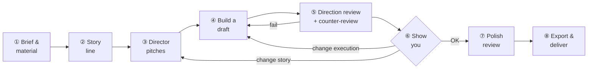

# Canvas Motion

[繁體中文](README.md) | **English**

**One HTML file is one video.**

A [Claude Skill](https://docs.claude.com/en/docs/agents-and-tools/agent-skills/overview) that lets Claude make short animated videos in code. Every frame is drawn on Canvas, and the soundtrack is synthesized live with WebAudio, so the whole video is a single HTML file. Play it in any browser, publish it as a claude.ai Artifact, or export it as an MP4 or GIF with sound.


<sub>This intro video was made with Canvas Motion itself. See [`examples/`](examples/) for more.</sub>

## Highlights

- **Creativity first, no templates**: no layout kits or story templates. Claude designs the composition, metaphor, and motion of every scene from your material.
- **Works like a designer**: asks for references, builds a story, finds a visual metaphor, and shows you every draft. Fine details are polished only after you approve the direction.
- **Seven quality benchmarks**: from Apple keynotes to Pixar. Benchmarks define *how good* the result must be, not *how* to make it.
- **Independent review**: every round uses fresh reviewer subagents, and a counter-reviewer checks whether the reviews were biased, lenient, or copied from each other.
- **Product demos and narration**: captures real product screens and brand colors to act out the workflow, with optional offline Chinese voice-over and subtitles.
- **What you see is what you export**: every frame is a pure function `frame(t)`, so playback, screenshots, and exports are identical.

## Quick start

**Claude Code**

```bash
git clone https://github.com/chengwesley/canvas-motion.git ~/.claude/skills/canvas-motion
```

**claude.ai**: download `canvas-motion.skill` from [Releases](../../releases), upload it under *Settings → Capabilities → Skills*, and turn on *Code execution and file creation*.

Then just describe what you want:

> Turn this product brief into a 30-second vertical video for Instagram Reels.

> Tell a story with these numbers. The twist at the end is the point. Use the Pixar benchmark.

> Make a feature demo of our product: start from the website, show how to finish the first task, and add narration and subtitles.

**On-screen copy and numbers come only from the material you provide.** If the material can't support a scene, Claude drops the scene instead of making things up.

## Workflow



| Step | What happens |
|---|---|
| ① Brief & material | You provide the request, material, and references; Claude asks about characters, narration, platform, and things to avoid |
| ② Story line | The material is linked into one cause-and-effect story (`story.md`). Connectors can be added, facts cannot |
| ③ Director pitches | Three directors each pitch a story plus a visual metaphor, then review and vote on each other's pitches (`spec.md`) |
| ④ Build a draft | The chosen pitch is built and checked automatically by `verify.py` |
| ⑤ Direction review + counter-review | Three fresh reviewers judge only story, metaphor, clarity, and facts; a counter-reviewer decides whether those reviews can be trusted |
| ⑥ Show you | If the direction is off, go back to the pitch or the build. Pixel details wait |
| ⑦ Polish review | After your OK, three new reviewers check frame by frame, again followed by a counter-review |
| ⑧ Export & deliver | Export MP4/GIF or publish the HTML, with delivery notes |

See [`references/agents.md`](references/agents.md) for the full crew setup.

## Quality benchmarks

Say "use the Hollywood benchmark" to switch; the default is Apple keynote. A benchmark describes how the audience should react. **The reference work marks the level, not a style to copy.** Breaking conventions can still earn a perfect score.

| Benchmark | Reference work | Audience reaction |
|---|---|---|
| Apple keynote (default) | Steve Jobs introducing the first iPhone, 2007 | Gets it at a glance, remembers one image, wants it |
| Hollywood | Christopher Nolan theatrical trailers | Carried along, wants to see the film |
| Business presentation | McKinsey consulting decks | Grasps the conclusion in 30 seconds and can act on it |
| Fundraising pitch | Airbnb's early pitch deck, YC Demo Day | Believes it is worth investing in, and now |
| Classic ad | Apple "1984", Dove "Real Beauty Sketches" | Tells others about it and remembers who made it |
| Pixar | The "Married Life" opening of *Up* | Moved without a single line of dialogue |
| Explainer | Kurzgesagt | Learns one thing and can explain it to someone else |

Requirements for visual richness, design, and narrative, plus the scoring scale for each benchmark, are in [`references/rubric.md`](references/rubric.md) (Traditional Chinese).

## Features

| Area | What you get |
|---|---|
| Art styles | Anime backgrounds, watercolor, ink wash, flat illustration, pixel art, neon, low poly, paper cut, comic halftone, crayon; brand colors supported |
| Layout | The same video is 16:9 on desktop and 9:16 on mobile, each laid out separately rather than scaled |
| Motion | Springs, anticipation, squash and stretch, smears, camera moves, parallax, export motion blur; motion design guidelines adapted from the LottieFiles Motion Design Skill (MIT) |
| Characters | [Open Peeps](https://www.openpeeps.com) illustrations (Pablo Stanley, CC0): full body and bust, 33 expressions, 53 hairstyles, acting through expression and pose |
| Product demos | `capture.py` grabs real screenshots, page text, and brand colors; browser, app, and phone frames, cursor clicks, typing, auto zoom-to-click, spotlights, and labels |
| Narration & subtitles | Built-in offline Taiwanese Mandarin voices on Windows; 3 takes per line with the clearest picked automatically; scene timing follows the voice-over; burned-in subtitles plus `.srt`, five subtitle styles |
| Music | Cuts land on bar lines and the score follows each scene's energy; or compose your own with synthesized gongs, cymbals, woodblocks, and drums, plus your own sound effects |
| UI micro-animations | 40+ components: glass cards, rolling KPI numbers, button states, toggles, notification stacks, Dynamic Island, calendar drag, card payments |
| Genre effects | American comics, Hong Kong comics, anime, cinema (letterbox, teal-and-orange grading, light beams) |
| Story films | Films of a minute or more follow a film-crew process with checks for three-act balance, beats, shot variety, axis jumps, and cutting rhythm |
| Automatic checks | Clipped, overlapping, or orphaned text; scene errors; fonts; contrast; number provenance; `taste.py` flags static frames, off-beat motion, and slide-deck feel |

> Narration voices and most reference docs are in Traditional Chinese. On-screen text follows whatever language your material is in.

## Requirements

| Tool | Used for | If missing |
|---|---|---|
| Python 3.10+ | Build, screenshot, and export scripts | Required |
| Playwright + Chromium | Screenshot checks, MP4 export | HTML output only |
| ffmpeg | MP4 export | `pip install imageio-ffmpeg` works instead |
| Pillow | Contact sheets, product screenshots | Required for screenshots |
| Node.js | Syntax check during build | Check is skipped |
| Voice | Narration via `voice.py` | Not needed without narration; outside Windows use `edge-tts` or macOS `say` |
| CJK fonts | Chinese text in screenshots | Text renders as boxes |

Run `python3 ~/.claude/skills/canvas-motion/scripts/check_env.py` to check everything at once. The claude.ai code execution environment already has all of it.

## Advanced

<details>
<summary><b>Manual usage</b></summary>

```bash
SKILL=~/.claude/skills/canvas-motion

# 1. Write storyboard.json (format at the top of scripts/storyboard.py), then preview the board and pacing checks
python3 $SKILL/scripts/storyboard.py storyboard.json --preview

# 2. Generate the project (project.json + scene scaffolding)
python3 $SKILL/scripts/storyboard.py storyboard.json my-video

# (Product videos) Capture real screenshots, page text, and brand colors → my-video/assets/, source.txt, brands/
python3 $SKILL/scripts/capture.py https://your-product-url my-video --name home --brand BrandName

# (With narration) After writing vo for each scene, generate the voice-over; --fit adds bars to match its length
python3 $SKILL/scripts/voice.py my-video --fit

# 3. For custom visuals, edit scene functions in my-video/scenes/ (see references/api.md)

# 4. One-step check (build + contact sheets + text checks); exit code 0 means pass
python3 $SKILL/scripts/verify.py my-video                # → my-video/dist/index.html, my-video/sheets/*.jpg

# 5. Export MP4 or GIF
python3 $SKILL/scripts/export.py my-video out.mp4 --size 1080x1920 --mobile --verify 2,10
python3 $SKILL/scripts/export.py my-video out.gif
python3 $SKILL/scripts/export.py my-video out.mp4 --size 1280x720 --crf 25   # 720p, smaller file; writes out.srt when narrated, --no-subs skips burned-in subtitles
```

Open `dist/index.html` in any browser to play. Space pauses, arrow keys jump one bar, and the bottom-right control switches aspect ratio.

</details>

<details>
<summary><b>project.json example</b></summary>

```json
{
  "title": "New feature launch",
  "style": { "base": "tech", "mood": "sharp, futuristic", "colors": { "a1": "#5ef2c6" }, "music": { "bpm": 116 } },
  "aspect": "auto",
  "scenes": [
    { "fn": "sHook",    "bars": 2, "energy": 0.35, "trans": "zoom" },
    { "fn": "sFeature", "bars": 3, "energy": 0.7,  "trans": "push",
      "vo": ["One line of narration, also the subtitle", { "say": "Upload a P D F", "sub": "Upload a PDF" }] },
    { "fn": "sOutro",   "bars": 2, "energy": 1 }
  ],
  "voice": { "engine": "winrt", "voice": "Yating", "subs": true, "duck": 0.28 }
}
```

| Field | Meaning |
|---|---|
| `fn` | Scene function, defined in `scenes/` |
| `style` | Style parameters chosen by Claude; contrast, fonts, and pacing are validated at build time (schema in [`styles/_schema.json`](styles/_schema.json)) |
| `bars` | Scene length in bars (one bar is 2 seconds at 120 BPM) |
| `energy` | 0–1, controls music density; arrange it to shape the emotional arc |
| `trans` | Transition out of the scene: `cut` `fade` `push` `wipe` `zoom` `iris` `flash` `glitch` |
| `vo` | Narration (optional). A string is both spoken and subtitled; use `say`/`sub` when they differ (see [`references/voice.md`](references/voice.md)) |

See [`references/api.md`](references/api.md) and [`examples/keynote-demo`](examples/keynote-demo) for how to write scene functions.

</details>

<details>
<summary><b>Project structure</b></summary>

```
.
├── SKILL.md                   Instructions for Claude
├── engine/                    Fixed engine: HTML shell, drawing and layout, timeline and music, player
├── library/                   Brushes, not layouts: kit.js, art styles looks.js, product demos product.js, UI micro-animations ui.js/uictl.js, characters peeps.js
├── brands/                    Brand profiles (generated by capture.py --brand)
├── styles/                    Style settings
├── scripts/                   verify / capture / voice / storyboard / build / sheet / taste / castsheet / export / style_gen /
│                              check_env / selftest / new_project / preview_styles / peeps_catalog / peeps_import
├── references/                agents.md (crew), rubric.md (benchmarks and scoring), craft.md (animation craft), crew.md (story-film crew),
│                              genres.md (genre effects), direction.md (context → specs and pacing), looks.md (art styles and shapes),
│                              api.md (scene API), style-pack.md (style settings), product.md (product demos), ui-kit.md (UI micro-animations),
│                              voice.md (narration and subtitles), motion-design.md (staging and easing), character.md (characters) + peeps/ (parts catalog)
├── examples/                  Example projects (also regression tests)
└── media/                     Intro animation for the README
```

</details>

<details>
<summary><b>How it works</b></summary>

```
project.json + scenes/*.js (+ assets/ screenshots, voice/ narration audio)
        │  build.py
        ▼
engine/infra.js ─ style settings ─ scenes ─ engine/tail.js
        │
        ▼
dist/index.html (single file: screenshots and narration inlined as data URIs, no external dependencies, fonts from Google Fonts)
        │
        ├── Browser playback: requestAnimationFrame → frame(t), AudioContext schedules music and narration live
        ├── sheet.py: Playwright calls frame(t) for screenshots → contact sheets
        └── export.py: OfflineAudioContext renders WAV (music + narration + SFX) → frame(i/fps) per frame → ffmpeg (H.264 + AAC) + .srt
```

- **Timeline**: scene length is measured in bars, and cuts land on the first beat. Transitions are centered on the cut, drawing both scenes and compositing them.
- **Text**: `txt()` is drawn after post-processing, so bloom never blurs it; Chinese line breaking respects punctuation rules.
- **Music**: `step()` runs every 16th note and picks which parts (pad, drums, bass, lead) to play from the current scene's energy; chord progressions and timbres come from the style. If a project defines a global `MUSIC(A, i, t, info)` in `scenes/`, it takes over the whole score (instruments: `tone`, `bend`, `gong`, `cymbal`, `woodblock`, `drum`, `kick`, `pad`…).
- **Narration & subtitles**: audio from `voice.py` is placed in each scene by its real length (lead-in, gaps, and tail are adjustable). While narration plays, the music bus ducks to about 0.28× and comes back afterward. Subtitles are split at punctuation, timed by character count, drawn above everything, and included in text checks.
- **Product screenshots**: images in `assets/` are inlined and drawn with `pic()`; `picMap()` maps positions on a screenshot to screen coordinates for cursors, zooms, and spotlights. Screenshots and exports wait until every image and audio clip is decoded.
- **Performance**: DPR is capped at 1.5, backgrounds and glows are pre-baked as low-resolution layers, and repeated elements are cached on offscreen canvases.

</details>

## Known limitations

- No live-action footage or frame-by-frame character animation. Photos and screenshots can be used as material; product screens behind a login must be captured yourself.
- Offline narration (winrt) runs only on Windows. Speech recognition often confuses homophones, so listen once before delivering.
- The code execution environment can't reach Google Fonts, so screenshots use the system Noto Sans CJK and may differ slightly from online playback.
- Without a GPU (for example in cloud containers), rendering is slower. This affects only screenshot and export speed, not quality.
- Browsers only allow audio after a user click, so the page always shows a play button first.

## Development

After changes, run the regression tests (builds every combination and runs screenshot and text checks on the examples), make sure there are no scene errors, and review the contact sheets frame by frame:

```bash
python3 scripts/selftest.py --sheet
```

Package as a `.skill` file (a zip whose top level is the `canvas-motion/` folder):

```bash
git archive --prefix=canvas-motion/ -o canvas-motion.skill HEAD
```

See [`references/style-pack.md`](references/style-pack.md) for the style format and [`references/api.md`](references/api.md) for the scene API.
