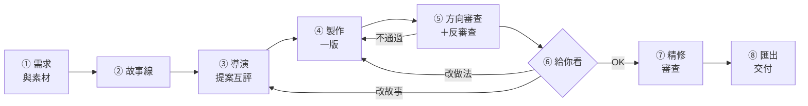

# Canvas Motion

**繁體中文** | [English](README.en.md)

**一支 HTML，就是一支影片。**

讓 Claude 用程式做動畫短片的 [Claude Skill](https://docs.claude.com/en/docs/agents-and-tools/agent-skills/overview)。畫面由 Canvas 逐格繪製，配樂由 WebAudio 即時合成，整支片就是一個 HTML 檔：可以直接在瀏覽器播放、發布成 claude.ai Artifact，也能匯出含配樂的 MP4 或 GIF。


<sub>這支介紹動畫本身就是用 Canvas Motion 做的。更多範例見 [`examples/`](examples/)。</sub>

## 特色

- **創意優先，不套範本**：沒有版面零件和敘事範本，每一幕的構圖、隱喻與動畫都由 Claude 依素材發想。
- **像設計師一樣工作**：先問參考、串故事、找視覺隱喻，每一版先給你看，方向確認後才精修細節。
- **七個品質標竿**：從 Apple 發表會到 Pixar，只定義「好到什麼程度」，不限制畫面怎麼做。
- **獨立審查**：每輪派全新的審查 subagent，再由反審查檢查審查有沒有被汙染、放水或互抄。
- **產品示範與旁白**：擷取產品真實畫面與品牌色演出操作過程，可加離線中文旁白與字幕。
- **所見即所得**：每一格都是 `frame(t)` 的純函式，播放、截圖、匯出的畫面完全一致。

## 快速開始

**Claude Code**

```bash
git clone https://github.com/chengwesley/canvas-motion.git ~/.claude/skills/canvas-motion
```

**claude.ai**：到 [Releases](../../releases) 下載 `canvas-motion.skill`，在「設定 → Capabilities → Skills」上傳，並開啟「Code execution and file creation」。

安裝後直接用自然語言描述需求：

> 幫我把這份產品說明做成 30 秒的介紹影片，要直式，給 IG Reels 用。

> 用這些數字講一個故事，重點是最後那個轉折。用 Pixar 標準。

> 做一支我們產品的功能示範影片：從官網開始，示範怎麼完成第一個任務，加上旁白和字幕。

**畫面上的文案和數字只會來自你提供的素材**；素材撐不起某一幕時，Claude 會刪掉那一幕，而不是自行編造。

## 工作流程



| 步驟 | 做什麼 |
|---|---|
| ① 需求與素材 | 你提供需求、素材與參考風格；Claude 補問人物、旁白、平台與禁區 |
| ② 故事線 | 把素材串成一條因果故事線（`story.md`），事實不能加 |
| ③ 導演提案互評 | 3 位導演各提一種故事＋視覺隱喻，互評投票後定案（`spec.md`） |
| ④ 製作一版 | 依定案製作，`verify.py` 自動檢查 |
| ⑤ 方向審查＋反審查 | 3 位全新審查只看故事、隱喻、傳達與事實；反審查判定審查是否可信 |
| ⑥ 給你看 | 方向不對就回到提案或製作；像素細節先不修 |
| ⑦ 精修審查 | 你說 OK 後，換 3 位全新審查逐格檢查，同樣經過反審查 |
| ⑧ 匯出交付 | 匯出 MP4／GIF 或發布 HTML，附交付說明 |

分工細節見 [`references/agents.md`](references/agents.md)。

## 品質標竿

說一句「用好萊塢標準」就換，預設是 Apple 發表會。標竿描述觀眾看完的反應，**代表作是水準的座標，不是要模仿的風格**；打破慣例照樣可以拿滿分。

| 標竿 | 代表作 | 觀眾看完的反應 |
|---|---|---|
| Apple 發表會（預設） | 2007 年賈伯斯發表第一代 iPhone | 一眼看懂、記住一個畫面、想要它 |
| 好萊塢 | 諾蘭電影的院線預告片 | 被帶著走，看完想進戲院 |
| 商業簡報 | 麥肯錫的顧問簡報 | 30 秒內抓到結論，能拿去做決定 |
| 募資報告 | Airbnb 早期募資簡報、YC Demo Day | 相信這件事值得投，而且是現在 |
| 經典廣告 | Apple〈1984〉、Dove〈Real Beauty Sketches〉 | 會跟別人講這支片，記得是誰拍的 |
| Pixar | 《天外奇蹟》開場〈Married Life〉 | 一句台詞都沒有，照樣被打動 |
| 知識解說 | Kurzgesagt | 學會一件事，還能講給別人聽 |

每個標竿在視覺豐富度、設計、敘事線三個面向的要求與分數刻度，見 [`references/rubric.md`](references/rubric.md)。

## 功能一覽

| 類別 | 能力 |
|---|---|
| 畫風 | 動畫風背景、水彩、水墨、扁平插畫、像素、霓虹、低多邊形、剪紙、美漫網點、蠟筆，可套品牌色 |
| 版面 | 同一支片在電腦是 16:9、在手機自動變 9:16，各自重新排版，不是等比縮小 |
| 動作質感 | 彈簧、預備動作、擠壓伸展、抹影、鏡頭、視差、匯出動態模糊；動態設計準則改寫自 LottieFiles Motion Design Skill（MIT） |
| 角色 | [Open Peeps](https://www.openpeeps.com)（Pablo Stanley，CC0）插畫角色：全身與半身、33 種表情、53 種髮型，靠表情與姿勢演戲 |
| 產品示範 | `capture.py` 擷取真實截圖、頁面文字與品牌色；瀏覽器／App／手機外框、游標點擊、打字、自動推近鏡頭、聚光與標籤 |
| 旁白與字幕 | Windows 內建離線台灣中文語音，每句 3 版自動挑最清楚的一版，依旁白長度排秒數；字幕燒進畫面並另存 `.srt`，五種字幕樣式 |
| 配樂 | 切點對齊小節，依每幕強度自動編曲；也能自己作曲，內建鑼、鈸、梆子、皮鼓等合成樂器，可用自己的音效檔 |
| UI 微動態 | 40 多個元件：玻璃卡片、KPI 數字滾動、按鈕狀態、開關、通知堆疊、動態島、行事曆拖曳、刷卡付款 |
| 類型特效 | 美漫、港漫、日式動畫、電影（寬銀幕、青橙調色、光束） |
| 故事片 | 一分鐘以上的故事片走劇組流程，檢查三幕比例、節拍、景別變化、跳軸與剪輯節奏 |
| 自動檢查 | 文字裁切／疊字／孤字、場景錯誤、字型、對比、數字出處追溯；`taste.py` 抓出畫面沒在動、沒對拍、像投影片 |

## 環境需求

| 工具 | 用途 | 缺少時 |
|---|---|---|
| Python 3.10+ | 建置、截圖、匯出腳本 | 必要 |
| Playwright + Chromium | 截圖驗證、MP4 匯出 | 只能產出 HTML |
| ffmpeg | MP4 匯出 | 可用 `pip install imageio-ffmpeg` 代替 |
| Pillow | 縮圖總覽、產品截圖處理 | 截圖時必要 |
| Node.js | 建置時的語法檢查 | 略過檢查 |
| 旁白語音 | `voice.py` 配音 | 不配音就不需要；非 Windows 可用 `edge-tts` 或 macOS 的 `say` |
| 中文字型 | 截圖顯示中文 | 截圖會出現方框 |

執行 `python3 ~/.claude/skills/canvas-motion/scripts/check_env.py` 一次檢查。claude.ai 的程式執行環境已全部內建。

## 進階

<details>
<summary><b>手動操作</b></summary>

```bash
SKILL=~/.claude/skills/canvas-motion

# 1. 寫分鏡 storyboard.json（格式見 scripts/storyboard.py 開頭），先預覽分鏡表與節奏檢查
python3 $SKILL/scripts/storyboard.py storyboard.json --preview

# 2. 產生專案（project.json + 自訂場景鷹架）
python3 $SKILL/scripts/storyboard.py storyboard.json my-video

# （產品片）擷取產品網站的真實截圖、頁面文字與品牌色 → my-video/assets/、source.txt、brands/
python3 $SKILL/scripts/capture.py https://產品網址 my-video --name home --brand 品牌名

# （有旁白）每幕寫好 vo 後產生配音，--fit 依旁白實際長度自動加小節
python3 $SKILL/scripts/voice.py my-video --fit

# 3. 需要自訂畫面時，在 my-video/scenes/ 編輯場景函式（寫法見 references/api.md）

# 4. 一鍵檢查（建置＋縮圖＋文字檢查），結束碼 0 才算通過
python3 $SKILL/scripts/verify.py my-video                # → my-video/dist/index.html、my-video/sheets/*.jpg

# 5. 匯出 MP4 或 GIF
python3 $SKILL/scripts/export.py my-video out.mp4 --size 1080x1920 --mobile --verify 2,10
python3 $SKILL/scripts/export.py my-video out.gif
python3 $SKILL/scripts/export.py my-video out.mp4 --size 1280x720 --crf 25   # 720p、檔案較小；有旁白時另存 out.srt，加 --no-subs 不燒字幕
```

`dist/index.html` 用任何瀏覽器打開就能播放；空白鍵暫停，左右鍵前後跳一小節，右下角可以切換比例。

</details>

<details>
<summary><b>project.json 範例</b></summary>

```json
{
  "title": "新功能發表",
  "style": { "base": "tech", "mood": "俐落、有未來感", "colors": { "a1": "#5ef2c6" }, "music": { "bpm": 116 } },
  "aspect": "auto",
  "scenes": [
    { "fn": "sHook",    "bars": 2, "energy": 0.35, "trans": "zoom" },
    { "fn": "sFeature", "bars": 3, "energy": 0.7,  "trans": "push",
      "vo": ["一句旁白，也是字幕", { "say": "上傳 P D F 文件", "sub": "上傳 PDF 文件" }] },
    { "fn": "sOutro",   "bars": 2, "energy": 1 }
  ],
  "voice": { "engine": "winrt", "voice": "Yating", "subs": true, "duck": 0.28 }
}
```

| 欄位 | 說明 |
|---|---|
| `fn` | 這幕的場景函式，寫在 `scenes/` 裡 |
| `style` | 風格參數，由 Claude 依情境決定；建置時自動驗證對比、字體與節奏（格式見 [`styles/_schema.json`](styles/_schema.json)） |
| `bars` | 這幕佔幾小節（120 BPM 時一小節 2 秒） |
| `energy` | 0–1，控制配樂密度，由低到高安排情緒起伏 |
| `trans` | 離開這幕的轉場：`cut` `fade` `push` `wipe` `zoom` `iris` `flash` `glitch` |
| `vo` | 旁白（選填），字串就是念的話也是字幕；念法和字幕不同時分開寫 `say`／`sub`（見 [`references/voice.md`](references/voice.md)） |

場景函式的寫法見 [`references/api.md`](references/api.md) 與 [`examples/keynote-demo`](examples/keynote-demo)。

</details>

<details>
<summary><b>專案結構</b></summary>

```
.
├── SKILL.md                   給 Claude 的操作說明
├── engine/                    固定引擎：HTML 外殼、繪圖與排版、時間軸與配樂、播放器
├── library/                   畫筆（不是版面）：kit.js、畫風 looks.js、產品示範 product.js、UI 微動態 ui.js／uictl.js、插畫角色 peeps.js
├── brands/                    品牌設定檔（capture.py --brand 產生）
├── styles/                    風格設定
├── scripts/                   verify / capture / voice / storyboard / build / sheet / taste / castsheet / export / style_gen /
│                              check_env / selftest / new_project / preview_styles / peeps_catalog / peeps_import
├── references/                agents.md（劇組分工）、rubric.md（品質標竿與評分）、craft.md（動畫手藝）、crew.md（故事片劇組）、
│                              genres.md（類型特效）、direction.md（情境→規格與節奏）、looks.md（畫風與形狀）、api.md（場景寫法）、
│                              style-pack.md（風格設定）、product.md（產品示範）、ui-kit.md（UI 微動態）、voice.md（旁白與字幕）、
│                              motion-design.md（出場順序與緩動）、character.md（角色）＋ peeps/（部件型錄）
├── examples/                  範例專案（也是回歸測試）
└── media/                     README 用的介紹動畫
```

</details>

<details>
<summary><b>運作原理</b></summary>

```
project.json + scenes/*.js（＋ assets/ 截圖、voice/ 旁白音檔）
        │  build.py
        ▼
engine/infra.js ─ 風格設定 ─ 場景 ─ engine/tail.js
        │
        ▼
dist/index.html（單一檔案：截圖與旁白都內嵌成 data URI，無外部依賴，字體從 Google Fonts 載入）
        │
        ├── 瀏覽器播放：requestAnimationFrame → frame(t)，AudioContext 即時排程配樂與旁白
        ├── sheet.py：Playwright 呼叫 frame(t) 截圖 → 縮圖總覽
        └── export.py：OfflineAudioContext 合成 WAV（配樂＋旁白＋音效）→ 逐格 frame(i/fps) → ffmpeg（H.264 + AAC）＋ .srt
```

- **時間軸**：場景長度以小節計算，切點落在小節第一拍。轉場中點對齊切點，期間同時繪製前後兩幕再合成。
- **文字**：`txt()` 延後到後製之後才繪製，所以不會被 bloom 糊掉；中文換行支援避頭點。
- **配樂**：每 16 分音符呼叫一次 `step()`，依當下場景的 energy 決定要加入哪些聲部（pad、鼓、bass、主旋律），和弦進行與音色由風格設定決定。專案若在 `scenes/` 定義全域函式 `MUSIC(A, i, t, info)`，整支配樂改由它負責（樂器：`tone`、`bend`、`gong`、`cymbal`、`woodblock`、`drum`、`kick`、`pad`…）。
- **旁白與字幕**：`voice.py` 產生的音檔依實際長度排在每幕裡（幕首、句間、幕尾留白可調），引擎播放旁白時把配樂匯流排壓到約 0.28 倍、講完再回升；字幕依標點切成短句、依字數分配時間，畫在所有畫面與後製之上，也會接受文字檢查。
- **產品截圖**：`assets/` 的圖片內嵌後由 `pic()` 繪製，`picMap()` 把截圖上的相對位置換成畫面座標，游標、鏡頭推近、聚光都用它定位；所有圖片與旁白解碼完才開始截圖或匯出。
- **效能**：DPR 上限 1.5，背景與光暈預先烘焙成低解析度圖層，重複繪製的元素快取到 offscreen canvas。

</details>

## 已知限制

- 不處理實拍影片或角色逐格動畫。照片與截圖可以當素材；需要登入的產品畫面要自己截圖。
- 離線旁白（winrt）只能在 Windows 執行；語音辨識常把同音字聽錯，交片前仍要用耳朵聽一次。
- 程式執行環境無法連上 Google Fonts，截圖使用系統的 Noto Sans CJK，和線上播放的字體會略有不同。
- 沒有 GPU 的環境（例如雲端容器）繪製較慢，只影響截圖與匯出速度，不影響成品品質。
- 瀏覽器規定使用者點擊後才能播放聲音，所以頁面一定會先顯示播放鈕。

## 開發

修改後跑回歸測試（建置所有組合，並對範例專案做截圖與文字檢查），確認沒有場景錯誤並逐格檢查縮圖：

```bash
python3 scripts/selftest.py --sheet
```

打包成 `.skill` 檔（就是 zip，最上層是 `canvas-motion/` 資料夾）：

```bash
git archive --prefix=canvas-motion/ -o canvas-motion.skill HEAD
```

風格設定格式見 [`references/style-pack.md`](references/style-pack.md)；場景寫法見 [`references/api.md`](references/api.md)。
