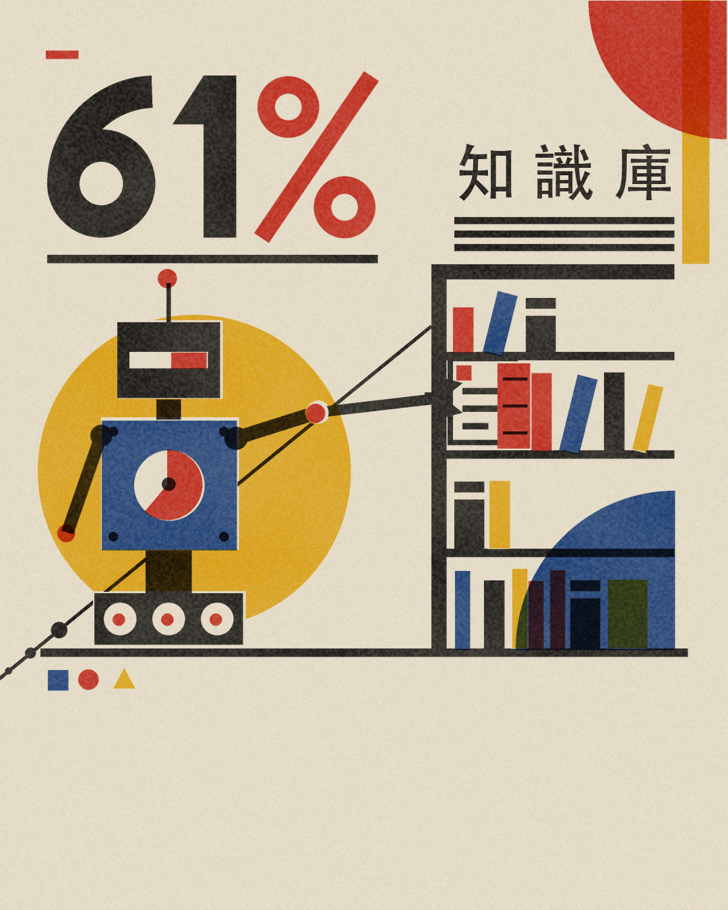

# 包浩斯幾何

## 一句話
只用圓、方、三角、粗直條四種基本形，配三原色加黑，像一張套色印刷的 1920 年代海報；物件重疊處會「套印」成新的顏色，數字與符號都是拼出來的，不是打出來的。

## 適合與不適合的題材
- 適合：一個大數字或一句結論當主角的數據知識卡（61%、3 倍、第 1 名）。
- 適合：架構、分類、流程這類「把複雜的事化約成幾個基本單位」的題材。
- 適合：機器、系統、工具、組織這類本來就能拆成方塊與圓的主角。
- 不適合：需要真實質感或情緒表情的人物故事。
- 不適合：需要柔和、溫暖、親切感的題材（本風格偏冷靜、理性、有點嚴肅）。
- 不適合：資訊密度高的細小圖表（粗直條與大色塊會吃掉細節）。

## 氣氛
理性、俐落、帶一點宣言感。顏色少、形狀少、留白大，但每一塊都有位置；舊紙加套印的輕微錯位，讓它像印出來的，不像電腦排的。

## 用程式畫的難度與限制
難度：低到中。所有形狀都是 PIL 的 `ellipse`、`rectangle`、`polygon`、`pieslice`、`arc`，最適合程式生成的風格之一。
限制：
- 套印要靠「每種墨一張獨立遮罩，最後逐版相乘」才會正確；若直接用 RGBA 疊色，重疊處不會變暗混色，會失去風格。
- 數字不能直接用字型打，要用圓環、弧、直條組字；目前只做了 6、1、%，其他數字要另外設計。
- 人物、動物、表情做不出來；主角一律用機械或幾何物件。
- 斜線與弧線在 1 倍尺寸會有鋸齒，必須用 2 倍尺寸繪製再 LANCZOS 縮小。
- 中文標題只能用黑體排版，沒有「拼字」的中文版本；用等寬字距撐開來模仿格線感。

## 指標畫法
1. 先建「色版」：紙色底 `EEE5D0`，黃、紅、藍、黑各一張 L 模式遮罩，尺寸為 2 倍（2160×2700），印刷順序黃、紅、藍、黑。
2. 只畫基本形：圓用 `ellipse`、方用 `rectangle`、三角用 `polygon`、扇形用 `pieslice`、粗直條用兩端齊平的四邊形（`bar()`，寬 16–20px 為手臂、5px 為對角軸線、12px 為地平線）。禁止圓角矩形與漸層。
3. 背景大場：一個直徑約 464px 的黃色大圓放在主角後方當太陽，圓心對準主角身體中心；右上角放一個半徑 205px 的紅色四分之一圓（角落切出）。
4. 挖空 `knock()`：物件先把所有色版在該形狀處清成 0（紙色露出），再畫自己的墨；這樣前後遮擋才乾淨，只有「有意重疊」的地方才套印。
5. 刻意套印：一個半徑 236px 的藍色四分之一圓，不挖空，直接壓在書架下兩層上，與下方紅、黃、黑書疊出暗綠、暗紫；這是全圖唯一的大面積混色，只做一處。
6. 對角軸線：一條 5px 黑線從左下穿過主角手臂方向指到書架槽位，視線引導用；主角手臂躺在這條線上。
7. 用「蓋板」表現放進去：筆記卡一半畫在空槽，再畫一塊紅色蓋板（約 48×126px，挖空後印紅，上有三條黑色槽紋）蓋住卡片右半，看起來像卡片被插進櫃子。
8. 套印失準：四版各自偏移（黃 (2,−1)、紅 (−2,1)、藍 (1,2)、黑 (0,0)，單位 px），再乘一層墨色斑駁（3px 格雜訊 218–255）與壓力不均（90px 格雜訊 225–255），最後乘 1px 紙顆粒（236–255，模糊 0.6）。
9. 數字拼字：6＝一個環加一段半徑兩倍的四分之一弧當莖（高 240、粗 48）；1＝直條加三角旗；%＝兩個環加一條斜粗條（粗 26）。
10. 學蒙德里安與莫霍利－納吉：書架每行只填到 `ROWEND`（行寬的一半到七成）留白；黃色直條（x 1010–1050，y 1–392）壓在紅色四分之一圓上做第二處套印。學康丁斯基：對角軸線上放半徑 5、8、12 的三個黑點。

## 模範學習
樣張已套用：只留一半的書量讓畫面有大片留白（Mondrian）、黃色直條壓在紅色四分之一圓上做透明套印（Moholy-Nagy）、對角軸線上由小到大的三個黑點（Kandinsky）。

### Wassily Kandinsky（瓦西里·康丁斯基）（1866–1944，俄國出生，後在德國與法國活動）
為什麼學他：他在包浩斯寫《Point and Line to Plane》（1926，包浩斯叢書第 9 本），規定了點、線、面各自的性格。
可以照做的規則：
1. 點、線、面三層分工：點（小圓）、線（細棒與軸線）、面（大圓與方塊），三種大小差距要明顯（點半徑 5–14px、線寬 5–20px、面直徑 200px 以上）。
2. 水平線是冷而穩的底座，垂直線是暖而上升的運動，對角線同時含冷與暖、張力最大。樣張：地平線（水平）托住畫面，書架立柱（垂直）向上，對角軸線從左下指向槽位。
3. 對角線上的點由小到大排列（半徑 5、8、12），像加速，把視線帶往主角。
4. 一張畫面只放一條主對角線，其他線用水平與垂直。
5. 圓、方、三角各用在不同角色：圓（太陽、輪子）、方（軀幹、書本）、三角（旗、手爪），不混用。
6. 線有粗細層次：結構線 5px，動作肢體 16–20px，地平線 12px。
不要照抄：《Composition VIII》（1923，古根漢）的具體構圖、他的音樂式曲線與弧形符號、以及特定的色形配對說法（作為個人理論，我們不照用）。
檢查表：
- 點、線、面的大小差距夠大，一眼分得出三層？
- 有且僅有一條主對角線，其餘為水平垂直？
- 對角線上的點是由小到大排列？
- 圓、方、三角各有固定的用途？

### Piet Mondrian（皮特·蒙德里安）（1872–1944，荷蘭）
為什麼學他：他用最少的元素做出不對稱的平衡，是包浩斯「留白也是形」的最嚴格版本。
可以照做的規則：
1. 留白為主，彩色只占小面積。《Composition with Red, Blue and Yellow》（1930）以白底為主，粗黑線分格，只在少數格內填原色。樣張：書架兩行只填到一半寬，留出大片紙色。
2. 分格大小不一，沒有兩格一樣大；一個大格配幾個小格，建立不對稱的平衡。
3. 原色與黑、白、灰：每種原色只用在少數格，面積有大有小，不平均分配。樣張：黃圓最大、藍色四分之一圓次之、紅色其他處最小。
4. 黑線只有水平與垂直，粗細一致。
5. 《Broadway Boogie Woogie》（1942–43，MoMA）把黑線換成彩色短條，形成跳動的節奏：樣張的書脊用同樣方式，一條條彩色矩形並排，不用輪廓。
6. 平衡靠重量：左側大面（黃圓）與右側密集線條（書架）互相對稱，不用鏡像對稱。
不要照抄：Mondrian 的整張網格構圖與其中任何格子的位置、紅黃藍的比例；斜線與圓不是他的語彙，所以我們保留自己的圓與對角線。
檢查表：
- 畫面至少 40% 是未上色的紙色留白？
- 沒有兩個格子或兩個大面是同樣大小？
- 彩色面積有大有小，沒有平均分配？
- 左右兩側重量接近但不是鏡像？

### László Moholy-Nagy（拉斯洛·莫霍利－納吉）（1895–1946，匈牙利出生，後入美國籍）
為什麼學他：他在包浩斯（1923–1928）把「疊印的透明面」與對角動勢當作構成語言，著有《Malerei, Photographie, Film》（1925）。
可以照做的規則：
1. 透明疊印：兩個色面重疊處用乘法產生第三色。他的《Composition A 19》（1927，油畫）是此類構成式抽象的例子；透明疊印的做法此處取其精神。樣張：藍色四分之一圓壓在書上產生暗綠與暗紫，黃色直條壓在紅色四分之一圓上產生深橙紅，兩處都是刻意的。
2. 疊印處最多兩三處，其餘全部挖空，才看得出是「刻意」。
3. 用細線穿過大面，把不相干的區域連在一起。樣張：對角軸線穿過太陽、機器人與書架。
4. 粗條與細線並置：粗條當結構，細線當運動方向。
5. 構圖不置中，主要形體靠向一角，對角線把空白拉出動勢。
6. 文字與數字當作構成的一部分，與線條的粗細一致（樣張的 61% 與下方粗橫線）。
不要照抄：《Lichtrequisit einer elektrischen Bühne》（電動舞台光道具，1930）等光學裝置與他的攝影與照片拼貼構圖。
檢查表：
- 至少有兩處刻意的透明疊印，且其餘全部挖空？
- 有一條細線貫穿至少兩個不同的色面？
- 主角形體靠向畫面一邊，不置中？
- 數字或標題的線寬與結構線一致？

## 代表畫家、設計師與作品
- Wassily Kandinsky（瓦西里・康丁斯基），1866–1944，俄國出生、後在德國與法國活動：1922–1933 年在包浩斯任教，著有《Point and Line to Plane》（《點線面》，1926）。學：點、線、面各有性格，圓、方、三角各配固定的顏色聯想。
- Josef Albers（約瑟夫・亞伯斯），1888–1976，德國出身、後定居美國：包浩斯畢業並任教，約 1950 年起的《Homage to the Square》系列，著有《Interaction of Color》（1963）。學：用有限的色塊並置與重疊，讓同一種顏色因鄰色不同而改變。
- Herbert Bayer（赫伯特・拜爾），1900–1985，奧地利出生、後入美國籍：包浩斯學生，後任印刷與廣告部主任；設計「Universal」字體提案（約 1925 年起，僅停留在設計稿）。學：全小寫、無襯線、由幾何構成的字形。
- Joost Schmidt（尤斯特・施密特），1893–1948，德國：1923 年威瑪包浩斯展覽海報；1925–1932 年在包浩斯教授文字設計。學：以粗直條、圓與色塊建立海報層次，字與圖形平等對待。
- Oskar Schlemmer（奧斯卡・施萊梅爾），1888–1943，德國：1922 年設計包浩斯標誌，《Triadic Ballet》（《三元芭蕾》）1922 年在斯圖加特首演。學：把人與物簡化成幾何體，用基本形做角色。
- Marianne Brandt（瑪麗安・布蘭特），1893–1983，德國：1924 年進入包浩斯金屬工坊，1928 年起代理主任；代表作 MT 49 茶葉濾壺。學：用球、圓柱、半圓構成日常物件，拆解成幾何零件就能設計機械。
- László Moholy-Nagy（拉斯洛・莫霍利－納吉），1895–1946，匈牙利出生，後入美國籍：1923–1928 年在包浩斯任教，著有《Malerei, Photographie, Film》（1925）。學：把版面當作構成實驗，用粗線、色塊與留白做動勢。

## 配色與色階
一個畫面只用紙色、黃、紅、藍、黑五個色碼。包浩斯沒有真正的「亮面與高光」：明暗靠「套印變暗」與「紙色透出」取得。色碼與 `sample.py` 的 `PAPER`、`INKS` 一致。

| 角色 | 陰影（套印） | 主色（墨色） | 亮面（墨斑漏紙） | 高光（挖空紙色） | 用途 |
|---|---|---|---|---|---|
| 紙色 | D0C4AA | EEE5D0 | F4EDDC | FFF6E4 | 畫面底、卡片、挖空處 |
| 黃 | 1B3310（黃×藍） | F3BA1C | F6CB52 | EEE5D0 | 太陽大圓、三角、書 |
| 紅 | CA2404（紅×黃） | D43226 | E0594A | EEE5D0 | 主角指示點、%、四分之一圓、蓋板 |
| 藍 | 170E16（藍×紅） | 1C4696 | 3C66B0 | EEE5D0 | 主角軀幹、書、套印大圓 |
| 黑 | 1C1A1A | 1C1A1A | 3A3636 | EEE5D0 | 結構線、數字、頭部、書架 |

每色在紙上乘出的實際色約為：黃 E3A717、紅 C62D1F、藍 1A3F7A、黑 1A1711。紅配額：% 與少量指示點，不做大面積紅（右上角四分之一圓是唯一例外）。

## 光源、陰影與體積
- 沒有光源，沒有立體；一切是平面。陰影只有一種來源：油墨重疊變暗。
- 想要「陰影」就讓兩個形狀刻意重疊，例如藍圓壓在黃書上變成暗綠。
- 不加投影、不加漸層、不加高光；不做 45 度偏移陰影。
- 體積只靠「大小」與「前後遮擋」，用挖空決定誰在前面。

## 線條、描邊與邊緣
- 沒有描邊。形狀靠色塊邊緣分開，結構靠粗直條而不是輪廓線。
- 線寬層級（1080 寬）：地平線 12、對角軸線 5、手臂 16–20、天線 6、書架立柱 22、書架隔板 12、數字筆畫 48。
- 端點一律平頭；圓只用整圓、四分之一圓或環，不做圓角矩形。
- 邊緣因四版偏移會露出 1–2px 紙縫或色暈，這是故意的。

## 質感與筆觸
- 紙：EEE5D0 加 1px 顆粒（236–255）模糊 0.6。
- 墨：3px 格的斑駁雜訊乘在每版遮罩上（218–255），加 90px 格的大塊壓力不均（225–255）。
- 沒有筆觸、沒有線條抖動：這是機器印的海報，不是手繪。
- 全程不用半透明；濃淡只用雜訊遮罩。

## 細節密度、格線與比例
以 1080×1350（4:5）為準：
- 底部約 22%（y>1053）保持紙色，只有一條地平線在 y=962，一排小符號（方、圓、三角）在其下方。
- 數字高 240px（約 18%），佔上半左側；知識庫標題與三條黑橫紋在右側，與書架對齊同一欄邊界（x=640–1000）。
- 主角高約 560px（含天線）：履帶底座、方形軀幹、方形頭、一條視窗條，無臉。
- 書架 360×570，四層，只有第二層留一個 116px 的空槽。
- 一個畫面最多 4 個主要物件（主角、書架、數字、卡片），其餘是色塊與幾何裝飾。
- 左邊界 70px，右邊界 80px，格線用 5、12、22 這幾種等寬倍數。

## 字體搭配與字級
- 中文標題：STHeiti Medium，約 92px，字距拉開對齊書架欄寬（逐字排列，每字間距約 (欄寬−92)/2），黑色，直接印在黑版上。
- 數字：不用字型，用圓環、弧、直條拼成（見指標畫法第 9 點）。
- 英文標籤：本樣張未用；若要用，選擇 Avenir Next Heavy 全大寫，字距開寬，黑色。
- 中文字型限用 STHeiti Medium 或 Hiragino Sans GB，逐字確認沒有缺字（可參考 flat-vector/components.py 的 check_glyphs 寫法）。
- 說明文字：STHeiti Medium 38–42px，黑色，放在底部留白區的上緣，最多一行。

## 動態性格
- 12 fps（一拍二），機械式、準確、不帶情緒。
- 形狀以「滑入」與「旋轉到位」為主：方塊從畫面外直線滑入、圓以縮放進入、三角旋轉 90 度停住。
- 緩動用線性或 ease-in-out，不要回彈、不要彈跳。
- 筆記卡沿對角軸線平移到槽口，最後蓋板「卡」一聲滑上；整個過程像機械裝配。
- 數字依序由左到右「組裝」：先出環、再出莖、最後出斜條。
- 鏡頭固定，最多做 3% 的慢推；版面偏移用整格（8–12px）步進。

## 元件清單
1. 主角 Agent：履帶底座（長條加三個輪）、方形軀幹（藍）、方形頭（黑，一條視窗條，無臉）、天線加紅圓點。
2. 軀幹儀表：挖空白圓，內有紅色 61% 扇形與黑中心點。
3. 手臂：兩段直條加圓關節，末端三角夾爪。
4. 筆記卡：挖空外框加內框、三條黑橫條與一塊紅色標籤方塊。
5. 知識庫書架：黑色立柱與隔板，書為矩形，偶有一本斜靠。
6. 蓋板槽口：紅色蓋板加三條黑槽紋，卡片插入時蓋住右半。
7. 大數字牌：用環、弧、直條拼成的 61%，下方一條粗黑橫線。
8. 太陽大圓：黃色整圓放在主角後方。
9. 角落四分之一圓：紅色放在右上角，只出一個。
10. 套印大圓：藍色四分之一圓壓在書上，做套印混色。
11. 對角軸線：5px 黑直線，由地面指向槽口。
12. 條紋：三條等寬黑橫條，當節奏標記。
13. 簽名列：藍方、紅圓、黃三角並排，放在地平線下方。
14. 地平線與標題：12px 黑色橫線；知識庫標題逐字排開。

## 常見失敗與避免方式
- 失敗：用 RGBA 疊色，重疊處不會變暗，失去套印感。避免：每色一張遮罩，逐版相乘到紙上。
- 失敗：物件有圓角、陰影或漸層，變成一般扁平風。避免：只用圓、方、三角、直條，挖空與套印取代陰影。
- 失敗：顏色超過四種墨，畫面散。避免：只用黃、紅、藍、黑，其餘靠紙色。
- 失敗：主角畫出眼睛與嘴，變成卡通。避免：頭只有一條視窗條與天線。
- 失敗：卡片只是浮在槽旁，看不出放進去。避免：用蓋板遮住卡片的一部分，卡片畫在蓋板之前。
- 失敗：斜線與弧有鋸齒。避免：用 2 倍尺寸繪製，再 LANCZOS 縮小。
- 失敗：版面塞滿，失去包浩斯的留白與秩序。避免：主要物件不超過 4 個，底部 22% 留白。
- 失敗：數字直接用字型打，風格斷裂。避免：用環、弧、直條拼；或換成不依賴數字的圖形主角。
- 失敗：缺字。避免：中文限用 STHeiti Medium，逐字檢查。

## 一定要做／一定不要做
一定要做：
- 每種墨一張遮罩，最後相乘。
- 所有物件只用圓、方、三角、直條。
- 刻意做一處有意義的套印混色。
- 版面對齊同一條格線，底部留白保持平靜。
- 主角用機械幾何，不畫臉。

一定不要做：
- 使用漸層、投影、圓角矩形或半透明。
- 超過四種墨色。
- 在任何物件上描輪廓線。
- 把字型直接當作主視覺而不是拼字或排版。
- 照搬任何包浩斯海報、標誌或建築的特定構圖。

## 原創界線
可以學：基本形與三原色的運用、套印混色、拼字、非對稱格線與對角軸線等技法。
不可以：複製包浩斯校徽、特定海報（如 1923 年展覽海報）、康丁斯基或亞伯斯的特定畫面；不使用「Bauhaus」字樣當品牌或標誌；機器人與書架必須是原創造型。
