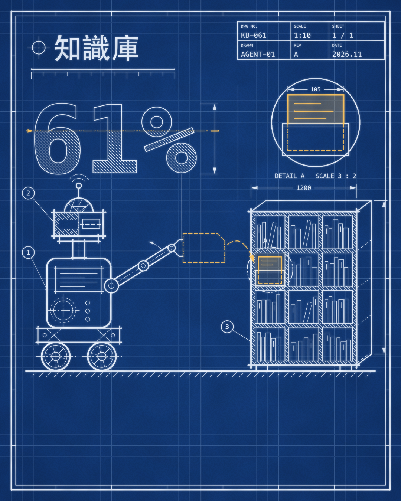

# 藍圖線框

## 一句話
深藍底、白色細線加一種琥珀色強調，用工程圖的語言（尺寸標註、剖面線、中心線、零件編號、圖框與圖標欄）把「系統怎麼運作」畫成一張可以被檢查的圖。

## 適合與不適合的題材
- 適合：系統架構、資料流、AI 代理如何讀寫知識庫這類「機制說明」，觀眾要看到零件之間怎麼連。
- 適合：帶數字的論點（61%、3 倍、−40%），尺寸標註天然就是「量測」的視覺語言。
- 適合：流程拆解、規格比較、前後版本對照（用 REV A / REV B 當敘事結構）。
- 不適合：情緒、人物故事、溫度感強的題材（人群、家庭、慶祝），線稿會顯得冷。
- 不適合：需要大面積色彩或照片質感的題材；本風格只有兩種墨色，畫面會很素。

## 氣氛
冷靜、精確、可信賴，帶一點復古的「圖紙攤在桌上」的物件感。像資深工程師在紙上推演，不是在炫技；資訊密度高但秩序井然，安靜。

## 用程式畫的難度與限制（低／中／高；哪些部分需要圖像生成模型或手繪素材才做得好）
難度：低到中。這是最適合純程式繪製的風格之一，因為所有元素本來就是直線、圓、弧與規則排列。
- 程式畫得很好：格線、圖框、尺寸線、剖面線、中心線、齒輪、輪子、機構連桿、書櫃、儀表盤。
- 需要細心：虛線與長短線的相位對齊、剖面線被輪廓裁切、箭頭尖端貼齊延伸線。
- 較難：有機形狀（人、動物、植物）的線稿、透視很強的三維件；機器人請維持正投影加簡單斜投影，不要硬畫透視。
- 紙張的斑駁與折痕用雜訊加模糊就夠，不需要素材圖。

## 指標畫法（這個風格公認的正統做法，寫成 5–8 個可以照做的步驟，例如上色順序、線條方向、分版套色、明暗層數；具體到參數）
1. 先鋪紙：底色 #164286，四角以 #0B265A 做暈映（徑向漸層，最暗處約 45% 混色），再乘上低頻斑駁（模糊半徑約 18px，亮度 80–100%）與細顆粒（亮度 93–100%）。
2. 格線兩級：細格 30px（約 10% 不透明度）、粗格 150px（約 25%），顏色 #96BEF0。粗格同時當構圖的對齊基準，主要物件的邊緣落在粗格線上。
3. 圖框：外框 3px、內框 1.1px，間距 12px；四邊每 150px 做一個分區刻度（長 12px）。標題欄放右上，兩列三欄，欄標用小字 11px、內容 19px，全部大寫單線字。
4. 線寬四級（以 1080 寬計）：外輪廓 4.6px、零件 3.0px、細節 1.8px、髮線（尺寸線、中心線、剖面線、隱藏線）1.1px。同一張圖只用這四級，不要出現第五種粗細。
5. 線型：實線＝可見輪廓；虛線（9 畫 6 空）＝被遮住或「預定位置」；中心線（24 長、5 空、4 短、5 空）＝圓心與軸；幻影線（26、5、4、5、4、5）＝被放大的細部範圍。
6. 剖面線：45 度（左上往右下）、間距 7–9px、髮線寬；被「剖開」的實心件（機器人感測頭、書櫃框、數字下半）才畫，並用輪廓裁切；剖面線墨量約 85%。
7. 尺寸標註：兩條延伸線（離物件 7px 起、超出尺寸線 9px），尺寸線兩端為細長實心箭頭（長 17px、半寬 4.2px），數字壓在線中央、背景挖空 8px 邊距，用等寬字 17px。
8. 分版套色：先畫白墨層、再畫琥珀墨層，兩層各自用相同的「微光暈」（高斯模糊約 2.4px、40% 不透明度）疊底，最後才疊本線。琥珀只給「這張圖在講什麼」的唯一對象。

## 模範學習

### Leonardo da Vinci（李奧納多·達文西，1452–1519，義大利）
- 為什麼學他：機構分解、剖開看內部、同一頁並排「前後狀態」，都是工程圖語言的祖師（MIT Technology Review 稱爆炸圖與剖視圖的技法源自他的筆記）。
- 可以照做的規則（參考 Codex Atlanticus《大西洋手稿》、Codex Madrid I 的機構頁）：
  1. 同一個機構在同一張紙上畫兩個狀態：現在的位置用實線，剛才的位置用虛線輪廓。本樣張：夾爪旁的虛線卡片＝剛放開前的位置，櫃內的實線卡片＝已放入。
  2. 看不見的部分不省略：被遮住的部分用虛線畫出來（透視看穿）。本樣張：卡片下 48% 被櫃格前緣蓋住，用琥珀虛線畫完整外形。
  3. 剖面線只用一個斜向，同一零件內平行、間距一致（約 7–9px）；本樣張全部改為左上往右下（Getty 對達文西排線方向的說明為此向）。
  4. 局部放大：用圓圈框出範圍，在空白處重畫一次，旁邊只寫一個短註（DETAIL A  SCALE 3 : 2），不寫長句。
  5. 零件旁只放短註與編號，說明永遠比圖小；同一頁允許多個大小不同的視圖，但每個視圖的邊緣各自對齊格線。
  6. 先畫輕的結構線（保留約 27% 的構圖輔助線），再畫定稿線；殘留的輔助線是可信度的來源，不要擦乾淨。
  7. 一頁只講一個機構的一個動作。
- 不要照抄：鏡像書寫、人體與解剖頁、具體機械（飛行器、自走車、投石機）的構圖、手稿的泛黃羊皮紙質感與手繪抖動。
- 檢查表：
  - 畫面裡有沒有同一物件的兩個狀態（實線＋虛線）？
  - 被遮擋的部分有沒有用虛線畫出來，而不是被直接截掉？
  - 全部剖面線是不是同一個斜向？
  - 局部放大旁是不是只有短註與尺度，沒有長句？

### R. Buckminster Fuller（巴克敏斯特·富勒，1895–1983，美國）
- 為什麼學他：他把結構簡化成「節點加等長桿件加三角形」，並以「用更少做更多」為設計準則，正好是這個風格「少量零件、可被檢查」的態度。
- 可以照做的規則（參考 Dymaxion Map，1943 年見刊於 Life；測地線圓頂專利 US 2,682,235，1954 年核准）：
  1. 要穩就用三角形：矩形框內加對角撐（X 撐），圓形外殼拆成三角面。本樣張：底盤兩端加 X 撐，感測頭圓頂拆成約 8 個三角面（髮線）。
  2. 一種零件重複多次：書櫃 12 格同尺寸、輪輻 6 根同角度，不做 12 種不同零件。
  3. 結構線用最細的髮線，面積留給空白；不堆零件。一個畫面零件編號不超過 3 個。
  4. 主題用數字量出來：61% 以高度尺寸量，而不是用形容詞（對應富勒的以量測說話）。
  5. 不預設「上方」：地面線是唯一的方向基準，其他視圖（細部圓）可以脫離它放在空白處。
  6. 曲面用大圓弧（圓心落在格線上）取得，而不是徒手曲線。
- 不要照抄：Dymaxion 世界地圖的二十面體展開圖、測地線圓頂的整體造型、Dymaxion 車與住宅、Expo 67 美國館的形象。
- 檢查表：
  - 至少一處有三角形撐或 X 撐，且是髮線等級？
  - 重複的零件尺寸、間距是否完全相同？
  - 主題數字是否有一個對應的尺寸標註？
  - 零件編號不多於 3 個？

## 代表畫家、設計師與作品
- Anna Atkins（安娜·阿特金斯）：19 世紀中、英國。《Photographs of British Algae: Cyanotype Impressions》（1843 起）。學藍曬圖的材料原點：白色形體落在深藍底上的剪影感與邊緣的柔化。
- John Herschel（約翰·赫歇爾）：19 世紀、英國。1842 年發明氰版（cyanotype）曬圖法。學「藍底白線」為何成為工程複製的標準色調，也就是這個風格的色彩出處。
- Leonardo da Vinci（李奧納多·達文西）：15–16 世紀、義大利。《Codex Atlanticus》（《大西洋手稿》）中的機械與機構圖。學機構分解圖：同一個零件從多個角度拆開畫，旁邊用短註解說明作用。
- Maurice Koechlin 與 Émile Nouguier（莫里斯·柯希蘭、埃米爾·努吉耶），及 Gustave Eiffel（居斯塔夫·艾菲爾）的公司：19 世紀末、法國。艾菲爾鐵塔的結構設計草圖與施工圖（1884 年起）。學把大結構切成「網格＋標註」的製圖紀律。
- Thomas Edison（湯瑪斯·愛迪生）：19 世紀末、美國。留聲機專利（美國專利第 200,521 號，1878）的附圖。學專利附圖的單線畫法與用字母標示零件、再以引線指出位置的語法。
- David Macaulay（大衛·麥考利）：1946 年生、英美。《Cathedral》（1973）、《The Way Things Work》（1988）。學「用一支筆把機制講給外行人聽」：剖面、拆解、重複的單位與旁白式標註。
- Peter Cook / Archigram（彼得·庫克與阿基格拉姆）：1960 年代、英國。《Plug-in City》（1964）。學把工程圖語言升級為敘事與宣言：標註、箭頭與拼貼並用，但仍守圖紙秩序。
- Buckminster Fuller（巴克敏斯特·富勒）：20 世紀中、美國。Dymaxion 世界地圖（1943 年刊於《Life》，1946 年取得專利）與 Dymaxion 汽車（1933）。學用幾何結構圖當作論點本身，而非裝飾。

## 配色與色階（表格：角色｜色碼｜用途；每個主要顏色列出陰影／主色／亮面／高光；一個畫面最多幾色；強調色怎麼用。色碼必須和 sample.py 一致）
一個畫面只用三種色：藍紙、白墨、琥珀墨。沒有第四種顏色，立體感靠線寬與剖面線，不靠漸層。

| 角色 | 色碼 | 用途 |
|---|---|---|
| 紙－陰影 | #0B265A | 四角暈映、折痕暗側 |
| 紙－主色 | #164286 | 整張底色 |
| 紙－亮面 | #BED7FA | 折痕亮側（約 15% 混色） |
| 格線 | #96BEF0 | 細格約 10%、粗格約 25% 不透明度 |
| 白墨－主色 | #EEF5FF | 所有主要線條與文字 |
| 白墨－暗階 | 白墨 25%–85% | 構圖輔助線 27%、剖面線 85%、大數字底線 85% |
| 琥珀－主色 | #FFC660 | 筆記卡、61% 水位線、箭頭、目標槽 |
| 琥珀－底填 | #FFC660 約 9–23% | 筆記卡內的半透明底（填 58/255）、目標槽（填 22/255） |

強調色規則：整張圖琥珀只能指向一件事（這裡是「正在被放入的筆記卡」與「61% 的水位」），面積不超過畫面 8%。若有兩個重點，第二個改用白墨加粗，不要加第二種強調色。

## 光源、陰影與體積
- 沒有光源、沒有陰影，這是此風格最重要的規則。體積靠三種手法：斜投影的頂面與側面（偏移 40px、−30px）、剖面線表示「被切開的實體」、虛線表示背後的結構。
- 圓形零件用同心圓加輻條表現厚度，不做漸層。
- 地面只用一條 4.6px 粗線，下方短斜線（間距 20px）表示地基，不畫落影。
- 若要增加層次，用墨量：重點物件 100%，構圖輔助線約 27%，背景格線更淡。

## 線條、描邊與邊緣（粗細以畫面寬度的比例表示）
- 外輪廓約 0.43% 畫面寬（4.6px）、零件約 0.28%、細節約 0.17%、髮線約 0.10%。
- 線端用圓頭；矩形角落「出頭」4–7px（製圖時刻意讓線稍微超出交點）。
- 輪廓不閉合的地方要有理由（被剖開、被遮擋、被引線打斷）。
- 邊緣有極輕的墨暈（高斯 2.4px、約 40% 墨量），模擬曬圖的擴散，不要加外光暈或霓虹。
- 墨量整體有低頻起伏（80–100%），像曬圖時曝光不均。

## 質感與筆觸（具體參數：密度、大小、透明度、方向）
- 紙張顆粒：256 格雜訊乘上 93–100% 亮度；斑駁：64 格雜訊放大並模糊 18px，乘上 80–100% 亮度。
- 折痕：畫面中央十字各一條，亮線 2px（約 15%）緊接暗線 3px（約 22%），模糊 1–2px。
- 剖面線：45 度、間距 7–9px、髮線寬，全畫面方向一致，不可混用兩個方向（除非是不同零件的相鄰剖面，才反向）。
- 沒有筆觸感。線是均勻、機械的；任何手繪抖動都會破壞「圖紙」的可信度。

## 細節密度、格線與比例（主體佔畫面多少、留白比例）
- 主體（機器人、書櫃、大數字、細部放大圓）合計約佔畫面上方 75%；底部約 22% 留白，只留圖框與格線。
- 大數字佔畫面高度約 14%，位於左上段，右側掛高度尺寸。
- 標題（知識庫）約 5.8% 高度，左上，下方一條粗細雙線加刻度尺。
- 圖標欄寬約 37% 畫面寬、高約 7.5%，放右上；不要放大，它是氛圍而不是資訊。
- 每個區塊（機器人、細部圓、書櫃）都落在粗格線上，彼此留 1 個粗格（150px）的呼吸。
- 一個畫面最多 3 個零件編號、2 組尺寸標註（加上數字本身的一組），再多就變成雜訊。

## 字體搭配與字級（中文／數字／英文的字體性格；標題、標籤、大數字佔畫面高度的比例）
- 中文標題：黑體類（本樣張用 STHeiti Medium），單線、無裝飾，78px。只用在標題與至多一個短標籤。
- 大數字與標註數字：等寬字（Menlo），大數字 250px、外框加剖面線；標註 15–19px。
- 英文標籤：大寫等寬，圖標欄欄標 11px、內容 19px；零件編號 18px 放在圓圈內。
- 層級只有三階：大數字（約 14%）、標題（約 5.8%）、標註（約 1.2–1.5%）。不要在中間插入第四階。
- 中文行文要少。工程圖的語言是數字、代號與短詞；長句子請放進字幕或旁白。

## 動態性格（怎麼動才對味：幀率、緩動、進出場、鏡頭；不該怎麼動）
- 幀率 24–30 fps，緩動偏線性或輕微 ease-in-out；像繪圖機（plotter）在畫。
- 進場：線條以「繪製」方式生長（描線 stroke-dash 動畫，由左到右、由上到下），格線與圖框先出現，物件後出現，標註最後出現。
- 尺寸標註：延伸線先出、尺寸線拉開、箭頭到位、數字淡入。數字（61%）要用水位線上升或儀表盤指針來「量」出來。
- 筆記卡放入：沿虛線路徑移動，到位時目標槽的虛線轉為實線、琥珀底填加深，零件編號 2 秒內出現。
- 鏡頭：整張圖紙平移或緩慢推近（最多 1.15 倍），像在圖桌上移動；不要旋轉、不要視差。
- 不該：彈跳、擠壓拉伸、粒子爆炸、霓虹閃爍、手繪抖動。

## 元件清單（知識影片常用的 14 個元件在這個風格下怎麼畫，各一句：主角 Agent、筆記卡、知識庫、資料夾、大數字牌、長條圖、箭頭、勾與叉、路徑或地圖、時間軸、對話框字幕、章節標示、人群或多個物件、背景）
- 主角 Agent：機器人以正投影畫成輪式機身加方形胸腔、感測頭（半剖面，附天線與訊號弧）、連桿手臂與夾爪；零件編號引線標在機身與感測頭上，不畫臉。
- 筆記卡：折角矩形，琥珀 4.6px 輪廓、13–23% 琥珀底填，內有 3–4 條 1.8px 文字橫線。
- 知識庫：斜投影書櫃，3 欄 4 列的格子，框架做剖面線，格內畫細線書脊，目標格以琥珀虛線方框標出。
- 資料夾：側視的折角標籤矩形，白墨 3px 輪廓，標籤上放大寫代號（如 F-02）。
- 大數字牌：等寬大字描外框，下半部（等於百分比的高度）填剖面線，旁邊掛高度尺寸，水位以琥珀中心線標出。
- 長條圖：白墨矩形加剖面線，底部一條基準線，頂部掛尺寸數字；最高那根改為琥珀。
- 箭頭：實心細長箭頭配虛線或中心線；流向用琥珀，一般關係用白墨髮線。
- 勾與叉：勾用 3px 折線畫在圓圈內；叉用兩條交叉線，皆為白墨，通過的項目另加一個琥珀圈。
- 路徑或地圖：以等高線與格線表示，路線用琥珀虛線，節點為帶編號的圓圈。
- 時間軸：一條帶刻度的尺（每 32px 一刻度，每 4 刻度一長刻），事件用引線與編號圓圈標在刻度上。
- 對話框字幕：矩形標註框加引線與小圓點指向對象（同零件編號語法），字用大寫等寬。
- 章節標示：圖標欄風格的小表格（SHEET 1 / 4、REV B），放在角落，換章節時更新。
- 人群或多個物件：同一個零件重複畫成陣列，並以尺寸線標示間距與數量，如「×12」。
- 背景：藍紙、兩級格線、圖框與分區刻度、折痕、暈映；底部 22% 保持安靜。

## 常見失敗與避免方式（至少 6 條）
- 失敗：線寬統一，畫面變成一團。避免：嚴守四級線寬，外輪廓最粗、髮線最細。
- 失敗：加漸層與陰影，變成科技風插圖。避免：只用墨量與剖面線，完全不加陰影。
- 失敗：琥珀用太多，失去重點。避免：琥珀只給一件事，面積小於畫面 8%。
- 失敗：尺寸標註的數字蓋住線條，或箭頭沒對齊延伸線。避免：數字背景挖空、箭頭尖端落在延伸線上。
- 失敗：中文字缺字、被擠成豆腐塊。避免：只用 STHeiti Medium 或 Hiragino Sans GB，並逐字檢查字形遮罩是否與 notdef 字形不同。
- 失敗：機器人被畫成人臉或手臂而已。避免：用輪子、機身、感測頭、手臂四塊組成，不畫眼嘴。
- 失敗：格線太亮，搶過主體。避免：細格不透明度不超過 10%、粗格不超過 25%。
- 失敗：手繪抖動或隨機線寬。避免：全部機械直線，隨機只用在紙張雜訊與書脊高度。

## 一定要做／一定不要做（各 5 條）
一定要做：
- 圖框、圖標欄與格線齊備，讓畫面一眼就是圖紙。
- 至少一組尺寸標註，並且尺寸數字與主題數字有關聯（例如 61 對應高度）。
- 用剖面線表達「被切開」，用虛線表達「看不見／預定」。
- 琥珀只用在一個敘事重點，其餘一律白墨。
- 底部留約 22% 安靜，不放資訊。

一定不要做：
- 不要加第四種顏色或霓虹光暈。
- 不要用漸層填色或投影。
- 不要讓任何線出現手繪抖動。
- 不要在圖面放長段中文句子。
- 不要把圖標欄寫成真實公司名稱或品牌。

## 原創界線（這個風格可以學什麼、不可以照做什麼）
- 可以學：藍曬的色調、線寬分級、線型約定、尺寸標註語法、剖面線、圖框與圖標欄的版式、機構分解的思路。
- 不可以：臨摹任何專利附圖、達文西手稿或建築圖的具體構圖；不可複製既有圖面中的零件組合或簽名圖樣。
- 不可以：放入真實公司、產品、客戶的名稱、標誌或圖號；圖標欄只用虛構代號（如 KB-061、AGENT-01）。
- 不可以：以「官方工程圖」的口吻暗示這是真實的技術文件，圖面只是一種敘事語言。
