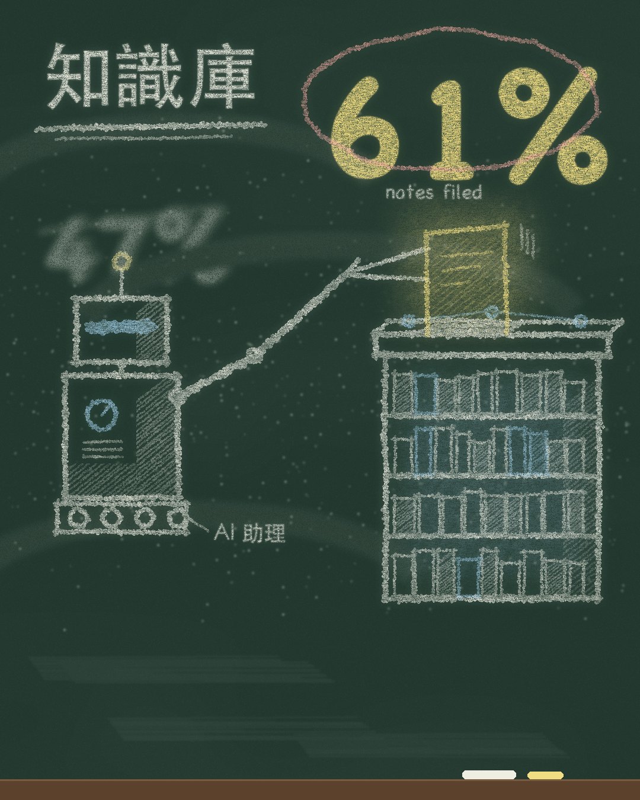

# 黑板粉筆

## 一句話
深綠石板上用粉筆一筆一筆畫出來的講解圖：線條帶粉粒、陰影是側鋒斜線、大數字用黃粉筆圈起來，像老師把一個觀念當場畫給你看。

## 適合與不適合的題材
- 適合：教學、解釋觀念、步驟拆解、「先畫給你看」的知識短片，畫面本身就帶有「正在講」的節奏。
- 適合：一個大數字加一句結論，用黃粉筆圈起來就是重點，不必爆炸框也有強調。
- 適合：流程圖、關係圖、因果箭頭這類本來就會畫在黑板上的內容。
- 不適合：需要精確讀數的密集圖表（粉筆線寬約 3–8px，細節會糊）。
- 不適合：高級、精密、科技冷感的品牌形象片；需要真實材質或大面積色彩的題材。

## 氣氛
親切、專注、帶一點懷舊的教室感。安靜但有人味，像下課後留在黑板上、還沒擦掉的那一題。

## 用程式畫的難度與限制
難度：中。粉筆的難處在「斷續與粉粒」，不在形狀。做法是把每一筆畫成許多抖動的小圓點，再用雜訊遮罩讓粉筆在紙齒上漏掉一部分，就有粉筆味。
限制：真正的粉筆筆壓、手腕轉動與擦拭後的粉霧，程式只能近似；所有線條偏直、偏穩，手抖感靠隨機位移而非真人節奏；大面積平塗要用側鋒斜線代替，不能填實色，否則立刻變成數位板；機器人只能用方塊與圓組成，畫不出複雜曲面。

## 指標畫法
1. 先畫黑板：底色 #22382E，疊 26 個寬 120–380px 的模糊橢圓，色 #465C52、不透明度 10–26 之間，模糊 40px，當作擦拭殘影；再加一層細雜訊顆粒 `effect_noise` 色 #788C82。
2. 粉筆線：沿線每 1.6px 放 2 個小圓點，半徑為筆寬的 0.25–0.55 倍，位置抖動 ±筆寬 0.28 倍；沿線方向再加緩慢飄移，最大 ±1.6px；兩端壓力降到 75%，中段 100%。
3. 全部筆跡先累積成「各顏色一張遮罩」，最後才上色：遮罩乘上紙齒雜訊（雜訊值大於 92 的才全留，其餘漏掉）與縱向粉筆紋（寬 6px 的長條雜訊），粉筆顏色就會自然漏出黑板。
4. 粉塵暈：每個顏色的遮罩再模糊 7px、不透明度除以 5 後疊回去，邊緣有淡淡粉霧。
5. 陰影一律用側鋒斜線：角度約 −0.9 弧度、間距 9–14px、線寬 1.6–2.2px、不透明度 70–140（滿值 255），只畫在背光側（右與下），再裁進物件的方框；光源在左上。
6. 形狀的角：四邊各自畫，每一角兩端各多伸 4px（手畫的超出感）；圓用 40 段多邊形、每個頂點抖動 ±1px。
7. 大字不用筆畫，而是把字形遮罩模糊 0.8px 後走同一套紙齒流程，字就像用粉筆側面壓出來的。
8. 強調：大數字用黃粉筆，外面用粉紅粉筆畫一圈沒有閉合的快速橢圓，筆寬 4.5px，半徑加減 4px 抖動，只畫一次。
9. 路徑與動作：虛線用 14px 線、10px 空，箭頭是兩筆短斜線；卡片動作用旁邊三道短短的動態線。
10. 「放進知識庫」的畫法：卡片垂直落入櫃頂的投遞口，卡片遮罩在投遞口近緣線以下整段清空，再用一筆白粉把近緣線畫在卡片上方；卡片下半被櫃子「吞掉」，不用任何箭頭也看得出正在放入。
11. 色場（史坦納）：黃色在卡片周圍、藍色在知識庫內部各鋪一塊側鋒色場（`field()`：寬 34px 斜向筆、間距 16–17px、不透明度 84／60，遮罩羽化 26px），放在最底層，白線與黃線畫在其上。
12. 被擦過的舊答案（波依斯）：在空白處用不透明度約 95／255 的白粉畫「47%」並劃一條線，沿擦拭方向拖糊 2–4 次，再加三道寬 46px 的弧形擦痕；整層在所有筆跡之後以低強度疊上。
13. 最後撒粉塵：700 個半徑 0.6–1.8px 的小點，集中在畫面中下段；底部約 22% 只留粉筆槽與一兩道極淡的擦痕。

## 模範學習

### Rudolf Steiner 魯道夫・史坦納（1861–1925，奧地利／瑞士）
為什麼學他: 他在黑板上用彩色粉筆把抽象觀念「畫給人看」（1919–1924 的講課黑板圖，自 1919 年秋起鋪黑紙保存，現存約一千多幅，由瑞士多爾納赫保管），是黑板講解圖的源頭。

可以照做的規則:
1. 色彩是意思，不是裝飾：少數幾種粉筆色各有固定任務。本樣張的黃只給「新來的東西」（卡片與數字），藍只給「知識與系統」（書、視窗、節點），其餘是白。
2. 用側鋒畫「色場」而不只是畫線：用粉筆側面一排斜向寬筆（約 34px 寬、間距 16px、不透明度約 60–84），讓色塊帶著粉的斷續；邊界要羽化到黑板，不能被方框切齊。
3. 暖色向前、冷色向後：黃色色場放在動作處（卡片周圍，像一團暖光），藍色色場放在知識庫內部（像深處）；兩個色場互不重疊。
4. 色場與輪廓錯位：色塊不必貼合白線，色與色之間的交界也是形體的一部分；白線只負責結構與重點，不重複描每一塊色。
5. 全部筆觸朝同一個斜向，像一隻手在同一個姿勢下畫完；陰影斜線與色場斜線同向。
6. 黑底上最多三到四種色：白、黃、藍，外加一道粉紅強調；不加第五色。
7. 文字很少，只標必要處，字像是邊講邊寫的。

不要照抄: 史坦納黑板圖中的具體圖像（人形、宇宙示意、花形等）、他的紅藍流動構圖與課程主題的符號；我們只借「少色、側鋒色場、暖冷分工」。

檢查表:
- 是否有至少一個以側鋒畫成的色場，且邊界是羽化而非矩形切齊？
- 黃色是否只出現在卡片與數字（新的東西）？
- 暖色場與冷色場是否各有各的位置、沒有互相蓋住？
- 粉筆顏色是否不超過白、黃、藍、粉紅四種？
- 色場的斜向是否與陰影斜線同向？

### Joseph Beuys 約瑟夫・波依斯（1921–1986，德國）
為什麼學他: 他的黑板是「思考的現場」：圖、字、箭頭寫了又擦，板面記得之前發生過什麼（《Richtkräfte／Directive Forces》1974–77，現藏柏林國家美術館；documenta 6〔1977〕上有 36 面黑板見證 100 天討論）。

可以照做的規則:
1. 黑板不是乾淨的：擦過的板面留下寬大的擦痕與殘粉；樣張用三道寬約 46px 的弧形擦痕與細顆粒，維持「剛有人擦過」的感覺。
2. 保留被擦掉的上一版答案：在空白處放一組很淡的舊數字（本樣張是被擦糊的「47%」加一條劃掉的線），強度只有現行筆跡的三分之一以下，擦拭方向是同一個斜向。
3. 修正本身就是內容：舊值（47%）被劃掉並退到空白處，新值（61%）用黃粉筆放在最顯眼處，觀眾看到的是「數字在變」，而不是只看到結果。
4. 用圈、箭頭與引線連接概念：圖與字之間用手畫的線連結，不用格框；一個畫面一兩條連線就夠。
5. 用最直接的材料：粉筆與黑板，沒有陰影、漸層與裝飾；質感來自摩擦與殘留，不來自特效。
6. 尺度跳躍：大字（61%）與小字（notes filed）相差一個量級，重點靠大小，不靠加框。

不要照抄: 波依斯具體黑板上的文字與圖解（如《Richtkräfte》上的概念圖、「Kunst = Kapital」之類的字句）、他的毛氈與油脂符號、講課時的姿態；我們只借「擦痕與舊答案的痕跡」。

檢查表:
- 板面上看得出擦拭的寬弧痕跡嗎？
- 有沒有一組被擦過的舊內容（強度明顯低於新內容）？
- 舊內容是否沒有和現行重點搶位置（在空白處、不被誤讀）？
- 大小字相差是否達一個量級？
- 底部約 22% 是否仍只有粉塵與擦痕？

## 代表畫家、設計師與作品
- Rudolf Steiner（魯道夫·史坦納），1861–1925，奧地利、瑞士：1919 至 1924 年講課時在黑板上畫的彩色粉筆圖，自 1919 年秋起以黑色厚紙覆蓋黑板而被保存下來，現存約一千多幅，由瑞士多爾納赫（Dornach）的遺產管理機構保管。學：用幾筆彩色粉筆把抽象觀念畫成可講的圖，黑底上少數顏色的節制運用。
- Joseph Beuys（約瑟夫·波依斯），1921–1986，德國：《Richtkräfte／Directive Forces for a New Society》（1974–1977），由約 100 面黑板組成，源自 1974 年倫敦的四週行動，現藏柏林國家美術館。學：黑板寫滿了就擦、擦了再寫，板面留著擦拭的痕跡，讓畫面像「思考正在發生」。
- Cy Twombly（賽·托姆布利），1928–2011，美國：1966–1971 年的「黑板繪畫」系列（灰色底布上以白蠟筆畫成圈圈），如多件《Untitled》。學：循環的線圈與抹擦式筆觸，即使沒有具體圖像也傳遞「書寫的節奏」。
- Dana Tanamachi（黛娜·塔納馬奇），美國（紐約），當代粉筆字體藝術家：為《O, The Oprah Magazine》設計 2012 年 2 月號全手工粉筆字封面。學：粉筆字的字距、陰影與裝飾線，如何讓整頁既手作又精緻。
- Salman Khan（薩爾曼·汗），1976–，美國：Khan Academy（2008 年成立，影片自 2006 年起上傳 YouTube），以電子黑板邊畫邊講的講解影片。學：深色底、少量彩色筆跡、一步一步長出來的畫面節奏，與講解同步。

## 配色與色階
黑板綠加四種粉筆色。白粉筆佔所有筆跡約 80%，黃色只給「新的東西」與大數字，粉紅只用在一道強調線，藍色給 AI 系統零件與網路。粉筆色透過漏白遮罩上色，螢幕上會比色碼略暗略綠，這是刻意的。色碼與 `sample.py` 一致；暗部是「該色以 40% 疊在黑板上」（側鋒斜線的實際效果），淡部是「該色再往白調 45%」（粉塵暈與高光邊）。

| 角色 | 暗部 | 本色 | 淡部 | 高光 | 用途 |
|---|---|---|---|---|---|
| 黑板（綠） | #1B2D25 | #22382E | #465C52 | #788C82 | 底、擦拭殘影（#465C52）、顆粒（#788C82） |
| 白粉筆 | #748176 | #EEEEE2 | #F6F6EF | #FFFFFF | 標題、輪廓、陰影斜線、說明字 |
| 黃粉筆 | #757A50 | #F2DE82 | #F8EDBA | #FFF6D0 | 61%、筆記卡、焦點 |
| 粉紅粉筆 | #74655C | #F0A8A0 | #F7CFCB | #FBE3E0 | 圈住數字的一道強調線 |
| 藍粉筆 | #547478 | #A0CDE6 | #CBE4F1 | #E2F1F8 | 視窗、儀表、書、網路節點 |
| 木槽 | #3E2C1D | #5C422C | #785A3E | #8A6B4A | 畫面底緣的粉筆槽 |

## 光源、陰影與體積
光從左上來。體積只靠兩件事：背光側（右、下）的側鋒斜線，和輪廓的粗細。陰影不填色、不漸層，斜線間距愈密愈暗，最密也只到 9px 間距，黑板底色必須從縫裡透出來。不畫投影，不畫地面；物件靠黑板的擦拭殘影與粉塵「落地」。

## 線條、描邊與邊緣
- 輪廓粉筆約 6px（主角方框）、5px（次要）、3–4px（書、細節），標題底線 6px 加一條 3.5px 的短線。
- 每一條線都抖：飄移 ±1.6px，兩端壓力較輕，角落各伸出 4px。
- 邊緣不乾淨：由紙齒遮罩造成斷續與粉粒，不用平滑抗鋸齒線。
- 沒有實心填色：區域要變暗只能用斜線，要變亮只能留黑板，要強調就換顏色；唯一例外是側鋒色場（寬筆斜向、不透明度約 60–84、邊界羽化），一個畫面最多兩塊。

## 質感與筆觸
- 筆觸：許多半徑 0.25–0.55 倍筆寬的小圓點疊成，粗細有輕微起伏，結構看得出圓點的堆疊。
- 紙齒：每個顏色遮罩乘上雜訊（門檻 92），漏掉的比例約三成，同時乘上縱向粉筆紋。
- 粉塵：邊緣暈 7px、強度 1/5；畫面中下段撒細小粉粒；偶有水平擦拭痕，只出現在底部。
- 黑板：綠底、擦拭橢圓、極細顆粒；底緣是棕色木槽，放兩支粉筆（一白一黃）。

## 細節密度、格線與比例
標題約佔高 14%，放左上；大數字約高 20%，放右上，是全頁最大元素；中段 45% 是主場景：左邊機器人、右邊知識庫、中間用手臂與卡片連起來；底部約 22% 保持安靜，只有粉塵、擦痕與粉筆槽。畫面上最多 3 個物件加 1 行手寫標籤，不加背景網格。知識庫的書本約 12–14 本一層，高低與疏密隨機，每層留一兩本陰影。

## 字體搭配與字級
- 中文標題：STHeiti Medium 約 122px，白粉筆，下面兩條粉筆底線。
- 大數字：Chalkboard SE Bold 約 236px，黃粉筆，放在右上並用粉紅粉筆圈起。
- 標籤與說明：STHeiti Medium 約 38px，粉筆白、降到 80% 強度；英文說明用 Chalkboard SE Regular 34px。Chalkboard SE 只含拉丁字母與數字，中文一律用 STHeiti Medium 或 Hiragino Sans GB。
- 每個中文字都用 `check_glyphs()` 逐字確認，缺字就立刻報錯。

## 動態性格
- 以 12 fps（一拍二）為主，粉筆寫字的節奏：筆畫「長出來」而不是淡入。
- 線條依路徑逐段顯現，速度約 600–900px／秒；字用由左到右的遮罩擦開。
- 強調圈是最後才畫上去的：一圈約 0.4 秒，停一下。
- 卡片落入投遞口時，下半被遮住，伴隨 2 幀的粉塵噴出；不要抖動畫面。
- 轉場像「擦黑板」：一條寬橡皮擦由左到右抹過，留下淡淡殘影。
- 不用平滑的鏡頭推拉，用硬切或擦除，維持板書感。

## 元件清單
1. 黑板底：深綠底、擦拭橢圓、顆粒，加底緣木槽與兩支粉筆。
2. 標題字：STHeiti 粉筆字，加上雙底線。
3. 大數字：黃粉筆數字，加一圈粉紅粉筆。
4. 說明標籤：小字加一條短引線指向物件。
5. 機器人 Agent：方形頭加視窗橫條（藍）、天線、方身、履帶，不畫臉。
6. 機器人手臂：肩、肘、腕三節，關節各畫一個小圓，末端兩筆夾爪。
7. 筆記卡：黃粉筆斜邊四邊形，淡斜線陰影與三行橫線。
8. 知識庫：多層書櫃，每層高低不一的方書，部分塗斜線陰影，部分用藍粉筆。
9. 櫃頂投遞口：櫃頂橫板加一個細長的斜面投遞口，卡片從這裡落入。
10. 網路節點：櫃頂幾個藍色小圓加連線，代表知識網路。
11. 箭頭與路徑：虛線加兩筆短斜線箭頭。
12. 動態線：卡片旁的三道短豎線。
13. 勾與叉：白粉筆兩到三筆的勾，或兩筆交叉的叉。
14. 粉筆槽與擦痕：畫面底緣木槽、一白一黃兩支粉筆，以及水平淡擦痕。
15. 側鋒色場：黃色（卡片周圍）與藍色（知識庫內部）兩塊羽化的斜向色場，最底層。
16. 被擦過的舊答案：淡「47%」加一條劃線與弧形擦痕，位於空白處。

## 常見失敗與避免方式
- 線條太乾淨像向量線：一定要有抖動、紙齒遮罩與粉塵暈，否則看起來是白色鉛筆。
- 黑板太黑太均勻：加上擦拭橢圓與顆粒，保持綠色，不用純黑。
- 用實色填滿區域：改用側鋒斜線；大面積深色一律留黑板。
- 顏色太多太亮：白粉筆佔 80%，其他最多三種，且都偏粉彩，不用飽和色。
- 字沒有粉筆質感：字形遮罩必須走同一套紙齒流程，不能直接貼乾淨字體。
- 缺字：Chalkboard SE 沒有中文，中文只用 STHeiti Medium，並逐字檢查。
- 卡片只是在旁邊飄、沒有進去：用遮蔽法，卡片下半被投遞口近緣線吃掉，再畫那條近緣線。
- 底部塞滿東西：底部約 22% 只留粉塵與粉筆槽。
- 把機器人畫成有眼睛嘴巴的臉：用方形視窗橫條代替，沒有五官。

## 一定要做／一定不要做
一定要做：
- 每條線都有抖動與紙齒斷續，邊緣帶粉塵。
- 陰影一律用背光側的斜線，光源在左上。
- 白粉筆佔大多數，黃色只給新東西與大數字。
- 大數字圈一圈，只畫一次。
- 底部約 22% 保持安靜。

一定不要做：
- 用實心色塊、平滑漸層或柔邊陰影。
- 使用超過四種粉筆色。
- 使用乾淨的向量字體直接貼上。
- 讓背景變成純黑或加上網格紋理搶戲。
- 把機器人畫成有五官的卡通臉。

## 原創界線
可以學：粉筆斷續與粉塵的質感、側鋒斜線陰影、黑板上留擦痕的視覺語言、字體裝飾與版面節奏。
不可以：複製史坦納、波依斯、托姆布利、塔納馬奇的任何具體圖樣或構圖，或仿造特定教學頻道的版面與商標；畫面中不放品牌名；機器人與知識庫必須是原創造型。
