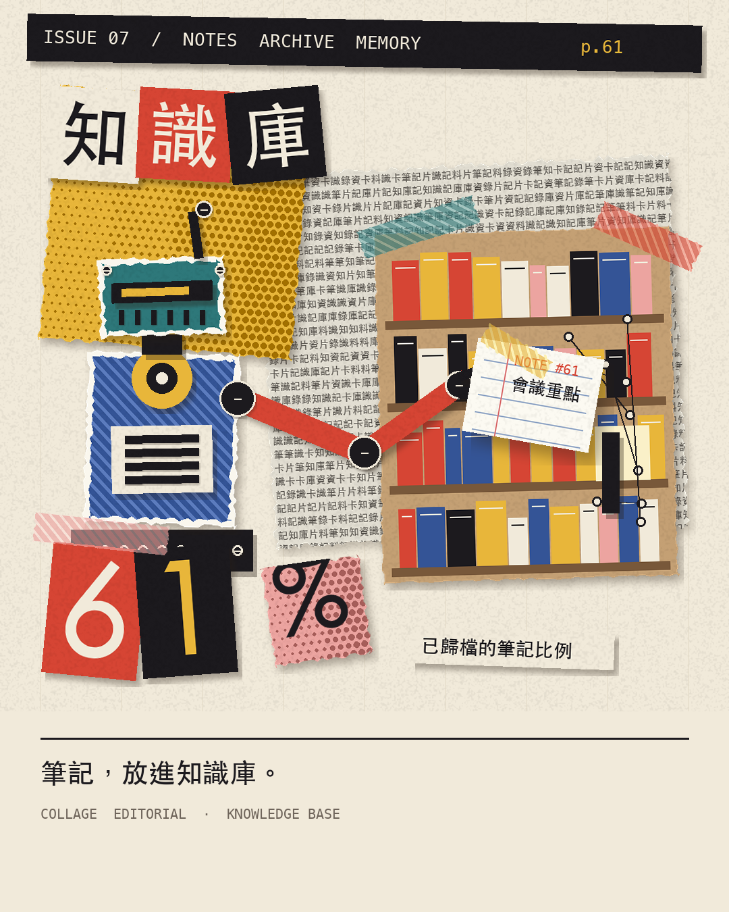

# 拼貼編輯風

## 一句話
把畫面當成一張被剪刀與膠水拼起來的雜誌頁：每個元素都是一塊有厚度、有手撕邊、帶投影的紙，再用紙膠帶、網點與贖金信式標題黏在一起。

## 適合與不適合的題材（3–5 條）
- 適合：觀點型、清單型、「資料整理／知識管理」類知識短片，內容本來就是許多片段要被拼成一個結論。
- 適合：需要編輯感與個性的品牌短片、雜誌風封面、章節標題動畫。
- 適合：一張畫面放三到五個資訊塊（標題、大數字、主體、註解）的 4:5 動態海報。
- 不適合：需要精確比例的資料圖表、流程密集的操作示範（紙片重疊會吃掉可讀性）。
- 不適合：嚴肅、需要冷靜信任感的法務或財務說明（拼貼的玩心太重）。

## 氣氛
手作、俗豔又有秩序、帶紙味的編輯感；像一本獨立雜誌的跨頁，每塊紙都有自己的角度，但整體被格線與留白收住。

## 用程式畫的難度與限制（低／中／高；哪些部分需要圖像生成模型或手繪素材才做得好）
中。紙張顆粒、手撕邊、網點、紙膠帶、投影都能用 PIL 程式化做出。做不好的部分：真實照片剪影（雜誌人像、老照片）與手剪的不規則輪廓，需要授權照片或手繪素材；程式只能做幾何剪紙與抖動多邊形的撕邊。

## 指標畫法（這個風格公認的正統做法，寫成 5–8 個可以照做的步驟，例如上色順序、線條方向、分版套色、明暗層數；具體到參數）
1. 先鋪底頁：米白紙色 #F1EADA，疊 2px 級紙纖維雜訊（亮度 ±18，放大 2 倍），再畫極淡的版面格線（每 120px 一條，色 #E1D8C4）。
2. 由大到小疊紙：先放兩塊最大的背景紙（報紙文字紙、網點色塊，約畫面 30–40% 寬），再放主體，最後放小物件與文字，後放的壓在先放的上面。
3. 每塊紙都做「手撕邊」：沿四邊每 7px 取一點，向內隨機位移 0–6px 組成多邊形當遮罩；需要露出白色紙芯時，外層 #FAF7EE 撕邊、內層縮 6–8px 再撕一次。
4. 每塊紙旋轉 −8° 至 +8°，彼此角度不要相同；不要超過 ±10°，否則像打翻而不是排版。
5. 每塊紙貼上投影：偏移 (6, 8)px、高斯模糊 6px、透明度約 35%（黑偏暖棕）；被拿起或浮高的紙（正在放入的筆記）加大到 (14, 18)、模糊 10。
6. 標題用「贖金信」做法：每個字獨立一塊紙，底色輪流用 米白／紅／墨黑，字色反相，每字旋轉 ±6°，字塊之間重疊 6px。
7. 紙膠帶斜貼在紙角：長 110–200px、寬 34–44px、透明度約 65%，兩端鋸齒剪口，帶 4px 斜紋；每個畫面 3–4 條，只貼在「接點」處。
8. 最後加墨黑細線與圓點標註（線寬 2–3px）當資訊連線，並保留底部約 22% 的空白紙面。

## 代表畫家、設計師與作品（5–8 位：人名（原文＋常用中譯）、年代與地區、1–2 件代表作、這個風格要向他學什麼。只列你有把握的事實；任何不確定的作品名或年份，在該行結尾標「（待查證）」，寧可少列也不要編造）
- Hannah Höch（漢娜．赫希）：1920 年代德國柏林達達；《Cut with the Kitchen Knife Dada Through the Last Weimar Beer-Belly Cultural Epoch of Germany》（約 1919–1920）。學習：大小尺度並置、密集但有動線的構圖。
- Kurt Schwitters（庫爾特．施維特斯）：1910–30 年代德國；「Merz」系列拼貼。學習：用票券、碎紙的質感與節奏做畫面，而不是用形狀。
- Richard Hamilton（理查．漢彌爾頓）：1950 年代英國波普；《Just what is it that makes today's homes so different, so appealing?》（1956）。學習：用單一場景把許多片段組成一則清楚的敘事。
- Romare Bearden（羅馬爾．比爾登）：1960–70 年代美國；《The Block》（1971）。學習：以剪紙塊面堆出空間，色塊分區明確。
- Alexander Rodchenko（亞歷山大．羅欽可）：1920 年代蘇聯；為馬雅可夫斯基《Pro Eto》做的照片蒙太奇（1923）。學習：斜向構圖與大小對比的節奏。
- Barbara Kruger（芭芭拉．克魯格）：1980 年代起美國；《Untitled (Your body is a battleground)》（1989）。學習：大字加色塊做標題的編輯式版面。
- Peter Blake（彼得．布萊克）：1960 年代英國波普；《Sgt. Pepper's Lonely Hearts Club Band》專輯封面（1967，與 Jann Haworth 合作）。學習：多元素擺進同一層次且仍有焦點。

## 配色與色階（表格：角色｜色碼｜用途；每個主要顏色列出陰影／主色／亮面／高光；一個畫面最多幾色；強調色怎麼用。色碼必須和 sample.py 一致）
| 角色 | 色碼 | 用途 |
|---|---|---|
| 紙白（主底） | #F1EADA | 底頁、標籤紙、留白 |
| 紙芯白（高光） | #FAF7EE | 撕邊露出的白邊、筆記卡 |
| 報紙灰 | #E2DED2 | 背景文字紙 |
| 墨黑（陰影／描線） | #1C1A1E | 標題塊、線條、機器細節 |
| 紅（強調） | #D64534 | 標題塊、手臂、紙膠帶、「重點」 |
| 芥黃（主色之一／亮面） | #E8B63A | 網點塊、感測核心、書脊 |
| 青綠（主色之二） | #2E787A | 機器頭、紙膠帶 |
| 靛藍（主色之三） | #345496 | 機器身體、書脊 |
| 粉（柔和輔色） | #ECA4A0 | % 網點塊、書脊 |
| 牛皮紙（中間調） | #C4A074 | 書櫃主體 |
| 書櫃深棕（陰影） | #78583A | 層板 |
- 網點與斜紋的暗面＝底色各通道 −70（網點），亮面＝+40（斜紋）；高光用紙芯白 #FAF7EE。
- 一個畫面最多 6 個色相（紅、芥黃、青綠、靛藍、粉＋墨黑／紙白），強調色紅色只用在標題與最重要的一塊，面積不超過 15%。

## 光源、陰影與體積
不做寫實明暗。體積全靠「紙的層疊」：每塊紙都有偏右下的投影（偏移 6–8px、模糊 6px、透明度約 35%），越高的紙陰影越大越淡。紙面本身保持平塗，頂多加網點或斜紋表示材質。

## 線條、描邊與邊緣（粗細以畫面寬度的比例表示）
不描邊；邊緣就是撕邊或剪邊。撕邊抖動幅度 0–6px（約畫面寬 0.5%），直剪的塊（標題字塊、機器零件）用直邊。資訊連線與圓點為 2–3px（約 0.25%）墨黑。

## 質感與筆觸（具體參數：密度、大小、透明度、方向）
- 紙纖維：2px 級雜訊，亮度 ±14–18。
- 網點：間距 12px、交錯排列，半徑由 1.2px 漸增到 4.8px（沿水平方向），顏色為底色 −70。
- 斜紋：45°，間距 18px、線寬 6px，顏色為底色 +40。
- 報紙：15px 字級的灰字，行距 20px，透明度由整張紙降到約 60%。
- 筆記本橫線：間距 26px、色 #96AAC8，左側一條紅邊線。

## 細節密度、格線與比例（主體佔畫面多少、留白比例）
密度中高：主體與資訊塊佔畫面上方約 78%，底部約 22% 留白紙面。大數字約畫面高度 14%，標題「知識庫」約 8%，主角機器約 28%。用 120px 格線對位，但每塊紙旋轉，營造「對齊中的失序」。

## 字體搭配與字級（中文／數字／英文的字體性格；標題、標籤、大數字佔畫面高度的比例）
- 中文標題：黑體（STHeiti Medium），大字做贖金信字塊；標籤用同一字體 26–28px。
- 大數字：同黑體，190px 以上，兩色反相字塊。
- 英文與頁碼：等寬字體（Menlo）當報頭與註腳，營造雜誌排版感。
- 中文只用黑體，避免宋體缺字；字數少、字級大。

## 動態性格（怎麼動才對味：幀率、緩動、進出場、鏡頭；不該怎麼動）
- 幀率 12 fps 的「定格」感，每塊紙「啪」地貼上（0.15 秒內落下，帶 1–2 度過衝），像逐格拍攝。
- 紙以 ease-out 快速入場，投影由大變小模擬落地；膠帶最後才貼上。
- 鏡頭固定或只做緩慢（<3%）推近；不要旋轉鏡頭或平滑漂移。
- 不該：線性勻速滑動、彈性果凍感、過於整齊同步的入場。

## 元件清單（知識影片常用的 14 個元件在這個風格下怎麼畫，各一句：主角 Agent、筆記卡、知識庫、資料夾、大數字牌、長條圖、箭頭、勾與叉、路徑或地圖、時間軸、對話框字幕、章節標示、人群或多個物件、背景）
- 主角 Agent：用剪紙塊拼成的機器人，方頭帶視窗縫與散熱格、天線、靛藍斜紋身體、芥黃感測核心、紅色關節手臂與黑色夾爪、履帶底座，不畫臉。
- 筆記卡：紙白橫線紙，紅色邊線與小標，斜貼並加大投影，上方貼一條紙膠帶。
- 知識庫：牛皮紙書櫃，多色書脊，留一格空位等待放入。
- 資料夾：牛皮紙對折片，撕邊標籤紙貼在前緣。
- 大數字牌：每個數字一塊紅或墨黑紙，反相字色，旁邊貼粉色網點塊放 %。
- 長條圖：用不同高度的剪紙條拼成，頂端撕邊，數值寫在貼上的小標籤。
- 箭頭：墨黑紙剪的粗箭頭，帶輕微旋轉與投影。
- 勾與叉：用紅色與青綠的剪紙條拼成，不用描線。
- 路徑或地圖：虛線以紙膠帶斜貼，地點是圓形紙片。
- 時間軸：一條黑色紙帶加多塊標籤紙，用紙膠帶固定。
- 對話框字幕：米白標籤紙加輕微旋轉，黑字，放在底部留白區邊緣。
- 章節標示：Menlo 英文報頭條加頁碼（p.61）。
- 人群或多個物件：重複剪紙塊並錯開角度，用兩三種顏色。
- 背景：米白紙、淡格線、報紙文字紙與網點塊疊成層次。

## 常見失敗與避免方式（至少 6 條）
- 每塊紙角度一致像貼紙：角度要錯開 ±3–8°。
- 投影方向不一致：全畫面統一偏右下。
- 紙堆太滿看不出重點：保留底部 22% 與大數字周圍的空氣。
- 報紙背景文字搶過主體：降低對比、縮小字級。
- 中文缺字或字體混用：只用 STHeiti，輸出前逐字檢查。
- 撕邊像鋸齒：抖動步距 7px、幅度小於 6px，不要規律重複。
- 機器人被拼成抽象形狀看不出是機器：加上視窗縫、天線、關節與履帶。

## 一定要做／一定不要做（各 5 條）
一定要做：
- 每塊紙都有投影；
- 標題用贖金信字塊；
- 紙膠帶貼在接點；
- 保留底部留白；
- 色票限制在 6 個色相內。
一定不要做：
- 用漸層或光澤做體積；
- 加入寫實光影；
- 所有紙塊角度相同；
- 使用多於兩種中文字體；
- 用品牌標誌、現成雜誌圖片入畫。

## 原創界線（這個風格可以學什麼、不可以照做什麼）
可以學：剪貼的層疊方法、尺度對比、贖金信字塊與紙膠帶的語彙。不可以：重現上述藝術家的特定構圖、人物或標誌性圖像，也不可使用真實雜誌、商標或他人照片；畫面內容與配色皆為原創。
