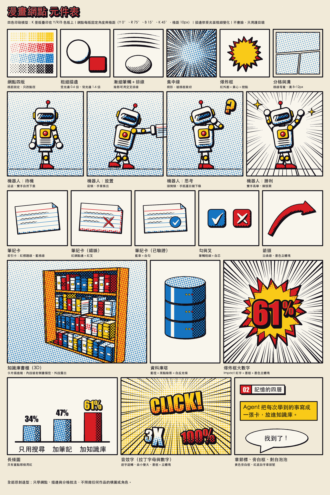

# 漫畫網點

## 元件庫

`components.py` 收錄本風格的共用技法與元件（Page、tone、outline、stroke、robot、shelf3d、burst_number 等），可直接 `from components import *` 使用；`sample.py` 就是用它組成的三格頁。

## 一句話
粗黑描邊、平塗原色、網點做陰影與漸層、放射集中線與分格，像一頁用四色印刷機印出來的漫畫，重點一眼跳出來。

## 適合與不適合的題材
- 適合：一個大數字或一句結論要「砸」進觀眾眼裡（61%、3 倍、第 1 名）。
- 適合：流程有明確的「誰把什麼放到哪裡」動作，分格天然能拆成因與果。
- 適合：需要年輕、有衝擊力的社群開場，或把嚴肅主題變輕鬆的科普。
- 不適合：需要精確讀數的密集圖表（網點與粗線會吃掉細節）。
- 不適合：沉穩、高級、留白很多的企業形象片；需要真實感或柔和漸層的題材。

## 氣氛
熱鬧、直接、帶一點復古印刷感。聲量大，但靠格線與留白維持秩序。

## 用程式畫的難度與限制
難度：中。粗描邊、網點、集中線、爆炸框都可用 PIL 程序化畫出，且風格容忍幾何感。套色偏移與紙紋已內建在 `components.py`。
限制：人物表情與手繪墨線真正的筆壓與抖動程式做不出來，本風格以機器人與物件為主角；筆刷粗細只依邊的方向與兩端漸細變化，輪廓偏乾淨幾何；複雜透視場景需手繪；機器人只有正面加前傾，沒有真正的側面或四分之三視角。

## 指標畫法
本風格用「兩層印刷模型」：色版層（紙＋黃、紅、藍三色版）在下，K 墨層一律疊在最上面。物件上色時會同時清掉下方的墨，所以照畫家順序（先遠後近）畫，遮擋就會自然正確。

1. 先分格：格框用尺畫的等寬直線 5px，溝寬 14px，格框下緣可微傾斜；標題區約佔高 15%，主場景用「因、動作、結果」三格，底部約 20% 留白。
2. 平塗底色：每個物件先填一個主色（紅、黃、藍或未印刷的紙白 #FFFCF3），不做漸層，再描邊。
3. 陰影只用一版網點，由底色決定：白底配藍點、黃底配紅點（疊出橙色）、紅或藍底配 K 點。形狀減去往光源方向平移後的自身，得到月牙形，暗核再疊一層 K 點 0.3。光源在左上。
4. 高光就是不印：白色反光在色版填紙白，墨層同時挖空，不用半透明白。
5. 網點規則：全頁格距固定 10px（1080 寬），每版角度固定：Y 0°、R 75°、B 15°、K 45°；網點全頁連續對齊，濃淡只改點徑 `r = 格距 × √(覆蓋率 ÷ π)`，點徑加減 4% 抖動，覆蓋率不超過 0.95。
6. 套色偏移：色版整體偏移約 (1.3, 0.9)px，描邊與色塊之間會露出細細紙縫，這是復古印刷感的來源；最後加一層極輕的紙紋雜訊。
7. 全部以 2 倍尺寸繪製再用 LANCZOS 縮小，網點與筆觸邊緣才會柔順。
8. 集中線：從主角中心向外放射約 120–150 條漸細楔形，內徑 150px 起，粗 8–9px，被格框裁切。
9. 速度線：平行、兩端漸細（尾端收尖），粗 4–10px、長短不一，只畫在移動物體後方，沿運動方向。
10. 爆炸框：外層紅星有 K 點月牙，內層黃星縮到 0.8 倍，中心 58% 保持乾淨，只在外圈漸進紅點；數字放在乾淨的黃底上，Impact 紅字、墨框加墨色立體塊。
11. 「推進書架」的畫法：卡片是一張垂直於書脊的平面，切成內外兩段。內段在被遮書本之前先畫，外段最後畫，內段就會被緊鄰的書擋住，看起來是插進去了；再加沿推入方向的速度線、推卡的手掌（貼在卡片外緣，不壓在卡面上），以及一個白色爆炸框加音效字（如 CLICK!）。特寫格的書改用安靜配色（藍黃為主、少白），讓白色卡片成為最亮的元素。

## 模範學習
樣張已套用：Kirby Krackle 黑點叢（結果格的爆炸框四周，與第一格筆記卡後方），網點只當色調與陰影用（Lichtenstein），其餘維持原有的兩層印刷模型。

### Roy Lichtenstein（羅伊·李奇登斯坦）（1923–1997，美國）
為什麼學他：把印刷網點當成「顏色與陰影的單位」，是這個風格的根。
可以照做的規則：
1. 顏色只有紅、黃、藍、白加黑，每區塊平塗，沒有漸層。《Whaam!》（1963，Tate）、《Drowning Girl》（1963，MoMA）、《In the Car》（1963，蘇格蘭國家美術館）都是如此。
2. 網點只在三種地方出現：大面積背景（第一格藍點，涵蓋率 0.05 到 0.35）、形體的陰影、爆炸框外圈的橙色。其他地方一律平塗。
3. 網點大小一致、排列固定，濃淡只靠點徑改變（本頁全頁格距 10px、各版角度固定）。
4. 黑色輪廓線粗而均勻（5–6px），封閉形狀，轉角不尖，輪廓線是主要的描繪方式，不是補充。
5. 格子大膽裁切：主角與物件被格框切到，不留安全邊。第二格的書架與手臂就是被切到的。
6. 文字與擬聲詞進入畫面當作形狀：CLICK! 與 61% 都帶黑色粗描邊與偏移立體塊，像印刷字。
7. 高光是留白（不印），不是白色顏料。
不要照抄：「Whaam!」的戰鬥機與爆炸、哭泣或溺水的女孩、漫畫對白框裡的愛情台詞，與他的筆觸（Brushstroke）系列。
檢查表：
- 每個色塊都是平塗，沒有漸層？
- 網點只出現在背景、陰影與爆炸外圈嗎？
- 黑色輪廓線粗細一致、全部封閉？
- 至少有一個格子被格框明顯裁切物件？
- 高光是紙白未印，不是白色色塊疊上去？

### Jack Kirby（傑克·科比）（1917–1994，美國）
為什麼學他：他的能量表現（粗壯形體、爆發感、黑點能量場）是漫畫語言的標準答案之一，只學原則，不照抄角色。
可以照做的規則：
1. Kirby Krackle：以一簇簇實心黑圓點表現能量場，成熟形式出現於 1965–1966 年的《Fantastic Four》與《Thor》，更早的雛形可追到 1940 年《Blue Bolt》第 5 期。樣張：結果格爆炸框外 205–250px 處放 15 簇，第一格卡片後方放 7 簇。
2. 一簇約 4–8 顆，大顆在中心、向外逐漸變小（半徑 4–15px），不排整齊，簇與簇之間留空。
3. 黑點是實心 K 墨，不是網點；它畫在 K 墨層、比網點大很多，與背景的網點形成層次。
4. 能量要從一個中心爆開：黑點簇、集中線、爆炸框都對準同一個中心。
5. 形體粗壯、肩寬、拳或手比身體大：握爪與推卡的手臂用誇張的前縮透視（近大遠小）。
6. 一格只做一件事，動作的最高點（推進、爆發）放在格子最大的位置。
不要照抄：他的英雄角色、宇宙機器（Fourth World）與具體的跨頁構圖；Krackle 只是手法，不是商標。
檢查表：
- 黑點簇是實心墨色，且大小有由中心向外遞減？
- 黑點、集中線與爆炸框是否指向同一個中心？
- 黑點簇沒有排成規則格子？
- 每格只有一個動作重點，且占格最大？

## 代表畫家、設計師與作品
- Roy Lichtenstein（羅伊·李奇登斯坦），1923–1997，美國：《Whaam!》（1963）、《Drowning Girl》（1963）。學：把網點當成「顏色與陰影的單位」、三原色加黑線的克制配色。
- Benjamin Day Jr.（小班傑明·戴伊），1838–1916，美國印刷商與插畫家：Ben-Day dots 印刷網點技法（1879 年發展）。學：點格規則排列、點徑決定明暗，而非手繪排線。
- 手塚治虫（Osamu Tezuka），1928–1989，日本：《原子小金剛／Astro Boy》（1952 年起連載於《少年》雜誌）。學：機器人以簡單幾何構成、輪廓乾淨可辨。
- 鳥山明（Akira Toriyama），1955–2024，日本：《Dr. スランプ》（1980 年起）、《七龍珠》（1984 年起）。學：機械與道具的圓潤造型、清楚的黑線與乾淨塊面。
- 大友克洋（Katsuhiro Otomo），1954–，日本：《AKIRA》（1982 年起連載於《Young Magazine》）。學：機械細節密度、速度線與構圖的衝擊力。
- Jack Kirby（傑克·科比），1917–1994，美國：《Fantastic Four》（1961 年起，與 Stan Lee 合作）。學：誇張透視、粗壯輪廓、能量爆發的視覺語言。
- Scott McCloud（史考特·麥克勞德），1960–，美國：《Understanding Comics》（1993）。學：分格之間的時間與因果轉換、格距與節奏。
- Hergé（埃爾熱），1907–1983，比利時：《丁丁歷險記》系列（含《藍蓮花》，1934–1935 年連載於《Le Petit Vingtième》，原為黑白，1946 年重繪上色）。學：「清晰線（ligne claire）」等粗線條與清楚的傳達。

## 配色與色階
採四色印刷模型：只有紙、黃、紅、藍四種色版加 K 墨。中間色一律由網點疊出，不另設灰色、橙色或其他色碼。一個畫面最多 3 個彩色（紅、黃、藍），強調色只給最重要的元素（紅用在標題字與 61%）。色碼與 `components.py` 一致。

| 角色 | 色碼 | 用途 |
|---|---|---|
| 墨色（K 版，偏暖黑） | #18141C | 描邊、K 點陰影、集中線、速度線 |
| 紙色（底，新聞紙米黃） | #F7F0DE | 畫面底、溝、字底 |
| 物件內白（未印刷處） | #FFFCF3 | 格內底、書脊、卡片、機器人本體 |
| 紅（R 版） | #DD242A | 標題與數字字色、機器人指示燈與靴、箭頭 |
| 黃（Y 版） | #FFD01E | 爆炸框內層、關節、空格提示、章節標 |
| 藍（B 版，印刷藍） | #1C7AC6 | 主場景背景網點、掃描光條、勾章、書本 |

中間色怎麼來（全部是網點疊色，不是色碼）：
- 橙：黃底加紅網點（爆炸框外圈、黃色物件的陰影）。
- 淺藍與藍灰：紙白加藍網點（機器人機身陰影、背景漸層）。
- 深藍：藍底加 K 網點（背板、藍色書本背光側）。
- 暗紅：紅底加 K 網點（靴、指示燈、紅色物件背光側）。
- 灰：紙白加 K 網點，不用灰色色碼。
- 淡黃底：紙白加黃網點（結果格背景）。

## 光源、陰影與體積
光從左上來；背光側（右與下）用網點填，一個物件只有一層月牙陰影，最暗的核心再疊一層 K 點。陰影用哪一版看底色（見指標畫法第 3 點）。體積只靠「亮面平塗＋月牙網點陰影」表達，不加第三層。物件不投影到地面。

## 線條、描邊與邊緣
- 物件描邊依邊的法線方向決定粗細：受光邊約 0.6 倍、背光邊約 1.6 倍，在頂點之間平滑過渡（`outline()`），做出筆刷的粗細變化。
- 格框、旁白框、章節標用等寬直線，不做粗細變化：格框是用尺畫的，人物與物件才用筆刷。
- 自由筆觸（速度線、集中線、排線、手寫字）用兩端漸細的筆刷（`stroke()`）。
- 線寬層級（1080 寬）：格框 5、前景特寫 9–12、主角 7–8、背景物件 5–6、細節 2–3、底部分隔線 3。
- 轉角圓頭接點；不用抗鋸齒以外的柔邊。

## 質感與筆觸
- 印刷模型：K 墨層疊在色版層之上；每版角度固定（Y 0°、R 75°、B 15°、K 45°），格距 10px，只改點徑不改格距，點徑加減 4% 抖動，網點全不透明。
- 套色偏移約 1px（色版偏 1.3、0.9），描邊旁露出細紙縫；加極輕紙紋雜訊。
- 網點密度隨位置漸變（由淡到濃），不用透明度。
- 速度線不透明、尾端收尖；集中線不透明、放射。
- 底部留白區只留紙色，不再加淡網點。

## 細節密度、格線與比例
標題區約 15% 高；三格頁依序是因（寬鏡頭，地平線傾斜）、動作（低視角透視特寫）、結果（爆炸框數字），三格共約 65% 高，溝寬 14px；爆炸框與數字落在結果格正中。底部約 20% 保持平靜：只有一條 3px 細線與一行說明。每格只放一個主角。

## 字體搭配與字級
- 中文標題：STHeiti Medium，約 128px（高 9.5%），紅字＋墨色外框 6px，加墨色立體塊（`title_lettering()`）。
- 大數字與音效字：Impact，數字約 150px（高 11%），紅字墨框加立體塊，放在黃色爆炸框內；音效字逐字旋轉 ±4°、字級由小到大，黃字下半部加紅點漸層，放在雜亂背景上時先墊白色爆炸框。
- 說明：STHeiti Medium 42px，墨色，無外框。
- 中文字型限用 STHeiti Medium 或 Hiragino Sans GB，並用 `check_glyphs()` 逐字確認沒有缺字。

## 動態性格
CHANGES.md 沒有提供動態方面的新規則，以下沿用既有做法：
- 以 12 fps 為主（一拍二），像漫畫格切換，動作用「定格＋瞬間變化」。
- 分格依序「砰」地出現（0.1 秒內彈出，過衝 5%），不要淡入。
- 爆炸框彈出時整畫面抖 2–3 幀（振幅 4–8px）。
- 速度線與集中線可逐幀換隨機種子閃爍。
- 鏡頭用硬切到特寫格；不要平滑長推拉、不要慢淡出。
- 小目標（例如空書格）在手機上不易辨認，動畫中搭配一次推近鏡頭（硬切到特寫格）。

## 元件清單
以下對應 `components.py` 的函式名稱：
- 主角 Agent：`robot(pose=...)`，圓角方頭加整條黑色護目鏡（鏡內一道藍色掃描條、兩道斜向白反光是挖空墨層做的）、天線紅燈、黃色關節球、紅靴，不畫臉；身體與四肢為紙白，背光側加藍點月牙。姿勢 `POSES`：idle、placing、carrying、thinking、triumph。手臂特寫用 `limb_arm()`。
- 筆記卡：`note_card(state=...)`，索引卡加紅色標題線、藍色格線、墨色手寫線與折角；`state="verified"` 為藍色圓章加白勾，`"wrong"` 為紅叉章。
- 知識庫：`shelf3d()` 搭配 `Cam` 小型透視相機畫 3D 書櫃（書為立方體，木框黃底加紅點，背板藍加 K 點）；書的排列用 `make_books()`；卡片插入的內外段遮擋已內建（`card_in`）。
- 資料夾與資料庫：`database()` 畫圓柱資料庫；資料夾以黃色平塗夾片加紅色標籤條，用 `P.mask`、`P.fill`、`P.outline` 自行組合。
- 大數字牌：`burst_number()`（`burst()` 加 Impact 數字）。
- 長條圖：`bar_chart()`，粗描邊平塗長條，右側 K 點陰影，重點條用 `hi` 標出。
- 箭頭：`arrow()`，實心紅箭加墨框與立體塊，路徑用 `bezier()` 取點。
- 勾與叉：`check_mark()`（藍）、`cross_mark()`（紅）。
- 路徑或地圖：分格之間用箭頭與虛線連接，不畫真實地圖。
- 時間軸：連續分格橫排，格底加 `chapter_tag()` 小序號。
- 對話框字幕：`balloon()` 對話泡泡，旁白用 `caption_box()` 黃色旁白框。
- 章節標示：`chapter_tag()`，紅色數字塊加紙白文字塊。
- 人群或多個物件：重複同一形狀，錯開高度，後排只留輪廓加網點。
- 背景：`panel()` 紙白底加單色 `tone()` 漸層，標題格或結果格用 `focus_lines()`；速度與衝擊用 `speed_lines()`、`impact_marks()`、`sparkle()`；音效字 `sfx()`；標題字 `title_lettering()`。
- 空格提示：空出的書格畫黃色虛線框加 `sparkle()` 小星芒，再用箭頭從卡片指過去。

## 常見失敗與避免方式
- 網點太小太密變成髒灰：格距固定 10px，點徑只改大小。
- 到處是網點、沒有主角：每格只讓一個區域有密網點。
- 描邊粗細不一：只用上述線寬層級；人物有粗細變化，格框一律等寬。
- 顏色超過 4 個：只用紅黃藍加墨與紙，中間色靠網點疊。
- 主角畫成手臂或畫臉：用完整機器人與護目鏡光條。
- 爆炸框蓋住重要內容：爆炸框只壓在格框與留白上。
- 缺字：中文字型限定，並用 `check_glyphs()` 逐字檢查。
- 用平滑漸層與柔邊陰影：一律改為網點。
- 兩點直線幾乎看不見：`stroke()` 的筆寬依沿線位置計算，只有兩個端點時整條線只剩最細寬度；要先補點再算筆寬（`stroke()` 已內建，自行畫線時也要照做）。
- 筆記卡出現「眉毛」：卡面的紅標題線或墨線被畫成兩道斜眉狀，要與卡片同一個旋轉座標轉換一起畫，並放在卡面內縮處。
- 爆炸框中心雜亂：內層黃星的中心 58% 要保持乾淨，紅點只從外圈漸進，數字放在乾淨的黃底上。
- 套色偏移過大或缺失：偏移約 1px；沒有偏移會太像數位平塗，太大則變成錯版。

## 一定要做／一定不要做
一定要做：
- 先分格再畫內容。
- 所有陰影用網點，且只用一層月牙加暗核。
- 描邊墨色一致，物件描邊受光邊細、背光邊粗。
- 最重要元素用爆炸框或集中線強調。
- 底部留白保持平靜。

一定不要做：
- 使用平滑漸層或半透明陰影。
- 一格塞多個主角。
- 使用超過 3 個彩色。
- 讓字沒有外框而融進背景。
- 照搬任何特定漫畫的構圖、角色或招牌圖樣。

## 原創界線
可以學：網點作為色階單位、粗描邊與平塗、集中線與速度線、分格節奏等技法。
不可以：複製李奇登斯坦的特定畫面（含其對白框與女孩構圖）、任何漫畫的角色、招牌動作姿勢與標誌性圖樣；畫面中不放品牌名；機器人與物件必須是原創造型。
