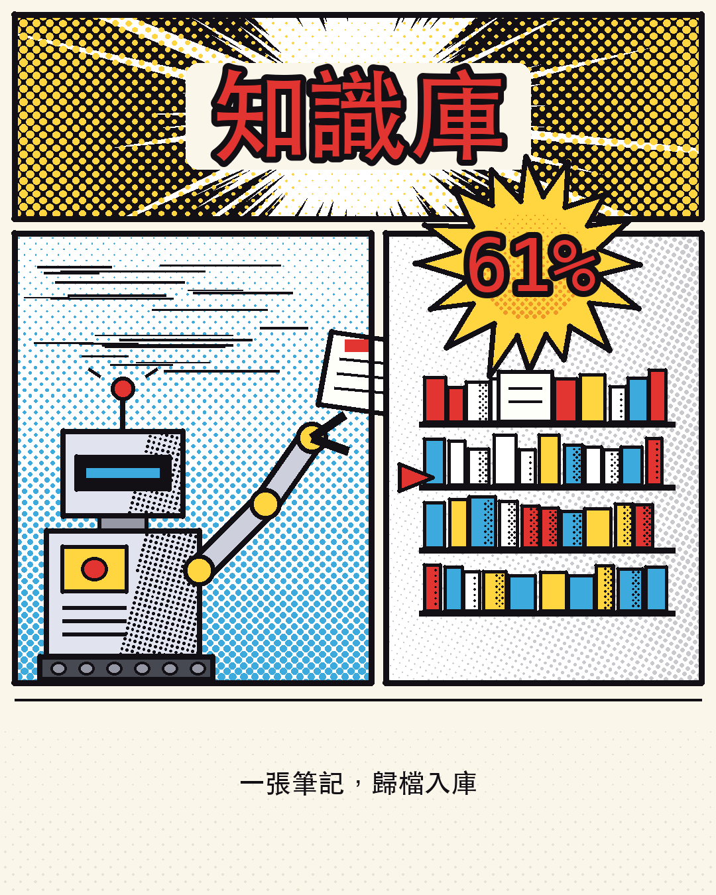

# 漫畫網點

## 一句話
粗黑描邊、平塗原色、網點做陰影與漸層、放射集中線與分格，讓每個畫面像一頁印刷漫畫，重點一眼跳出來。

## 適合與不適合的題材（3–5 條）
- 適合：一個大數字或一句結論要「砸」進觀眾眼裡（61%、3 倍、第 1 名）。
- 適合：流程有明確的「誰把什麼放到哪裡」動作，分格天然能拆成因與果。
- 適合：需要年輕、有衝擊力的社群開場，或把嚴肅主題變輕鬆的科普。
- 不適合：需要精確讀數的密集圖表（網點與粗線會吃掉細節）。
- 不適合：沉穩、高級、留白很多的企業形象片；需要真實感或柔和漸層的題材。

## 氣氛
熱鬧、直接、帶一點復古印刷感。聲量大，但靠格線與留白維持秩序。

## 用程式畫的難度與限制（低／中／高；哪些部分需要圖像生成模型或手繪素材才做得好）
難度：中。粗描邊、網點、集中線、爆炸框都可用 PIL 程序化畫出，且風格容忍幾何感。
限制：人物表情與手繪墨線的「筆壓變化」程式做不出來，本風格以機器人與物件為主角；擬真的紙張紋理、印刷錯位（套色偏移）要靠素材或手動加偏移；複雜透視場景需手繪。

## 指標畫法（這個風格公認的正統做法，寫成 5–8 個可以照做的步驟，例如上色順序、線條方向、分版套色、明暗層數；具體到參數）
1. 先分格：外框 22px 紙色溝，格框描邊 9px（約畫面寬 0.8%）；標題格約佔高 25%，主場景格兩欄並排。
2. 平塗底色：每個物件只填一個主色（原色或灰），不做漸層，先填色再描邊。
3. 描邊：墨色 #121014，主輪廓 7–8px，內部細節 4–6px，轉角用圓頭接點，線寬一致。
4. 陰影用網點不用漸層：點格旋轉 45°（物件陰影用 15°，環境用 30° 錯開），物件陰影點距 8px、半徑 1.0–2.8px，只蓋在背光側（右下）。
5. 背景網點：點距 10–14px，半徑隨位置從 0.5 漸增到 5–6px，做出由淡到濃；同一畫面最多三種點色與角度。
6. 集中線：從標題中心向外放射 150–180 條細楔形，內徑 150px 起，被格框裁切，墨色填。
7. 速度線：水平平行線 2–4px、長 60–220px，只畫在移動物體後方。
8. 重點爆炸框：16 角星形，內半徑約 0.6 倍外半徑，黃底加橙色小網點，數字紅字＋墨色外框 9px。

## 代表畫家、設計師與作品（5–8 位：人名（原文＋常用中譯）、年代與地區、1–2 件代表作、這個風格要向他學什麼。只列你有把握的事實；任何不確定的作品名或年份，在該行結尾標「（待查證）」，寧可少列也不要編造）
- Roy Lichtenstein（羅伊·李奇登斯坦），1923–1997，美國：《Whaam!》（1963）、《Drowning Girl》（1963）。學：把網點當成「顏色與陰影的單位」、三原色加黑線的克制配色。
- Benjamin Day（班傑明·戴伊）發明的 Ben-Day dots 印刷網點技法，19 世紀末美國：學：點格規則排列、點徑決定明暗，而非手繪排線。
- 手塚治虫（Osamu Tezuka），1928–1989，日本：《原子小金剛／Astro Boy》（1952 年起連載）。學：機器人以簡單幾何構成、輪廓乾淨可辨。
- 鳥山明（Akira Toriyama），1955–2024，日本：《Dr. スランプ》（1980 年起）、《七龍珠》（1984 年起）。學：機械與道具的圓潤造型、清楚的黑線與乾淨塊面。
- 大友克洋（Katsuhiro Otomo），1954–，日本：《AKIRA》（1982 年起連載）。學：機械細節密度、速度線與構圖的衝擊力。
- Jack Kirby（傑克·科比），1917–1994，美國：《Fantastic Four》（1961 年起，與 Stan Lee 合作）。學：誇張透視、粗壯輪廓、能量爆發的視覺語言。
- Scott McCloud（史考特·麥克勞德），1960–，美國：《Understanding Comics》（1993）。學：分格之間的時間與因果轉換、格距與節奏。
- Hergé（埃爾熱），1907–1983，比利時：《丁丁歷險記》系列（含《藍蓮花》，約 1934–1935 年連載）。學：等粗清晰線與平塗色的清楚傳達。（待查證）

## 配色與色階（表格：角色｜色碼｜用途；每個主要顏色列出陰影／主色／亮面／高光；一個畫面最多幾色；強調色怎麼用。色碼必須和 sample.py 一致）
一個畫面：墨色＋紙色＋最多 3 個彩色（紅、黃、青），灰色只做中性。強調色只給最重要的一個元素（紅用在標題字與 61%）。

| 角色 | 色碼 | 用途 |
|---|---|---|
| 墨色（陰影） | #121014 | 描邊、陰影網點、集中線 |
| 紙色（底） | #FAF6EA | 畫面底、溝、字底 |
| 白（高光） | #FFFFFF | 格內底、書脊、卡片 |
| 紅（主色） | #E23430 | 標題與數字字色、機器人指示燈、箭頭 |
| 黃（亮面） | #FFD640 | 標題網點、爆炸框、關節、胸前面板 |
| 橙（黃的陰影網點） | #F09628 | 爆炸框內小網點 |
| 青（主色） | #3CAADC | 主場景背景網點、機器人掃描光條 |
| 機器人本體 | #E1E4EE | 機身、頭 |
| 機械臂 | #CDD0DC | 手臂 |
| 履帶深灰 | #464852 | 履帶 |
| 中性灰網點 | #C8C8CD | 知識庫格背景網點 |

## 光源、陰影與體積
光從左上來；背光側（右與下）用墨色小網點填，不用平滑漸層。體積只靠「亮面平塗＋右側網點陰影」兩層表達，不加第三層。物件不投影到地面。

## 線條、描邊與邊緣（粗細以畫面寬度的比例表示）
- 格框 9px（0.83%）；物件主輪廓 7–8px（約 0.7%）；細節與書脊 4–6px（0.4–0.5%）；標題字外框 9px。
- 線寬統一、轉角圓頭；不用抗鋸齒外的柔邊；不使用漸細筆觸（集中線例外）。

## 質感與筆觸（具體參數：密度、大小、透明度、方向）
- 網點：全不透明，點距 8–16px，半徑 0.4–6px，方向 15°／30°／45° 依層次錯開。
- 網點密度隨位置漸變（由淡到濃），不用透明度。
- 速度線不透明、水平；集中線不透明、放射。
- 底部留白區用極淡網點（點距 16px、半徑 0.4–1.6px、色 #E8E2D2）。

## 細節密度、格線與比例（主體佔畫面多少、留白比例）
標題格約 25% 高，主場景兩格約 52% 高（左 50%、右 50% 寬），爆炸框與數字約 15% 高並壓在格框上。底部 22% 保持平靜：只有淡網點、一條細線、一行說明。每格只放一個主角。

## 字體搭配與字級（中文／數字／英文的字體性格；標題、標籤、大數字佔畫面高度的比例）
- 中文標題：STHeiti Medium，約 150px（高 11%），紅字＋墨色外框 9px。
- 大數字：Menlo 粗感，約 110px（高 8%），紅字＋墨色外框 9px，放在黃色爆炸框內。
- 說明：STHeiti Medium 40px，墨色，無外框。
- 中文字型限用 STHeiti Medium 或 Hiragino Sans GB，並逐字確認沒有缺字。

## 動態性格（怎麼動才對味：幀率、緩動、進出場、鏡頭；不該怎麼動）
- 以 12 fps 為主（一拍二），像漫畫格切換，動作用「定格＋瞬間變化」。
- 分格依序「砰」地出現（0.1 秒內彈出，過衝 5%），不要淡入。
- 爆炸框彈出時整畫面抖 2–3 幀（振幅 4–8px）。
- 速度線與集中線可逐幀換隨機種子閃爍。
- 鏡頭用硬切到特寫格；不要平滑長推拉、不要慢淡出。

## 元件清單（知識影片常用的 14 個元件在這個風格下怎麼畫，各一句：主角 Agent、筆記卡、知識庫、資料夾、大數字牌、長條圖、箭頭、勾與叉、路徑或地圖、時間軸、對話框字幕、章節標示、人群或多個物件、背景）
- 主角 Agent：方頭方身機器人，履帶、頭部暗色視窗加單條光條、天線紅燈、機械臂，不畫臉。
- 筆記卡：白底粗描邊的斜放矩形，三條墨線加一條紅色標籤。
- 知識庫：多層書架，書脊用紅黃青白平塗，部分加網點陰影。
- 資料夾：黃色平塗夾片，描邊 6px，標籤處加紅條。
- 大數字牌：黃色爆炸框加紅字墨框數字。
- 長條圖：粗描邊平塗長條，每條右側加網點陰影，數字用爆炸小標。
- 箭頭：實心紅三角加墨框，或粗墨線加三角頭。
- 勾與叉：粗墨框的圓角方塊，勾用青、叉用紅，筆畫 10px。
- 路徑或地圖：分格間用粗虛線與箭頭連接，不畫真實地圖。
- 時間軸：連續分格橫排，格底加小序號方塊。
- 對話框字幕：白色橢圓或方形泡泡加墨框和尖尾，STHeiti 墨字。
- 章節標示：黃色矩形角標貼在格左上角，墨框，紅字。
- 人群或多個物件：重複同一形狀，錯開高度，後排只留輪廓加網點。
- 背景：紙色底，格內放單色網點漸層，標題格用集中線。

## 常見失敗與避免方式（至少 6 條）
- 網點太小太密變成髒灰：點距不低於 6px，半徑不小於 0.4px。
- 到處是網點、沒有主角：每格只讓一個區域有密網點。
- 描邊粗細不一：全片只用 3 種線寬（9／7–8／4–6）。
- 顏色超過 4 個：只用紅黃青加墨與紙。
- 主角畫成手臂或畫臉：用完整機器人與視窗光條。
- 爆炸框蓋住重要內容：爆炸框只壓在格框與留白上。
- 缺字：中文字型限定，並逐字檢查。
- 用平滑漸層與柔邊陰影：一律改為網點。

## 一定要做／一定不要做（各 5 條）
一定要做：
- 先分格再畫內容。
- 所有陰影用網點。
- 描邊墨色一致。
- 最重要元素用爆炸框或集中線強調。
- 底部留白保持平靜。

一定不要做：
- 使用平滑漸層或半透明陰影。
- 一格塞多個主角。
- 使用超過 3 個彩色。
- 讓字沒有外框而融進背景。
- 照搬任何特定漫畫的構圖、角色或招牌圖樣。

## 原創界線（這個風格可以學什麼、不可以照做什麼）
可以學：網點作為色階單位、粗描邊與平塗、集中線與速度線、分格節奏等技法。
不可以：複製李奇登斯坦的特定畫面（含其對白框與女孩構圖）、任何漫畫的角色、招牌動作姿勢與標誌性圖樣；畫面中不放品牌名；機器人與物件必須是原創造型。
