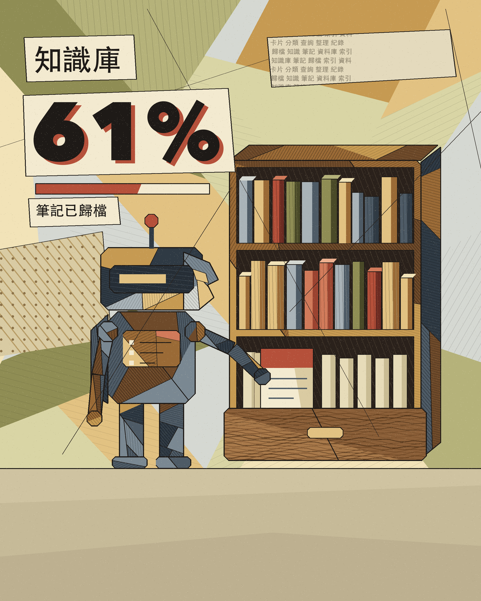

# 立體派

## 一句話
把每個物件拆成一片片平面，同時從好幾個視角（正面、側面、上方）看它並拼在一起；顏色克制在赭、灰藍、橄欖與一點磚紅，線條時斷時續，再貼上報紙、木紋紙、壁紙與模板字母等拼貼片，讓人看到「構成」而不是「寫實」。

## 適合與不適合的題材
- 適合：講「多角度看同一件事」的知識短片：觀點整合、資料來源交叉比對、系統架構的拆解、前因後果同時呈現。
- 適合：靜物般的物件組合（機器人、書櫃、卡片）；剛好能被拆成多個面。
- 適合：需要報紙、文字拼貼感的主題（媒體、資訊、檔案、知識庫）。
- 適合：手機 4:5 海報，色塊大、輪廓硬，縮小後仍有結構感。
- 不適合：需要溫暖情感與人物表情的題材。
- 不適合：需要精確比例的操作示範與 UI 截圖；形體被刻意扭曲，會誤導。
- 不適合：兒童向或需要柔和氣氛的內容。

## 氣氛
像 1910 年代巴黎畫室裡一張被拆開重組的靜物：色調沉靜偏褐，線條銳利，資訊像報紙碎片散落；理性、有點冷，但拼貼的紙感與木紋又帶一點手作的溫度。

## 用程式畫的難度與限制
難度：中。幾何與多邊形最適合程式，核心是「多邊形切割」與「有節制的隨機」；樣張約 1 秒（2 倍超取樣後縮小）。
限制：
- 隨機切割容易失控：切線角度必須限制在少數幾個值（`ANG`），平面數量與最小面積要設門檻，否則變成碎玻璃。
- 面的明暗是任意的（多光源），但不能完全亂：同一物件至少要有一組明、一組暗，輪廓才讀得出來。
- 物件必須仍可辨識：機器人的頭、軀幹、手臂、腿，書櫃的格與書，不能被切到看不出來；變形只做在「多視角疊加」上。
- 斷線（失落的邊）要有分寸：外輪廓留 90% 以上，內部邊線留約 65–80%。
- 文字拼貼片中的小字是真的中文，必須用 STHeiti Medium 並過 `check_glyphs()`；大數字與標題放在奶油紙片上，保證可讀。
- 動畫時多邊形切割的種子必須固定，只讓個別平面平移或換色，不可每幀重切。

## 指標畫法
1. 先定色票：赭（OCH）、灰藍（GRY）、橄欖（OLV）、磚紅（BRK）各五階，加炭黑 `1E1A17` 與奶油紙 `F3EAD0`。磚紅只用在書、卡片標頭、天線與數字影子。
2. 背景：整個天空區切成約 22 個大平面，用赭、灰、橄欖的淺階（亮 3–4 階為主），少量斜線排線；對比刻意低，好讓主體跳出來。
3. 物件逐一做成「平面疊」：先用 `facets()` 沿 `ANG` 的五個角度切成 2–5 片，每片從色階任挑一階（相鄰兩片不同階），暗片大機率加排線，亮片偶爾加點彩（`stipple`）。
4. 多視角：頭畫正面再疊一個側面楔形（鼻突般的多邊形）並重複感測燈；軀幹左側加一片較暗的側面平行四邊形；書櫃除了正面，另畫從上方看的頂面與從右側看的側面；每本書分書背與書口兩面，部分加頂面。
5. 邊線：每片用炭黑線描邊但隨機漏掉約 15–35% 的線段（passage，失落的邊），外輪廓漏得較少；整張再拉幾條細長斜線穿過物件與背景。
6. 合成式拼貼片：壁紙（斜條與圓點）貼在左側；抽屜前板是木紋紙（波浪紋）並被斜線切成兩個紋路方向；報紙片貼在右上，寫滿真的小字；標題、大數字、標籤各貼一張奶油紙片。
7. 大數字：先印一份磚紅的偏移影（右下 9,7）再印炭黑的字，是「兩個視點」的重影，也像模板字母的錯位。
8. 底部約 22% 只有三塊幾乎同色的平面與一條地平線，不放物件、不排線；最後撒一層細小的紙粒與畫布點。

## 模範學習
### Pablo Picasso（1881–1973，西班牙，主要活動於法國；此處僅取原則）
為什麼學他：他與布拉克一起建立了「把物件拆成平面並同時呈現多個視角」的方法，並在 1912 年前後把現成材料帶入畫面（一般視《藤椅靜物》為第一件拼貼，先後次序仍有爭議）。
可以照做的規則：
1. 把物件拆成幾個平面，每個平面獨立上色，不求自然的光影連續。
2. 同時畫出正面與側面：一個頭可以正面加側面並存。
3. 色彩克制：用赭、灰、褐為主，少量對比色當「錨點」。
4. 讓邊緣有時斷、有時連，平面之間互相滲入（passage）。
5. 用文字、數字、模板字母當作畫面元素，而不只是說明。
6. 允許把兩種材質並置（畫的與貼的）。
不要照抄：不要複製《Ma Jolie》（1911–12，紐約現代藝術博物館）的女子與樂器格網，也不要複製《亞維農的姑娘》的人物構圖與面孔造型，更不要重畫具名的吉他或小提琴靜物。
檢查表：
- 每個主體都至少有兩個視角嗎？
- 色票是否限制在四個色相以內？
- 平面的明暗是否不遵守單一光源，但仍讀得出形體？
- 有沒有文字或字母被當成造型使用？

### Georges Braque（1882–1963，法國）
為什麼學他：他把材質與紙拼貼系統化，色調比畢卡索更柔和、結構更安靜，適合做「質感」。
可以照做的規則：
1. 用仿木紋紙、壁紙等現成圖案貼進畫面，並與畫的部分接合。
2. 把一個物件的邊線在別處延續（長斜線穿過），讓物件與背景相連。
3. 色調以褐、灰、橄欖為主，亮面小心留白。
4. 先立結構，再貼質感：先切平面，後加紙。
5. 用細密排線建立暗面，而不是加深整塊顏色。
不要照抄：不要複製《水果盤與玻璃杯》（Fruit Dish and Glass，1912，一般視為其第一件 papier collé）的構圖與木紋紙配置，也不要複製《小提琴與燭台》（Violin and Candlestick，1910，舊金山現代藝術博物館）的物件排列。
檢查表：
- 木紋紙是否被斜線分成兩個方向？
- 有沒有至少一條線穿過物件與背景？
- 暗面是排線而不是整塊塗黑嗎？

### Juan Gris（1887–1927，西班牙，活動於法國）
為什麼學他：他是比較「清楚」的立體派，平面乾淨、分工明確、色彩較明亮，適合做出可讀的資訊畫面。
可以照做的規則：
1. 先用乾淨的幾何分區，再填色，每區邊界明確。
2. 物件的每個面獨立明暗，但整體光影有節奏（例如左亮右暗為主、偶爾反轉）。
3. 用紙片類元素（報紙、標籤）承載文字，讓文字留在乾淨的矩形上。
4. 色彩比分析式立體派更鮮明，但仍限制在少數色相。
5. 讓一兩個物件的細節比其他更清楚（這張是大數字與抽屜前板）。
不要照抄：不要複製《畢卡索肖像》（Portrait of Pablo Picasso，1912，芝加哥藝術博物館）的人物、藍褐色調與調色盤構圖。
檢查表：
- 文字是否都在乾淨的紙片矩形上？
- 邊界是否清楚、分區明確？
- 資訊（61%、知識庫）是否是整張最清楚的部分？

## 代表畫家、設計師與作品
- Pablo Picasso（畢卡索）：1881–1973，西班牙。《Ma Jolie》（1911–12，紐約現代藝術博物館，分析式立體派）、《藤椅靜物》（Still Life with Chair Caning，1912，常被視為第一件拼貼）。學他的拆平面、多視角與拼貼。
- Georges Braque（喬治・布拉克）：1882–1963，法國。《小提琴與燭台》（1910，舊金山現代藝術博物館）、《水果盤與玻璃杯》（1912，一般視為第一件 papier collé）。學他的質感拼貼與克制色調。
- Juan Gris（胡安・格里斯）：1887–1927，西班牙。《畢卡索肖像》（1912，芝加哥藝術博物館）。學他清楚的分區與較明亮的綜合式風格。

## 配色與色階
色碼以 `sample.py` 為準。

| 角色 | 色階（暗→亮） | 用途 |
|---|---|---|
| 赭 OCH | 6E4A2A 9A6A36 C69A52 E2C282 F2E3B8 | 書櫃、機器人暖面、背景亮平面 |
| 灰藍 GRY | 2F3A44 4E5B66 7A8892 A9B3B8 D5D8D2 | 機器人主色、書、背景冷平面 |
| 橄欖 OLV | 4A4A28 6E6D3A 8F8D54 B5B27A D9D5A5 | 背景、書 |
| 磚紅 BRK | 6B2B22 9B4330 B5503A D17A5A EDB08F | 卡片標頭、進度條、數字影、天線、書（少量） |
| 炭黑 INK | 1E1A17 | 輪廓、字、排線 |
| 奶油紙 CREAM | F3EAD0 | 標題與數字紙片、卡片、進度軌道 |
| 報紙 NEWS | E4DABD（字色 8F8670） | 右上報紙片 |
| 木紋 WOOD | A8794A；紋 5E3F22 7D5430；第二向 8C6039（紋 4F3319 6D4725） | 抽屜前板 |
| 櫃內 | 2A211B（排線 463A2E） | 格子內部 |
| 護目鏡 | 262E36（排線 4E5B66） | 機器人頭部深色帶 |
| 壁紙 | D9CBA3；斜紋 B79C66；圓點 8C7248 | 左側拼貼片 |
| 地面 | CFC3A1 C6BA98 BDB090 | 底部三塊平面 |
| 索引卡 | E7DCB9 C9BC94 | 抽屜內其他卡片 |
| 卡片殘影 | D6C79B（線 6B5A44）；下半 DACBA2 | 第二視角的卡片 |

磚紅配額：只准小面積；赭與灰藍各佔主體的一半，橄欖只留給背景與書。

## 光源、陰影與體積
- 沒有單一光源：每個平面自己決定明暗，同一物件的明暗交錯，但保留「一邊整體偏暗」的趨勢才看得出體積。
- 體積靠平面的轉折與排線，不用漸層、不用柔邊。
- 不畫投影；物件與地面的關係只靠地平線與底部平面。
- 暗面用排線（間距約 9–12px）而不是塗黑。
- 大數字與標題不加投影，只有磚紅偏移重影。

## 線條、描邊與邊緣
- 炭黑線，粗 1.5–3px（在 2 倍畫布上 3–6px）；外輪廓較粗，內部平面邊較細。
- 內部線段隨機漏掉約 20–35%（失落的邊），外輪廓只漏 8% 左右。
- 長斜線細（約 1px）穿過物件與背景，連接畫面。
- 邊角是切角（八邊形的倒角），不用圓角。
- 不用發光與模糊。

## 質感與筆觸
- 沒有筆觸，只有平面、排線與紙材質：木紋（波浪線）、壁紙（斜紋加圓點）、報紙（真字）、點彩（`stipple`）。
- 最後一層紙粒：約 2.6 萬個細小點，三種近似色，極輕。
- 繪製用 2 倍畫布再縮小，邊緣乾淨。
- 排線方向取自 `ANG` 的五個角度，與切線一致。

## 細節密度、格線與比例
以 1080×1350（4:5）為準：
- 地平線 y=1052，下方約 22% 只有三塊近同色平面。
- 標題 66px、大數字 184px（Avenir Next Heavy）、標籤 32px，左邊界約 74px，各貼奶油紙片。
- 機器人高約 556px（含天線）；書櫃 430×670，加頂面與右側面；抽屜前板 y 從 917 起。
- 背景平面約 22 個；機器人每個部件 2–5 片平面；書約 25 本。
- 主體不超過 4 個，拼貼片 4 張（壁紙、報紙、標題紙、數字紙）。

## 字體搭配與字級
- 中文只用 STHeiti Medium，所有中文（含報紙小字）先過 `check_glyphs()`，缺字會報錯。
- 數字用 Avenir Next Heavy（index 8），像模板字母；炭黑字加磚紅偏移重影。
- 標題 66px、標籤 32px 炭黑；報紙小字 15px、淺灰褐色，只當質感。
- 所有主要文字都在奶油紙片上，確保可讀。

## 動態性格
- 節奏：階梯式、機械式，24fps 以 ease-in-out 與線性為主，不用彈跳。
- 平面「滑入」：每個平面沿其切線方向平移進場，依序拼成物件，每片 3–5 幀。
- 拼貼片「貼上」：紙片從側邊滑入並輕微旋轉到定位，最後貼上炭黑邊線。
- 視角切換：頭的正面與側面輪流微微位移（相位差），表現「同時看見多個視角」。
- 鏡頭：水平緩慢推移或輕微旋轉 1–2 度。
- 不該：不要每幀重新切割平面，不要使用柔和淡入淡出以外的光效。

## 元件清單
以下函式都在 `sample.py`。
- 多邊形切割：`facets()`，沿 `ANG` 五個角度把多邊形分成平面，用 `clip()` 做半平面裁切。
- 平面疊：`plane_stack()`，每片挑一階、必要時排線或點彩，並描邊（含漏線）。
- 排線：`hatch()`，裁切在單一平面內的平行線。
- 點彩：`stipple()`，淺色小點，用在亮面。
- 漏線描邊：`edges()`，隨機略過某些線段。
- 木紋紙：`wood()`，波浪紋，抽屜前板用。
- 報紙片：`collage_text()`，裁切在多邊形內的真實小字。
- 倒角矩形與多邊形轉換：`chamfer()`、`to_polys()`，把圓角與線段轉成切角多邊形。
- 背景：約 22 個平面加一張壁紙片。
- 機器人：灰藍與赭的平面疊，正面頭加側面楔形、軀幹加側面平面，護目鏡加感測燈，無五官。
- 筆記卡：正面卡片加偏移殘影卡片；抽屜前板蓋住下半張表示已放入。
- 書櫃：正面、頂面、右側面三視角；書分書背與書口，部分有頂面。
- 數字與標題：奶油紙片加炭黑字，大數字另有磚紅偏移重影。
- 進度膠囊：奶油軌道加磚紅斜切填色，炭黑邊。

## 常見失敗與避免方式
- 失敗：切割太碎，變成碎玻璃。避免：限制平面數與最小面積，切線只用 `ANG` 的五個角度。
- 失敗：物件被切到看不出來。避免：外輪廓保留、內部平面最多 5 片，部件的明暗至少有一組亮與一組暗。
- 失敗：顏色太多、太鮮豔，失去立體派的沉靜。避免：只用四個色相，磚紅只准小面積。
- 失敗：所有線段都畫出來，像線稿填色。避免：內部線段漏掉 20–35%。
- 失敗：把毫無關係的圖案隨便貼上去。避免：每個拼貼片都承載資訊（標題、數字、標籤、報紙）或材質（壁紙、木紋）。
- 失敗：文字壓在平面或排線上讀不出來。避免：重要文字一律貼在奶油紙片上。
- 失敗：直接照畫畢卡索或布拉克的名作構圖（吉他、小提琴、女子肖像）。避免：只取原則，主體用自己的機器人與書櫃。
- 失敗：動畫每幀重切平面造成閃爍。避免：固定種子，平面只平移或換色。

## 一定要做／一定不要做
一定要做：
- 每個主體至少兩個視角。
- 平面的切線角度限制在少數幾個值。
- 內部線段要有漏線，外輪廓大多完整。
- 保留至少一種拼貼材質（木紋、報紙或壁紙）。
- 底部約 22% 保持平靜。
一定不要做：
- 不要使用漸層、模糊或柔和投影。
- 不要把物件切到無法辨識。
- 不要使用超過四個色相。
- 不要把重要文字放在花紋之上。
- 不要在圖中放品牌名稱或商標，也不要照畫他人名作。

## 原創界線
可以學：拆平面、多視角、限制色票、斷線、拼貼材質與模板字母的運用。
不可以：照抄《Ma Jolie》《亞維農的姑娘》《畢卡索肖像》《水果盤與玻璃杯》等的構圖與母題（吉他、小提琴、人物臉孔、格網式人像）；不得使用他人商標或品牌；機器人、書櫃、卡片造型必須自行設計。
