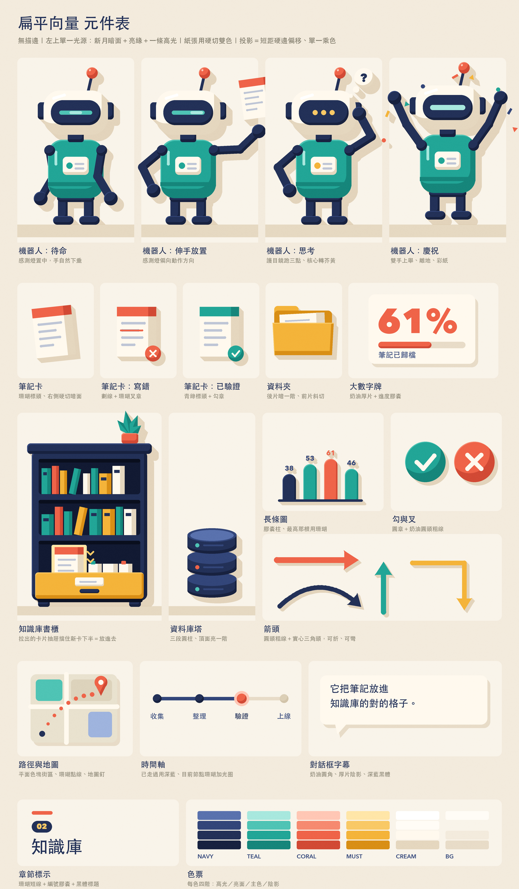

# 扁平向量

## 元件庫

`components.py` 是可以直接 import 的元件函式庫（`from components import *`），畫面由 `sample.py` 組合；所有中文字都經過 `Layer.text()`，它會先跑 `check_glyphs()`，缺字會直接報錯。

## 一句話
用純幾何色塊（圓角矩形、圓、膠囊）與四階色階堆出物件，不描邊、不漸層，只靠左上光源的「新月形暗面」與短距硬邊的 45 度偏移陰影，做出現代科普片那種乾淨、友善、像紙一樣的畫面。

## 適合與不適合的題材
- 適合：AI、軟體、流程、組織與管理等抽象概念的科普解說，用機器人、卡片、櫃子、箭頭就能講清楚。
- 適合：數字與比例為主角的知識卡（大數字、進度條、長條圖）。
- 適合：手機 4:5 動態貼文，輪廓簡單、縮小後仍然辨識得出來。
- 不適合：需要寫實質感的題材（食物、皮膚、織品、建築材質）。
- 不適合：需要細膩表情與情緒演出的人物故事；此風格的人物要靠姿勢與道具，不靠臉。

## 氣氛
明亮、溫暖、可信賴，像一本設計精良的兒童科學書。中性偏暖的紙色底配深藍、青綠、珊瑚、芥黃，沒有壓迫感，資訊感強但不冷。

## 用程式畫的難度與限制
難度：低到中。幾何形與色階完全可以用 PIL 或 Canvas 程式畫，是最適合程式生成的風格之一；`components.py` 已把常用元件寫成函式，直接組合即可。
限制：
- 有機形狀（真實的人、動物、植物葉脈）程式畫會僵硬，要簡化成幾何，或用手繪向量素材。
- 投影是「輪廓朝 45 度掃出去再取聯集」，用倍增位移（1、2、4…px）幾次就算完，不貴；但仍建議預先算成圖，逐格動畫時只重算會動的圖層。
- 現有元件的姿勢有限：機器人只靠手臂變化，身體不傾斜、腳不跨步；卡片是靜止直立的，「往下推」要動畫補卡片下降與抽屜回彈。
- 只用 2 倍超取樣（`S = 2`），放大看時細線邊緣略軟；要輸出 4K 可以把 `S` 改成 3。
- 要避免「看起來很模板」，靠的是比例、留白與少量刻意的不規則（歪斜的書、錯落的圓點），這需要人調。

## 指標畫法
1. 先定色票：一個紙色底（BG）、獨立的地面色階（FLOOR）＋四個色相（深藍、青綠、珊瑚、芥黃）＋奶油紙白，每個色相四階（陰影、主色、亮面、高光）。整個畫面最多 6 個色相。
2. 先畫大色塊：底色填滿，右上角先切一個青綠高光階的大三角形（(520,0)、(1080,0)、(1080,600)），一個日暈圓（PINK 主色階，半徑約畫面寬 33%，樣張 360px）加一個同心的小圓（芥黃高光階 FFE6A8，260px），圓心對準「動作」，也就是機器人頭到卡片之間，不要放在單一物件後面；地面用 FLOOR 主色整片，地平線再加一條 10px 的 FLOOR 陰影階細帶。
3. 每個物件先填主色（ramp[1]），不描邊。
4. 暗面：把物件輪廓往左上位移（短邊 ×0.55 橫向、×1.0 縱向，位移量為短邊的 17–30%），用原輪廓減去位移後的輪廓，得到右下新月形，填陰影色（ramp[0]）。
5. 亮緣：輪廓往右下位移 2.5–3.5px 後相減，得到左上極細亮邊，填亮面色（ramp[2]）；只給圓角大物件，小物件可省。
6. 高光：每個大形狀左上內側放一條約 10px 寬的圓頭短線，用高光色（ramp[3]），一個物件最多一條。
7. 平面物件（書脊、卡片、標籤）不用新月，改成「硬切雙色」：右側約 20–36% 用陰影色，沒有漸層（卡片 20%、書脊 36%）。
8. 投影：整層輪廓朝右下 45 度掃出 20–26px（物件）或 10–12px（UI 厚片），扣掉物件自己，用一個乘色（`TINT` E9DECD）整片壓暗，硬邊、不模糊、不漸淡，只投在地平線以上的牆面；站在地上的物件另加一條高 12px 的接地膠囊（乘色 DECEB6）。最後整張疊一層細顆粒（雜訊 σ18、overlay 混合 7%）。
9. 表現「放進去」要靠遮擋：新卡片畫在抽屜內部之後、抽屜前板之前，讓下半張被前板蓋住；卡片後面墊一塊亮芥黃（FFE6A8）的格位底，旁邊加兩個芥黃的向下 V 字表示動態。`kb_shelf(insert=...)` 用回呼確保圖層順序正確。不要只靠點線或箭頭示意。

## 模範學習

### Charley Harper（查理・哈柏）（1922–2007，美國辛辛那提）
為什麼學他：他自稱「極簡寫實」（minimal realism），把動物與生態化約成最少的幾何形，正是扁平向量把機器人與書櫃化約成膠囊與矩形的方法。

可以照做的規則：
1. 數翅膀、不數羽毛（見 Audubon〈Counting the Wings〉）：每個物件只留辨識所需的特徵。書櫃每排只放 5–6 本寬書（寬 44–60px），不加書脊標籤帶、不斜靠，樣張就是這樣刪的。
2. 用圓、矩形、三角三種基本形組物件；同一物件內不超過 3 種形狀，形與形之間靠色階分開，不描邊（《The Giant Golden Book of Biology》，1961）。
3. 重複即節奏：同形、同寬的書脊一路排開，間隔固定，用顏色交替（青綠、芥黃、奶油、珊瑚）產生韻律，而不是用細節。
4. 正負形並用：日暈圓與地面、牆面都是平整色塊，留白當作形狀的一部分，不補紋理。
5. 每個形狀都是平塗硬邊；體積只靠一層暗面，不用漸層。
6. 強調色只給一個焦點（樣張是珊瑚大數字），其餘色塊讓位。

不要照抄：他的鳥、昆蟲、動物擬形（如以圓與三角組成的鳥身）、Ford Times 系列的具體構圖；只學化約的方法。

檢查表：
- 任何一個物件能不能再刪掉一個形狀仍認得出來？（不行才算到位）
- 同類重複物件（書脊）是否同寬度級距、同間距？
- 是否全程無描邊、無漸層？
- 珊瑚大面積是否只有一處？

### Saul Bass（索爾・巴斯）（1920–1996，美國）
為什麼學他：他把剪紙般的硬邊形狀、極少的顏色與不對稱的張力做成標誌性海報與片頭，讓扁平色塊有「剪出來」的力道。

可以照做的規則：
1. 形狀要像用剪刀剪出來：邊緣是直線或單一圓弧，轉角銳利。樣張右上角用一個大三角形（頂點 (520,0)、(1080,0)、(1080,600)）切出牆面，不用小碎片。
2. 一個畫面只主打 2–3 色（《Anatomy of a Murder》1959 的片頭只有灰、黑、白）；樣張以奶油牆、深藍、珊瑚為主，青綠、芥黃、粉色退到小面積。
3. 不對稱構圖：重量放一邊（右側櫃子與三角形），另一邊用大數字平衡；避免置中、對稱。
4. 用一條強斜線帶動視線：機器人的手臂是畫面唯一的長斜線，從左下指向抽屜；背景的三角斜邊與它呼應但不平行（《The Man with the Golden Arm》1955 的剪紙手臂以斜線當主角）。
5. 大形狀要大到被裁切：背景三角形、日暈圓都被畫面邊緣或櫃子切掉一部分，而不是整個放進畫面。
6. 圖形即訊息：卡片被遮擋進抽屜的方式本身就是「放進去」，不加說明箭頭以外的圖示。

不要照抄：他的剪紙手臂、螺旋、人體部位剪影與經典海報的構圖與配色組合。

檢查表：
- 背景是否有至少一個大面積、直邊、被畫面邊緣裁切的形狀？
- 構圖重量是否明顯偏一側而非置中？
- 主色是否不超過 3 個，其餘只佔小面積？
- 有沒有一條貫穿畫面的主斜線？

### Mary Blair（瑪莉・布萊爾）（1911–1978，美國，生於奧克拉荷馬州 McAlester）
為什麼學她：她為迪士尼《Cinderella》（1950）、《Alice in Wonderland》（1951）與《Peter Pan》做色彩設計，並為 1964 年「小小世界」留下概念畫，以意想不到的配色與把場景壓成色塊的能力聞名。

可以照做的規則：
1. 配色要有一組「意外但和諧」的搭配：粉色圓盤、淺芥黃內圈、青綠機器人、深藍櫃子；彩度高但明度接近的色塊並置（樣張以粉色日暈取代原本的桃色）。
2. 背景不寫實：日暈圓、色塊只表示「這裡是知識空間」，不畫窗、牆線、透視。
3. 少量重複的小圖案增添童趣：芥黃 V 字、書脊色條、卡片小標籤，成組而小（≤8 個裝飾）。
4. 形狀平面、略帶玩具感：圓角統一，無厚度透視。
5. 冷暖色塊成對出現：粉對青綠、芥黃對深藍，讓相鄰的兩塊在色相上互補而不是同色階。
6. 保留大面積純色當呼吸空間，下方 22% 的地面維持單一暖米色。

不要照抄：「小小世界」的各國兒童造型與樂園建築、她的《Cinderella》《Alice》角色與場景構圖，以及她的具體色票。

檢查表：
- 是否有一組讓人「沒想到但很搭」的色塊相鄰（如粉與青綠）？
- 背景是否只有色塊、沒有透視或寫實細節？
- 裝飾是否成組、小面積且 ≤8 個？
- 相鄰色塊是否冷暖或色相對比，而不是只差明度？

## 代表畫家、設計師與作品
- Paul Rand（保羅・蘭德）：1914–1996，美國。兒童書《Little 1》（1962，與 Ann Rand 合作）、IBM 商標。學他把物件化約成最少的幾何，並用色塊的位置而不是細節來講故事。
- Saul Bass（索爾・巴斯）：1920–1996，美國。電影《迷魂記》（Vertigo, 1958）片頭、《Anatomy of a Murder》（1959）海報與片頭。學他用剪紙般的硬邊形狀與極少的顏色，建立強烈的視覺記憶點。
- Mary Blair（瑪莉・布萊爾）：1911–1978，美國。迪士尼概念美術、「小小世界」（it's a small world）遊樂設施設計（1964）。學她大膽而意想不到的配色，與把繁複場景簡化成色塊的能力。
- Otl Aicher（奧圖・艾舍）：1922–1991，德國。1972 慕尼黑奧運視覺識別與運動圖示。學他用嚴格的格線與一致的圓角幾何，讓一整套圖示像出自同一把尺。
- Charley Harper（查理・哈柏）：1922–2007，美國。《The Giant Golden Book of Biology》（1961，Golden Press）。學他的「最少形狀的寫實」：用圓、三角與弧線抓住動物的特徵，不畫多餘細節。
- Malika Favre（瑪莉卡・法芙）：1982 年生，法國出生，現居西班牙巴塞隆納。為《紐約客》繪製的封面，如 2019 年春季時尚特刊封面（以 Frida Kahlo 的造型為靈感）。學她用正負形與大面積純色做出高對比的圖像。
- Kurzgesagt – In a Nutshell：2013 年起，德國慕尼黑的動畫工作室。《The Egg》（2019）。學他們把抽象科學概念變成友善、色彩飽和的扁平角色與場景，以及穩定一致的動態節奏。

## 配色與色階
一個畫面最多 6 個色相（底色、深藍、青綠、珊瑚、芥黃、奶油紙白）。色碼以 `components.py` 為準。

| 角色 | 陰影 | 主色 | 亮面 | 高光 | 用途 |
|---|---|---|---|---|---|
| 底色 BG | E8DCC8 | F3EBDD | F9F4EA | FFFCF6 | 牆面背景；陰影階用在進度條軌道與平板影 |
| 地面 FLOOR | DCCDB3 | E6D9C2 | EEE4D2 | F6EFE2 | 地面整片用主色，地平線 10px 細帶用陰影階 |
| 日暈 PINK（Blair 配色） | F0A9A4 | F7C3BC | FBD8D2 | FDEAE6 | 背景外圈大圓用主色；內圈用芥黃高光階（FFE6A8）。原桃色 SUN 階不再用在樣張 |
| 剪紙大三角 | — | A8E8DE | — | — | 右上角單一三角形（TEAL 高光階），Bass 式硬邊切面 |
| 深藍 NAVY | 182240 | 233158 | 33467A | 5A72AE | 知識庫櫃體、機器人腿與手與護目鏡、標題文字 |
| 青綠 TEAL | 16867B | 22A697 | 4FC4B5 | A8E8DE | 機器人身體、書、植物、感測燈、驗證勾 |
| 珊瑚 CORAL | D24A35 | EF6449 | F68A70 | FFC7B5 | 大數字、卡片標頭、天線燈、花盆、目前節點（強調色） |
| 芥黃 MUST | D98F16 | F4B43A | F9C966 | FFE6A8 | 書、格位底、動態 V 字、裝飾圓點與三角 |
| 奶油 CREAM | E5D7BF | FFF9EE | FFFCF6 | FFFFFF | 機器人頭殼、筆記卡、書 |
| 卡片文字線 INK | — | BFC6D6 | — | — | 卡片與面板的文字線 |
| 格子內部 HOLE | — | 121A33 | — | — | 書格與抽屜內部，比櫃框更暗，書和卡片才會跳出來（格子頂端再加一條 0A0F1E 的暗帶） |
| 陰影乘色 TINT | — | E9DECD | — | — | 所有物件投影（乘色，約壓暗 9%，疊在日暈上也只是暗一階） |
| 接地影乘色 | — | DECEB6 | — | — | 接地膠囊（高 12px），乘色 |

珊瑚色配額：大面積珊瑚只給大數字；其他地方只准小面積（卡片標頭、天線燈、花盆、每排書最多一本珊瑚書、目前節點）。機器人胸口不用珊瑚圓點，因為「奶油圓盤＋紅點」在手機上會看成一隻眼睛，胸口面板的指示點只用青綠或芥黃。

## 光源、陰影與體積
- 光源固定在左上；暗面在右下，亮緣在左上，全片所有物件一致。
- 體積只靠「一層新月暗面」＋「一條亮緣」＋「一條高光」三件事，不使用漸層、不使用模糊內陰影。
- 投影是短距硬邊的 45 度偏移：物件 20–26px（機器人 22px、書櫃 26px），UI 厚片（數字牌、地圖、對話框）10–12px；單一乘色，不模糊、不漸淡、不發光，扣掉物件本身，只投在地平線以上的牆面。
- 大數字和標題不加投影，維持海報般的平面感。
- 站在地上的物件加一條接地膠囊：寬約物件的 1–1.1 倍、高 12px，中心比地平線低 4px。
- 日暈圓放在動作後面，等於幫視線打聚光燈；奶油色的機器人頭也不會跟牆面混在一起。

## 線條、描邊與邊緣
- 不描邊，這是此風格的核心。形狀之間靠色階對比分開。
- 必要的線（手臂、天線、路徑）用圓頭粗線，粗度約畫面寬的 1%–3%（10–34px / 1080）。
- 小細節（卡片文字線）粗度約 0.5%–0.75%（5–8px），用 INK 這種比底色深一點點的灰藍，不用深色。
- 圓角半徑約短邊的 25%–50%，同一畫面圓角風格一致。

## 質感與筆觸
- 只有一層顆粒：雜訊 σ18、overlay 混合 7%，方向性無，目的是破除大面積色塊的塑膠感。
- 不加紙紋、不加筆觸；日暈用兩個同心圓表現，不用漸層。
- 裝飾以稀疏的小圓、十字、三角為主，一個畫面約 6–8 個，大小 9–15px 半徑，位置避開文字與主角。

## 細節密度、格線與比例
以 1080 寬、4:5（1080×1350）為準：
- 版面：地平線 y=1052（底部約 22% 保持平靜留給字幕），標題 66px、大數字 184px、標籤 32px，左邊界 74–80px。
- 機器人 k=1：高約 556px（含天線），頭寬 228、身體寬 196；手臂兩段各 92px、粗 30px，用兩節 IK 算關節，肩與手都是深藍圓。
- 伸手極限：手到肩膀的距離不超過 184px，所以放置目標要排在肩膀高度附近（約地平線往上 260px）；這也是把抽屜放在書櫃最下層的原因。
- 書櫃 430×670；三排比例 .29 / .29 / .42，最下排是抽屜，前板從該排 60% 高度開始，左右各凸出格子 12px，看起來是「拉出來」的。
- 主要物件不超過 4 個（機器人、卡片、櫃子、大數字），其餘都是裝飾；物件之間至少留一個圓角半徑的空氣。

## 字體搭配與字級
- 中文：只用黑體（STHeiti Medium），標題深藍、66px（約畫面高 5%），上方加一條珊瑚色短橫線當章節標記。
- 數字與英文：Avenir Next Heavy（`Avenir Next.ttc` index 8），幾何感接近瑞士海報；次一級用 Bold（index 0）。不用 Hiragino Sans GB 粗體，也不用襯線。
- 大數字：Avenir Next Heavy，珊瑚色，1080 寬畫面約 184px（約畫面高 13.6%），不加投影。
- 標籤：黑體 32px（約 2.4%），深藍亮面階；一個畫面最多一句短標籤。
- 所有中文字一律經過 `Layer.text()`，缺字會直接報錯，避免方框。

## 動態性格
- 幀率 24–30fps，緩動以 ease-out-back（輕微回彈）與 ease-in-out 為主。
- 進場：形狀由小彈大（scale 0 → 1.08 → 1），錯開 3–5 幀依序進入；投影隨物件一起縮放。
- 移動：卡片沿弧線飛向櫃子，到位時有 4–6 幀的小回彈，卡片被抽屜前板蓋住的那一刻才算放進去，最後書脊亮起。
- 數字：用計數滾到 61 並同步填滿進度條。
- 鏡頭：緩慢推近 3–6%，或水平微移，不做劇烈搖晃。
- 不該：不要抖動、不要彈跳過頭、不要加模糊動態、不要改變光源方向。

## 元件清單
以下函式都在 `components.py`，各自帶完整的暗面、亮緣與硬切雙色規則。
- 主角 Agent：`robot(pose=idle|reach|think|cheer)`。青綠膠囊身體加奶油圓角頭殼、深藍護目鏡裡一條橫向感測燈（`look` 讓高光偏向動作方向），胸口一塊奶油面板（青綠或芥黃指示點加兩條文字線），天線加珊瑚燈球；無臉、無五官。思考時護目鏡換成三顆芥黃圓點並加 `thought()` 小泡泡，慶祝時離地 18px、感測燈全亮並加 `confetti()`。
- 筆記卡：`card(kind=plain|wrong|verified)`。奶油紙加標頭帶（佔卡高 19%）、四條文字線、右側 20% 硬切暗面；plain 與 wrong 用珊瑚標頭，wrong 另加珊瑚刪除線與叉章，verified 用青綠標頭加勾章。
- 知識庫：`kb_shelf`（`books_row` 排書）。深藍書櫃三排，書脊以青綠、芥黃、奶油為主，每排最多一本珊瑚並有一本斜靠；最下排是拉出來的卡片抽屜，裡面放一排索引卡並留一格亮芥黃空位，`insert` 回呼把新卡畫在抽屜內部之後、前板之前。
- 資料庫：`db_tower`。堆疊的深藍圓柱，頂面是較亮的橢圓，每層一個狀態燈（青綠，中間那層珊瑚）。
- 資料夾：`folder`。芥黃本體加後片、一張奶油紙探出，前片為較亮的芥黃梯形。
- 大數字牌：`number_plate`。奶油厚片（10–12px 平面偏移影）放 Avenir Heavy 大數字、下方進度膠囊與黑體標籤；只貼在背景上時直接用 `big_bar` 畫進度膠囊，不加框。
- 長條圖：`bar_chart`、`big_bar`。圓頭膠囊柱，最高那根用珊瑚、其餘青綠與深藍交替，柱間距約柱寬的 0.5 倍。
- 箭頭：`arrow`。圓頭粗線（直線、折線、弧線皆可）加實心三角頭，三角頭自動對齊最後一段。
- 勾與叉：`badge(ok=True|False)`。圓底加奶油圓頭粗線，勾為青綠、叉為珊瑚。
- 路徑或地圖：`map_tile`、`pin`。平面色塊加圓角道路，珊瑚圓點沿弧線漸大排列，終點放珊瑚定位針。
- 時間軸：`timeline`。一條圓頭長線，已過的節點深藍、未到的節點淡米色，目前節點用珊瑚加高光光暈。
- 對話框字幕：`dialog`。奶油圓角矩形加三角尾巴、平面偏移影，深藍黑體字，放在下方留白區。
- 章節標示：`chapter_tag`。珊瑚短橫線、深藍編號膠囊（芥黃 Avenir 數字）、黑體標題。
- 人群或多個物件：同一形狀重複，用色相循環區分，大小與間距一致，最多 5 個。
- 背景：紙色底、一組同心日暈圓、稀疏幾何裝飾、一條地面色帶；`plant` 是常用的小植物，`confetti` 用於慶祝。

## 常見失敗與避免方式
- 失敗：每個物件都加深色描邊，變成卡通線稿。避免：全程不描邊，用色階分離。
- 失敗：暗面用漸層，質感變成塑膠。避免：只用硬邊新月暗面。
- 失敗：光源方向不一致。避免：所有暗面、亮緣、投影都由同一個函式產生。
- 失敗：色相太多、飽和度太高。避免：最多 6 個色相，其中珊瑚只當強調。
- 失敗：舊版 60–230px 的模糊長影，在機器人背後糊成一團、把大數字變成 3D 字，整張像 2013 年的扁平風。避免：改成 20–26px 的短距硬邊偏移、單一乘色，不模糊、不漸淡，大數字與標題完全不加投影。
- 失敗：機器人畫出眼睛與嘴，變成卡通臉。避免：用護目鏡與一條感測燈取代。
- 失敗：胸口放「奶油圓盤＋珊瑚圓點」，在手機上看起來像一隻眼睛。避免：胸口只用面板加青綠或芥黃指示點與文字線，珊瑚留給天線燈。
- 失敗：「放進去」只靠點線或箭頭，看不出卡片在抽屜裡。避免：用遮擋，卡片畫在抽屜內部之後、前板之前，並墊芥黃格位底。
- 失敗：畫面塞滿裝飾。避免：裝飾不超過 8 個，且避開文字。
- 失敗：中文字缺字（方框）。避免：只用 STHeiti Medium，所有文字走 `Layer.text()`，缺字會直接報錯；數字與英文改用 Avenir Next，不要混進中文字體。
- 失敗：珊瑚到處都是，大數字失去重點。避免：大面積珊瑚只給大數字，其餘只准小面積。

## 一定要做／一定不要做
一定要做：
- 所有形狀固定同一個左上光源。
- 每個物件至少有主色、陰影、亮面三階。
- 底部約 22% 保持平靜留給字幕。
- 強調色（珊瑚）只讓一個重點使用大面積。
- 投影用同一個乘色、同一個 45 度方向，並裁在地平線以上。
一定不要做：
- 不要描邊。
- 不要使用漸層、發光、模糊（含模糊長影）。
- 不要畫逼真材質或照片。
- 不要在圖中放品牌名稱或商標。
- 不要同時使用超過 6 個色相。

## 原創界線
可以學：幾何化的方法、色階與光源規則、留白與格線比例、動態節奏。
不可以：照抄任何一位藝術家或工作室的特定構圖、角色造型、招牌圖案（例如特定海報的構圖、特定吉祥物的比例）；不得出現他人商標或品牌名稱；機器人、書櫃、卡片等造型必須自行設計，不模仿既有角色。
