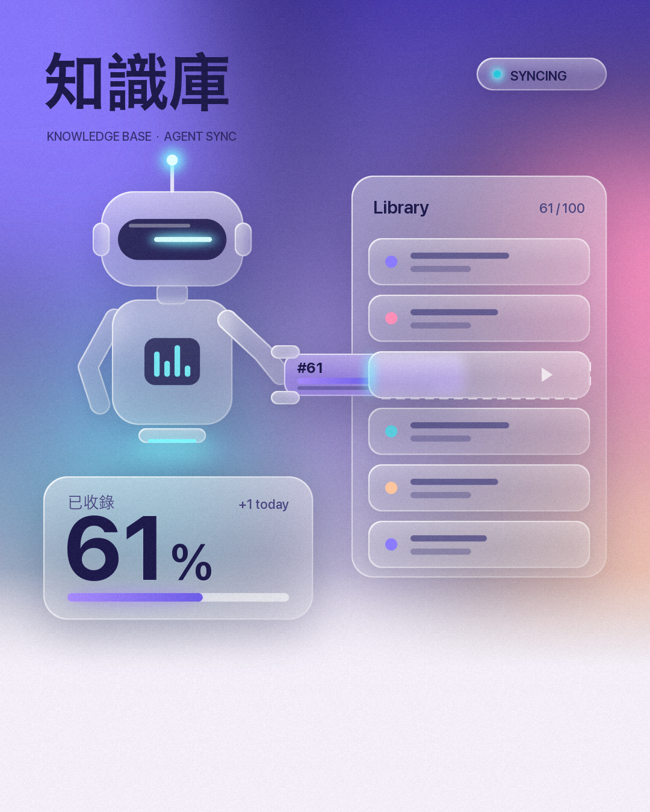

# 玻璃擬態介面

## 一句話
在柔和模糊的彩色光場上，疊幾層霜面半透明玻璃，每層靠「模糊半徑加霜白厚度」區分遠近，邊緣有一圈左上亮、右下暗的細光緣，做出現代 App 介面那種輕盈、通透、有景深的畫面。

## 適合與不適合的題材
- 適合：AI、雲端、SaaS 產品與流程，介面本身就是主角（儀表板、卡片、清單、進度）。
- 適合：產品發表、功能介紹、手機畫面風格的社群貼文，需要新、乾淨、有科技感。
- 適合：「把東西放進某個容器」這類動作，玻璃的透視與遮擋剛好能表現「在裡面」。
- 不適合：需要精確讀數的密集圖表（霜面會削弱細節）。
- 不適合：粗獷、復古、手作或高度紙感的題材；以及需要大量文字閱讀的畫面（半透明底難以保證對比）。

## 氣氛
輕盈、安靜、通透，帶一點夢幻的未來感。像晴天透過磨砂玻璃看到的彩色光暈，高級而柔和，沒有壓迫。

## 用程式畫的難度與限制
難度：中高。核心是「背景模糊 → 白色霜層 → 頂部光澤 → 光緣」這個固定順序，PIL 用 `GaussianBlur`、遮罩與 `alpha_composite` 都能做到；每片玻璃要重新模糊一次底下已有的畫面，計算量不小，但樣張約 5 秒可完成。
限制：
- 圖層順序決定一切：每片玻璃只能模糊「它之前已畫好」的東西，順序畫錯，景深立刻變假。
- 玻璃越多越慢，一個畫面建議不超過約 15 片，逐格動畫時只重算會動的圖層，背景光場與靜止玻璃預先算成圖。
- 真正的折射與色散程式做不出來，這裡只做「模糊加霜白加亮邊」的擬態版。
- 文字放在半透明底上對比容易不夠，主要文字一律用深色墨 #1E1B4B。
- 中文字型限用 Hiragino Sans GB 或 STHeiti Medium；英文與數字用系統 SF（SFNS.ttf，可變字重）。

## 指標畫法
1. 先做光場：垂直底色漸層（頂 #4C3EB0、中 #B8A8EC、底 #F3EEF8），再疊四個色塊光暈（紫 #8B7BFF、粉 #FF8FB8、青 #5ED6E6、桃 #FFC59E），色塊在 1/4 尺寸畫圓、模糊半徑 30、再放大。
2. 畫面下方 70% 以下開始漸變回 #F3EEF8，留下底部約 22% 平靜的淺色，不放任何玻璃。
3. `glass()` 的固定順序：① 柔和投影（偏移 lift 8–26px、模糊 lift × 1.6、墨色，不透明度 0.08–0.30）→ ② 背景模糊（取遮罩範圍外擴 3 倍模糊半徑，模糊後貼回遮罩內）→ ③ 白色霜層（不透明度 veil）→ ④ 頂部光澤（白色，由上往下線性衰減，衰減到 55% 高度）→ ⑤ 光緣。
4. 景深靠兩個參數：遠層（大面板）模糊 26、霜白 0.16；中層（機器人）模糊 18、霜白 0.30；近層（前景卡片與數字牌）模糊 24–30、霜白 0.26–0.55，投影最深。越近越不透明。
5. 光緣：遮罩向內縮 2px 取環，環的不透明度由左上 0.8 對角漸變到右下 0.18，白色。圓角半徑隨物件：小列 22、卡片 20–22、面板 36、大卡 40、藥丸狀標籤 27。
6. 只用一個強調漸層（紫 #6C5CE7 到 #A78BFA）做進度條、選取、筆記卡標題條；進度條後加同色發光（模糊 10）。
7. 機器的狀態光只用一個色：青 #7DF9FF，用在天線頂、護目鏡掃描條、底部推進環、胸口小長條；先畫發光（高斯模糊的橢圓）再疊亮核。
8. 機器人由玻璃零件組成：圓角方頭（圓角 54）、深色護目鏡（#1E1B4B，不透明度 0.88，不畫眼睛與嘴巴）、兩側耳盤、頸、圓角方身（圓角 44）加深色胸前螢幕、兩條粗 34px 玻璃管手臂、底部推進環；後方的手臂先畫。
9. 「放進去」靠遮擋與霜面：筆記卡（紫色調霜層 0.55）先完整畫出，再把目標列的前蓋玻璃（霜白 0.30、模糊 9）疊在卡片上。卡片進入列內的部分會被霜面糊掉、變暗，列外的部分仍清楚，就能一眼看出「卡片正在進入」；列口再放一道青色漏光（寬 6、高 34、發光 230）。
10. 其餘列各有彩色小圓點（四色光暈色循環）與兩條墨色線；目標列沒有圓點，只留一個白色向右三角（不透明度 0.7）示意進入方向。
11. 全畫面最後加一層固定種子的細顆粒（±6），避免玻璃像塑膠。

## 代表畫家、設計師與作品
- Michal Malewicz（米夏爾・馬萊維奇），波蘭，經營 Hype4 Academy：2020 年提出並推廣「glassmorphism」一詞與其設計準則。學：背景模糊、半透明、細亮邊與一個強調色的組合規則。
- Jony Ive（強尼・艾夫），1967–，英國：2013 年 iOS 7 的介面設計（他於 2012 年底接掌 Apple 的人機介面團隊）。學：以半透明讓使用者保持情境、介面退到內容後面。
- Alan Dye（艾倫・戴伊），美國：2025 年 6 月 WWDC 發表 Liquid Glass 時，Apple 的設計副總裁，由他主持介紹。學：玻璃材質如何隨內容反映色彩、懸浮在內容之上。
- Mark Rothko（馬克・羅斯科），1903–1970，美國（拉脫維亞出生）：《No. 61 (Rust and Blue)》（1953，洛杉磯當代美術館 MOCA 收藏）。學：多層薄塗的色塊如何產生「內在發光」與柔軟邊界。
- Olafur Eliasson（奧拉維爾・埃利亞松），1967–，丹麥與冰島藝術家：《The weather project》（2003，倫敦泰特現代美術館渦輪大廳）。學：用薄霧、光與鏡面做出彌漫、沒有硬邊的光場。
- Gerhard Richter（格哈德・里希特），1932–，德國：《Kerze（Candle）》系列（1982）。學：刻意的失焦與模糊如何製造距離感與柔和的明暗。

## 配色與色階
背景是柔和的紫、粉、青、桃光暈，玻璃只是白色霜層與墨色文字。一個畫面一個強調漸層（紫），一個機器狀態光（青）。色碼與 `sample.py` 一致。

| 角色 | 陰影 | 主色 | 亮面 | 高光 | 用途 |
|---|---|---|---|---|---|
| 深紫背景 | #4C3EB0 | #8B7BFF | #B8A8EC | #F3EEF8 | 光場由上而下；底部 #F3EEF8 是平靜的留白區 |
| 粉光 | #FF8FB8 | #FF8FB8 | #FFC59E | #FFFFFF | 右側光暈與列表彩色小點 |
| 青光（機器狀態） | #28C8DC | #5ED6E6 | #7DF9FF | #DCFFFF | 天線、掃描條、推進環、列口漏光；#28C8DC 是狀態點本體 |
| 墨紫（文字） | #1E1B4B | #1E1B4B | #4A4680 | 不用 | 標題、大數字與主要文字用 #1E1B4B；次要文字與列內線條用 #4A4680 |
| 強調紫 | #6C5CE7 | #6C5CE7 | #A78BFA | #FFFFFF | 進度條、筆記卡標題條、「#61」字色 |
| 玻璃霜層 | #1E1B4B | #FFFFFF | #FFFFFF | #FFFFFF | 不用色階：以不透明度分層，遠層 0.16、中層 0.30、近層 0.26–0.55；陰影階只作為投影色 |

## 光源、陰影與體積
光源在左上、偏上方。每片玻璃有四個明暗線索：頂部白色光澤由上往下衰減；光緣左上最亮、右下最弱；底下一團墨色柔和投影（向下偏移 8–26px、模糊約 1.6 倍偏移）；以及背景光暈透過玻璃的顏色。體積是「薄片」而不是立體，所以不畫側面厚度。投影越深、霜層越不透明，物件就越靠前。機器人底下另有青色推進光與一抹淡淡的地面影，讓它看起來懸浮。

## 線條、描邊與邊緣
- 沒有描邊。邊緣只有那一圈 2px 內縮光緣（左上亮、右下暗）。
- 所有形狀都是大圓角（20–54px），不使用直角；藥丸形用半高圓角。
- 手臂是 34px 粗圓頭玻璃管，輪廓是平滑曲線，不是折線。
- 虛線只用在「空位」：2px 白色、14px 線段、10px 間隔。
- 文字無外框、無陰影。

## 質感與筆觸
- 霜面：背景模糊半徑 8–30px，加白色霜層；越近越霧。
- 噪點：整張最後加固定種子顆粒 ±6，讓平滑漸層有玻璃的細微質感，也避免色階斷層。
- 光暈：高斯模糊的色塊，邊界全部看不到，沒有硬邊漸層帶。
- 不使用紙紋、網點與筆觸；一切皆光滑。

## 細節密度、格線與比例
- 畫面分三段：上方標題與狀態標籤約 20%、中段主體（機器人加面板加數字牌）約 58%、底部約 22% 保持淡色平靜。
- 面板在右、機器人在左、數字牌在前景左下，形成三個層次。
- 清單每列高 78px、間距 16px，面板 6 列，剛好放進高度；不要塞更多列。
- 一個畫面一個主要玻璃面板、一個數字牌、一個動作（卡片進入目標列）；其餘全是背景光。
- 玻璃片數控制在約 12–15 片：太多會糊成一片，失去景深。

## 字體搭配與字級
- 中文標題：Hiragino Sans GB（W6）約 104px，墨紫 #1E1B4B，直接放在光場上，不放卡片裡。
- 大數字：SF Bold 150px，「%」改 SF Semibold 84px，緊貼其後 6px；數字放在最前景的玻璃牌上。
- 面板標題：SF Semibold 30px；副資訊 SF Medium 22px，色 #4A4680。
- 狀態標籤與註解：SF Semibold／Medium 20–22px，全大寫，墨色約 75% 不透明。
- 中文小字（如「已收錄」）：Hiragino Sans GB（W3）26px。中文字型限用 Hiragino Sans GB 或 STHeiti Medium，並用 `check_glyphs()` 逐字確認沒有缺字。

## 動態性格
輕、緩、有漂浮感。
- 以 30 fps 為主，所有位移用緩入緩出，不使用硬切與抖動。
- 玻璃片依景深先後浮現：先遠層，再中層，最後近層，每層上浮 12–20px 同時淡入（0.4–0.6 秒）。
- 光暈色塊慢速飄移（每個週期 8–12 秒），相位彼此錯開，背景持續微微呼吸。
- 筆記卡沿水平線滑入目標列，進入列口後逐漸被霜面糊掉、變暗；進入完成後，列內多出彩色小圓點，進度條平滑增加 1%。
- 機器人上下浮動約 6px（週期 3 秒），推進環與天線的青光隨之微微閃動。
- 鏡頭只做緩慢推近或平移，不旋轉。

## 元件清單
1. 光場背景：漸層加四色光暈，底部漸回淺色。
2. 玻璃片 `glass()`：投影、背景模糊、霜層、頂部光澤、光緣。
3. 狀態標籤：藥丸形玻璃加青色狀態點與 SYNCING 字樣。
4. 知識庫面板：大圓角玻璃、標題與計數「61 / 100」。
5. 清單列：玻璃列加彩色小圓點與兩條文字線。
6. 目標空位：虛線框，進入後被前蓋玻璃蓋住。
7. 列口漏光：青色細長發光，表示卡片進入處。
8. 機器人頭部：圓角方頭、護目鏡、掃描條、耳盤、天線。
9. 機器人身體：圓角方身、胸前螢幕與等化條、頸。
10. 玻璃管手臂：粗圓頭、可彎折，末端接夾具。
11. 推進環：底部藥丸狀玻璃加青色光條，與地面光。
12. 筆記卡：紫色調霜層、標題條（強調漸層）、文字線、「#61」編號。
13. 夾具：兩片小玻璃夾住卡片左緣。
14. 大數字牌：前景玻璃牌，含說明字、大數字與強調漸層進度條。

## 常見失敗與避免方式
- 玻璃看起來像半透明塑膠貼紙：必須先模糊背景，再加霜層，不能只降低不透明度。
- 所有玻璃一樣霧、沒有景深：遠層霜層與模糊較輕、近層較重，並加深投影。
- 卡片只是蓋在列上、看不出進入：先畫卡、再把目標列前蓋玻璃疊上去，讓進入部分被糊掉。
- 文字被背景吃掉：主要文字用 #1E1B4B，放在霜層足夠的玻璃上，或直接放在淺色光場上。
- 光暈出現硬邊：色塊在 1/4 尺寸畫、再用模糊 30 並放大。
- 機器人畫成有臉的卡通：用深色護目鏡加一條青色掃描條，不畫眼睛與嘴巴。
- 色相太多、俗艷：背景光暈最多四個、只用一個強調紫、一個狀態青。
- 圖層順序錯誤，遠景玻璃糊到近景：嚴格由遠到近畫。
- 缺少顆粒導致色階斷層、像塑膠：最後加固定種子的細顆粒。
- 缺字：中文字型限定，並逐字檢查。

## 一定要做／一定不要做
一定要做：
- 每片玻璃依序做背景模糊、霜層、頂部光澤、光緣。
- 越近的玻璃越不透明、投影越深。
- 只用一個強調色（紫）與一個狀態光（青）。
- 用遮擋與霜面表現「放進去」。
- 底部 22% 保持淡色平靜。

一定不要做：
- 把玻璃畫成純色半透明方塊（沒有模糊）。
- 在玻璃上堆太多文字或細節。
- 使用硬邊漸層、描邊或手繪筆觸。
- 為機器人畫臉。
- 大片玻璃互相重疊成一團。

## 原創界線
可以學：背景模糊、霜層、光緣、景深分層與單一強調色等技法。
不可以：複製 Apple、Microsoft 等公司特定的系統介面、圖示、元件排版或「Liquid Glass」等產品識別；不重現羅斯科、里希特的特定畫作；畫面中不放品牌名；機器人與卡片必須是原創造型。
