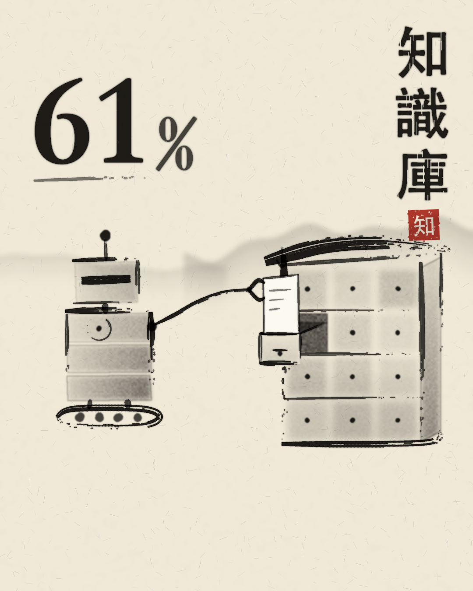

# 水墨

## 一句話
一種墨、五個濃淡、大片留白，用乾濕變化的筆觸寫出形體，再蓋一枚朱印，像在宣紙上寫字畫畫。

## 適合與不適合的題材
- 適合：沉穩、有分量的知識或觀點，一個大數字配一句短結論，留白愈多愈好看。
- 適合：流程中「一個動作」是焦點的題材，其餘留空讓觀眾的視線落在動作上。
- 適合：文化、人文、教育、品牌形象一類需要靜氣與質感的內容。
- 不適合：需要大量鮮豔色彩或彩色區分類別的圖表（水墨只有濃淡，彩色只剩一枚印）。
- 不適合：快節奏、年輕、熱鬧的促銷題材；需要精確細小標註的資訊圖。

## 氣氛
安靜、克制、有重量。畫面多半是空的，空的地方是設計，不是沒做完。

## 用程式畫的難度與限制
難度：高。水墨靠筆毛含墨量、水分與手腕速度，程式只能用「每根毛各自慢慢變乾」的模型去近似；水量暈開（破墨、潑墨）的偶然性也只能靠雜訊與模糊做出類似的邊緣。
限制：筆法的書寫節奏與真實飛白做不出來，只能得到可信的乾筆；物件必須是簡化的幾何形（方盒、圓、直線），用筆法賦予生氣；不適合畫複雜曲面、人物或表情；彩色幾乎不可用，朱印是唯一色彩；單張計算時間會比其他風格長（約數秒），但仍在 30 秒內。

## 指標畫法
1. 先鋪宣紙：底色 #F0E9D8，疊一層低頻雜訊做出 #DED3BC 的淡斑，再撒約 1100 根 4–20px 的細纖維線。
2. 先遠後近、先淡後濃：遠山 → 物件墨底（不畫地面） → 骨法線，最後才寫字與蓋印。墨層一律以「乘法」疊上，重疊處自然變深（積墨）。
3. 五個墨色：焦（不透明度 245）、濃（200）、重（140）、淡（80）、清（36），皆為同一種墨 #181614 的濃度，不加其他灰色。
4. 遠山：沿山脊畫連續起伏線，向下重複 80–140 次、每次降低濃度並向下偏 1px，高斯模糊 5px，山自然消融進霧。
5. 淡墨塊面（染）：多邊形填色，內部乘上低頻雜訊使濃淡不勻，邊緣加一圈「水乾後的深色邊」（約 50% 濃度、寬約 5px）；陰影方向（右與下）漸深到 100%，受光側只留 25%。
6. 骨法線（勾）：一根筆由約 6–20 根毛組成，每根毛帶有各自含墨量 0.55–1.0，沿路徑逐漸變乾；毛乾到門檻以下時留下 8–34px 的空段，這就是飛白。起筆壓力 0.55、中段 1.0、收筆 0.45。
7. 筆寬：外框 12–18px，隔板與抽屜 4–6px，細節 3–5px，櫃頂一筆長弧 36px，是全頁最粗最重的一筆。
8. 方形不畫封閉矩形：四邊各畫一筆，端點超出 3–5px，歪斜 ±2.5px。
9. 點（點）：以 6 次稍微偏移的圓疊成不規則墨點，半徑 5–14px，模糊 1.2px，用於關節與把手；每個抽屜面另做一層不同濃度的淡墨染（牧谿），取代抽屜縫。
9a. 分段與細線（齊白石）：機器人軀幹分三段、各段不同濃度、段間留紙白縫；手臂是一筆 7px 細長線，起筆 0.35、中段 1.0、收筆 0.75。
10. 字：字形遮罩模糊 1.6px，乘上粗糙度雜訊，再加沿筆畫方向的短飛白線；標題直排。
11. 「放進知識庫」的畫法：卡片垂直落入已拉出的抽屜，抽屜前板畫在卡片之後、整塊蓋在卡片下半，卡片下段便被抽屜吃掉；前板上緣再補一筆焦墨，並在卡片上方畫一道短的向下乾筆加小箭頭。
12. 留白：底部約 22% 不畫任何東西；不畫地面也不加地暈，物件直接懸在紙上（八大山人）。
13. 朱印：76px 方形、陰刻白字、邊緣有 5–10 個磨損小點，整幅只蓋一枚，偏轉 ±2.5°。

## 模範學習

### 八大山人 Bada Shanren（朱耷，1626–1705，中國，明末清初）
為什麼學他: 他把畫面減到只剩幾筆、讓形體懸在大片空白裡，這正是水墨風格「空的地方是設計」的最高標準（《魚石圖》〔1699，紐約大都會藝術博物館藏〕：七條小魚在空白紙面上就成了一池水）。

可以照做的規則:
1. 不畫地面：魚在沒有水線的空白中游；樣張因此拿掉機器人與櫃子底下的淡墨地暈，讓兩者直接懸在紙上。
2. 用筆的數量要少：能一筆畫完的不畫兩筆。樣張拿掉了抽屜的短橫線與機身的三道氣孔，抽屜只剩一個墨點。
3. 構圖不求滿、不對稱：物件擠在畫面一側與中段，頂部與底部大片留空，主體位置偏離中心；本樣張畫面約 60% 是空白。
4. 少量的重墨放在關鍵處：焦墨只用在視窗橫條、櫃頂長弧、櫃底一筆、墨點與大字等結構關鍵，其餘用濃墨以下。
5. 一個形體一個姿態：形不必規矩，輕微歪斜與長短不齊比整齊更有生氣（方框四筆各自歪 ±2.5px）。
6. 留白本身有重量：底部約 22% 不畫，與上半部的墨形成相互對照，而不是因為「沒畫完」。

不要照抄: 八大山人的白眼鳥、仰視的魚、奇石造型、「八大山人」款與花押，以及具體的題詩位置；我們只借「減筆、懸浮、不求滿」。

檢查表:
- 機器人與櫃子底下是否沒有任何地線或地暈？
- 同一個物件上是否沒有可以刪去的細小重複線（把手線、氣孔線）？
- 畫面空白（含底部 22%）是否至少約 60%？
- 焦墨是否只用在結構關鍵處（視窗、頂邊、底邊、墨點、大字），沒有拿來畫次要的線？

### 齊白石 Qi Baishi（1864–1957，中國）
為什麼學他: 他的蝦以濃淡與簡單筆觸畫出分節與透明感，且主張「似與不似之間」（太似則媚俗、不似則欺世），正是用簡化機器造型畫出生命感的方法。

可以照做的規則:
1. 一個身體分幾段、每段一個墨色：蝦的腹節用淡墨一節一節擦出；樣張把機器人軀幹畫成三段，各段濃度不同（約 100、140、176）、段間留紙白縫約 8px。
2. 身體粗、肢體細：蝦鬚與腿是一筆到底的細線；樣張的手臂是一筆 7px 的長細線，起筆輕、中段實、收筆仍有力，與 16px 的機身頂筆形成約 2:1 以上的粗細對比。
3. 每個部位換一種筆法：頭部寬扁的一筆、軀幹淡墨分段、手臂一筆細線、關節只是一個墨點，不用同一種筆畫全部。
4. 最深的墨給最小的點：蝦眼是濃墨點；樣張的最黑留給小面積（天線頂、手腕與抽屜的墨點），大塊面都用淡中墨。
5. 似與不似：機器人保持簡化、可辨認為機器，但不追求精確的機械細節；寧可少一個螺絲，也不要像工程圖。
6. 水感與透明：淡墨塊用乾後深色邊與內部不勻的濃淡，讓形體像半透明。

不要照抄: 齊白石的蝦、蟹、蛙、荷花與草蟲等題材，及他的題款與印；機器人不要畫成蝦形。

檢查表:
- 軀幹是否分成至少三段、每段濃度不同且段間有紙白縫？
- 手臂是否比機身外框細一半以上？
- 最黑的是不是小面積（墨點、視窗橫條），大塊面是否都是淡中墨？
- 是否每個部位用了不同的筆法（扁筆、分段染、細線、墨點）？

### 牧谿 Muqi（法常，活躍於南宋末，約 13 世紀，中國禪僧畫家）
為什麼學他: 《六柿圖》只用濃淡不同的墨與幾乎沒有輪廓的塊面，把六個柿子畫成有重量的物體，是「用墨色立形、用空白呼吸」的標準答案。

可以照做的規則:
1. 形體靠塊面（染），不靠輪廓：柿子大多沒有外框線，只在蒂與少數邊緣用深墨；樣張的機器人頭與軀幹因此只留頂邊、背光邊的兩三筆，其餘由墨塊自己立住。
2. 相鄰者濃淡不同：六個柿子各一個墨色（有一個明顯最深），間距也不均、有一個微微跑出一條線；樣張的 12 個抽屜面各用不同濃度的淡墨（約 26–60 之間輪換，皆為淡墨以下）。
3. 濕與乾對照：柿子的濕潤塊面配蒂的乾筆；樣張的塊面是濕染，邊框是乾筆飛白。
4. 背景是霧不是景：遠景只用極淡的山脊消融在霧中，與前景拉開距離（《觀音猿鶴圖》三幅的氣氛）；樣張的遠山濃度只有清墨 36 上下。
5. 構成極簡、物與物之間留足空氣：機器人與櫃子之間的空白不少於機器人的寬度（樣張約 1.25 倍）。
6. 一點深色當錨：全畫面最黑的點壓在視覺重心附近，其他濃淡向外遞減。

不要照抄: 六柿圖的六個柿子排列、柿蒂的具體畫法、觀音與猿鶴的造型與構圖；不仿製牧谿款印。

檢查表:
- 機器人的頭與軀幹是否各至少有一邊沒有外框線，形體靠墨塊立住？（牧谿原作多數邊沒有外框線；本樣張只做到每塊至少一邊，是目前的妥協，精修時應往「多數邊無外框」推進）
- 相鄰抽屜面的濃淡是否不同、沒有兩個相鄰的一樣濃？
- 遠景是否只是極淡、無明顯輪廓的霧？
- 機器人與櫃子之間是否有足夠空白（不少於機器人寬度）？

## 代表畫家、設計師與作品
- 牧谿（Muqi，法常），活躍於南宋末（約 13 世紀，約 1210–1269，說法不一），中國禪僧畫家：《六柿圖》，水墨紙本，現藏京都大德寺龍光院，日本重要文化財。學：極簡的構成、濃淡只靠墨色，在空白中立起形體。
- 八大山人（Bada Shanren，朱耷），1626–1705，中國（明末清初）：《魚石圖》（Fish and Rocks，1699，紙本水墨，紐約大都會藝術博物館藏）。學：大量留白、少量精準的筆觸、構圖不求滿。
- 石濤（Shitao，原濟），1642–1707，中國（清初）：《黃山三十六峰憶寫》冊頁（紐約大都會藝術博物館藏），以潑灑的墨法回憶黃山。學：墨點與濕筆造出山形，不描輪廓。
- 長谷川等伯（Hasegawa Tōhaku），1539–1610，日本（桃山時代）：《松林圖屏風》（六曲一雙，約 16 世紀末，東京國立博物館藏，日本國寶）。學：只用墨色層次營造霧中空氣感，物件由淡入濃。
- 雪舟等楊（Sesshū Tōyō），1420–約 1506，日本（室町時代）：《四季山水圖卷》（又稱《山水長卷》，1486，毛利博物館藏）。學：粗重的線與明暗對比、平面化的空間，以及長卷般的節奏。
- 齊白石（Qi Baishi），1864–1957，中國：以蝦、蟹、蛙等小動物聞名的水墨作品。學：蝦身用墨色濃淡與簡單筆觸堆出分節與透明感，題材小而可愛。
- 張大千（Zhang Daqian），1899–1983，中國（旅居巴西、美國、台灣）：1960 年代的潑墨潑彩山水，如《五亭湖》（1968，亞洲藝術博物館藏）。學：潑墨色塊先放、再以線收，墨與水的偶然用得有節制。

## 配色與色階
只有一種墨 #181614，加宣紙色與一枚朱印。墨的五個濃度是「同一種墨的不透明度」，下表為它們疊在宣紙上的實際色，用來取色參考；中間灰一律由濃度疊出，不另外設灰色色碼。朱印整幅只出現一次，卡片是整幅最亮的白。色碼與 `sample.py` 一致。

| 角色 | 暗部 | 本色 | 淡部 | 高光 | 用途 |
|---|---|---|---|---|---|
| 焦墨（245） | #181614 | #1F1C19 | #45423C | #79746B | 最後的骨法線、大字、抽屜把手 |
| 濃墨（200） | #1F1C19 | #45423C | #79746B | #ACA69A | 外框、隔板、次要字 |
| 重墨（140） | #45423C | #79746B | #ACA69A | #D1CBBC | 機身陰影、右側櫃面 |
| 淡墨（80） | #79746B | #ACA69A | #D1CBBC | #E6E0D0 | 受光側、抽屜面染 |
| 清墨（36） | #ACA69A | #D1CBBC | #E6E0D0 | #F0E9D8 | 遠山、霧 |
| 宣紙 | #DED3BC | #F0E9D8 | #F6F1E3 | #FCF9F1 | 底，筆記卡 #FCF9F1 |
| 朱印 | #741A14 | #B2281E | #CD736D | #E8A7A2 | 一枚印，整幅唯一的色 |

## 光源、陰影與體積
光從左上來。體積靠「淡墨由受光側向背光側漸深」，不靠投影：受光側只留約 25% 濃度，背光側（右、下）逐步到 100%。每個物件只做一層漸染，邊緣加水乾後的深色邊。地面不畫線也不畫墨量，物件直接懸在紙上；卡片因為是整幅最亮的白，成為視線入口。

## 線條、描邊與邊緣
- 輪廓叫「勾」，用焦墨與濃墨，起筆壓、行筆平、收筆輕；轉角不是圓頭接點，而是兩筆相交或略伸出。
- 外框 12–18px，隔板 4–6px，細節 3–5px，一筆櫃頂長弧 36px。
- 邊緣不是乾淨向量邊：筆毛有各自的含墨量，會出現飛白；染的邊緣會有一圈乾後的深色線。
- 不畫地平線；不畫完整封閉的矩形。

## 質感與筆觸
- 宣紙：底色加低頻淡斑，約 1100 根短纖維。
- 墨層為乘法疊色，重疊處變深（積墨），而不是半透明蓋。
- 乾筆（飛白）來自單根毛的含墨量在行筆中變少，空段 8–34px；不是整條透明度降低。
- 濕染：多邊形內部乘雜訊，邊緣深色邊；漸深方向朝背光側。
- 字有輕微毛邊與沿筆畫方向的短飛白線。
- 全部筆觸以 2 倍尺寸繪製後縮小。

## 細節密度、格線與比例
畫面約 60% 是空白。上方是大數字（左上，約高 25%）與直排標題（右上）；中段約 35% 是物件，機器人在左、知識庫在右，用一條手臂連起來；底部約 22% 完全不畫。知識庫是 3 欄 × 4 列的抽屜櫃，抽屜面各是一塊不同濃度的淡墨，只留一個墨點把手，不畫抽屜縫與短橫線，視覺密度集中在櫃頂長弧與被拉出的那一格。朱印落在標題下方。

## 字體搭配與字級
- 中文標題：STHeiti Medium 128px，直排，焦墨，字距約 140px，由上往下讀。
- 大數字：Songti Black 約 300px，焦墨；「%」降到 140px、濃墨；只用於阿拉伯數字與符號。
- 印章字：STHeiti Medium 約為印面 70%，白字陰刻。
- 中文字型限用 STHeiti Medium 或 Hiragino Sans GB，並用 `check_glyphs()` 逐字確認；Songti 只用於拉丁數字。

## 動態性格
- 以 12 fps（一拍二）為主，節奏緩慢，讓畫面「寫」出來：筆畫依路徑逐段顯現，速度約 400–700px／秒，字用遮罩由上往下擦開。
- 暈染用淡入的方式：淡墨塊在約 0.6 秒內由 0 長到目標濃度，邊緣先出現。
- 卡片落入抽屜：向下 0.5 秒，下半被前板遮住，抽屜把手輕微晃動一次；朱印最後「蓋」下去，只有 3 幀的輕壓縮。
- 鏡頭：緩慢平移或不動，不要彈跳、不要快速縮放；轉場用墨暈或淡出。
- 留白即呼吸：重要句子出現前停 0.5 秒，空白也是節奏的一部分。

## 元件清單
1. 宣紙底：底色、淡斑、纖維。
2. 遠山：淡墨山脊，由山脊向下消融成霧。
3. （已刪除）地面墨暈：改為物件懸浮、不畫地面。
4. 直排標題：STHeiti 焦墨字，直排，粗糙邊加飛白。
5. 大數字：Songti Black 焦墨數字，「%」濃墨降小。
6. 底線乾筆：數字下方一筆很乾的橫筆，只在起筆處有墨。
7. 朱印：76px 方印，陰刻「知」字，磨損小點。
8. 機器人頭：方塊、焦墨視窗橫條、天線加墨點，不畫臉。
9. 機器人身：分三段不同濃度的方身、一個半開的圓圈儀表，不畫氣孔線。
10. 履帶：長橢圓輪廓加四個墨點輪子。
11. 機械手臂：一筆 7px 的細長線，肩與腕各一個墨點，末端兩筆夾爪。
12. 知識庫：3×4 抽屜櫃，抽屜面各是不同濃度的淡墨加一個墨點；右側面染重墨，櫃頂一筆長弧。
13. 拉出的抽屜：前板、內部空腔與斜面，前板會遮住落入的卡片下半。
14. 筆記卡：宣紙中最亮的 #FCF9F1，四邊淡筆勾線、三行橫線，下半被抽屜遮住。

## 常見失敗與避免方式
- 線條太平均、像向量線：必須有毛束、起收筆壓力與飛白。
- 畫面塞滿：留白約 60%，底部約 22% 絕不動筆。
- 墨色用透明度亂蓋：必須用乘法疊色，且只用同一種墨的五個濃度。
- 加入其他顏色：除了朱印，不再出現任何彩色；強調靠濃淡與大小。
- 缺字或亂碼：中文字型限定，每個字用 `check_glyphs()` 檢查；印章字太小會糊成一團，印面至少 70px。
- 機器人畫成有眼睛嘴巴的臉：用視窗橫條、天線、履帶讓它像機器。
- 卡片沒有放進去：讓抽屜前板蓋在卡片之後，卡片下半被吃掉，而不是靠旁邊畫箭頭。
- 方框像封閉矩形：改成四筆各自畫、端點伸出。
- 朱印太多或太亮：整幅一枚，磨損要有但不可到辨識不出字。

## 一定要做／一定不要做
一定要做：
- 先遠後近、先淡後濃，最後才寫字、蓋印。
- 墨層用乘法疊色，濃度只用五級。
- 骨法線用毛束與飛白，不用均勻線。
- 保留大面積留白，底部約 22% 空白。
- 朱印整幅一枚。

一定不要做：
- 使用其他彩色、漸層或半透明陰影。
- 用乾淨向量線畫完整封閉的矩形。
- 把機器人畫成有五官的臉。
- 在留白處加上不必要的裝飾或紋樣。
- 用單一均勻的濃度畫所有東西。

## 原創界線
可以學：墨分五色的層次、勾與染的順序、乾筆飛白、留白與構圖、題款與印章的位置。
不可以：複製牧谿、八大山人、石濤、長谷川等伯、雪舟、齊白石、張大千任何具體作品的構圖、題材配置或款印；不仿造任何現存印章或題款；畫面中不放品牌名；機器人與知識庫必須是原創造型。
