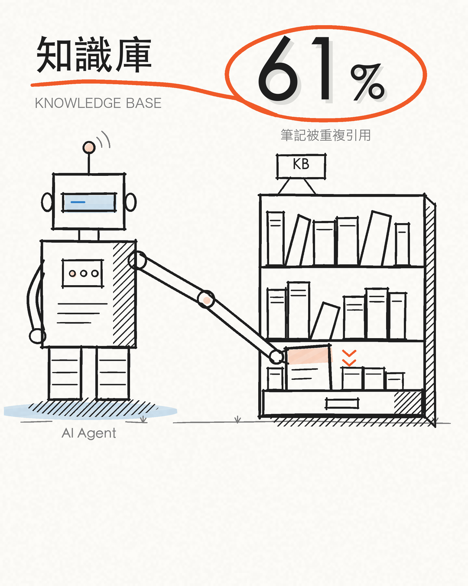

# 線稿手繪

## 一句話
白板上用一支黑色麥克筆邊講邊畫：手感黑線、45° 排線當陰影、只有一個橘紅強調色，看起來像講者當場畫給你看。

## 適合與不適合的題材（3–5 條）
- 適合：概念解說、流程與因果（A 怎麼變成 B）、方法論拆解，觀眾需要「跟著想」的內容。
- 適合：內部教育訓練、工作坊重點回顧、讀書心得，口吻親切、不需要商業質感。
- 適合：數字不多（一幕一個大數字）的說明，數字靠圈選與底線強調。
- 不適合：要表現品牌精緻度、產品真實畫面、大量數據圖表（線條會亂）。
- 不適合：情緒強烈或需要氣氛光影的題材（沒有色彩與光可用）。

## 氣氛
輕鬆、聰明、透明。像一位會畫圖的同事在白板前講解；留白多，觀眾的眼睛永遠知道下一筆會畫在哪裡。

## 用程式畫的難度與限制（低／中／高；哪些部分需要圖像生成模型或手繪素材才做得好）
**中。** 幾何物件（方框、書架、箭頭、機器人）用程式就能畫到位，關鍵是「抖動＋筆壓收尖＋轉角超出」三件事。做不好的部分：
- 人物與手勢：程式畫的火柴人很快就顯得笨拙，要有表情或姿勢的人物請用 Open Peeps 這類 CC0 線稿素材，或使用者提供的手繪。
- 手寫中文字：程式無法做出可信的手寫中文，一律用印刷黑體，不要假造手寫字型效果。
- 複雜有機形狀（植物、動物、地圖輪廓）：需要手繪素材或圖像生成後描線。

## 指標畫法（這個風格公認的正統做法，寫成 5–8 個可以照做的步驟，例如上色順序、線條方向、分版套色、明暗層數；具體到參數）
1. **底**：紙白 `#FBFAF6`，加 ±2 階的低頻灰階雜訊（雜訊圖以 1/6 解析度生成後雙三次放大），不要純白。
2. **先排版再下筆**：決定三塊——左上標題、右上大數字、中段主圖；下方 22% 完全留白給字幕。
3. **主線**：黑色 `#1E1E1E`，粗細 = 畫面寬 × 0.55%（1080 寬約 6px）。每筆用 0.9px 步距重取樣，沿法線加三組正弦疊加的抖動（振幅 1.1px，週期約 90px），筆寬只加 ±3% 的筆壓變化（Hergé：粗細一致）；頭尾 26px 只收尖到 78%。
4. **直線與方框**：每條邊獨立一筆，兩端各超出 1–4px，方框四角略為交叉但不凌亂；圓用一筆畫、終點多畫 0.45 圈重疊。
5. **陰影只用排線**：光從左上，物件右側與底部畫一條 20–24px 寬的側面，內填 45°（右上到左下）平行線，間距 = 畫面寬 × 1.1%，線寬 = 主線 × 0.38，每條間距隨機 ±15%。地面陰影是排線橢圓。整張圖沒有灰色漸層。
6. **強調色最後上**：橘紅 `#F05A28` 只用在（a）標題底線一筆（粗 = 寬 × 1.6%）、（b）大數字的圈（與底線同一筆連續畫成，粗 = 寬 × 0.85%）、（c）抽屜上方兩個向下的 V 字箭頭。面積填色用 25% 淡色 `#FCD6C4`，以 −28° 斜向、寬 = 畫面寬 × 3% 的麥克筆帶塗，每兩帶一帶 84% 濃度留出筆痕，整塊相對黑線錯位 (7, 5)px。
7. **次要色限一處**：藍 `#2F80C8`／`#CDE2F4` 只給機器人的護目鏡，最多兩個小地方。
8. **2 倍超取樣**：在 2160×2700 畫好再 LANCZOS 縮回，墨線邊緣才會柔。

## 模範學習

### Saul Steinberg（索爾・斯坦伯格）（1914–1999，羅馬尼亞出生，美國）
為什麼學他：他把「線」本身當作思考，一條細鋼筆線可以變成地圖、字、人；《紐約客》封面〈View of the World from 9th Avenue〉（1976 年 3 月 29 日）用鋼筆、鉛筆、色鉛筆與水彩，以誇張的比例改變觀點。

可以照做的規則：
1. 一條線做兩件事：樣張的橘紅線從「知識庫」標題底線一路延伸、繞過 61% 變成圈選，一筆到底，沒有斷點。
2. 比例服務於觀點：最重要的東西畫最大、最近（61% 與機器人手臂），其餘退到小而細，不求寫實比例。
3. 細線與稀疏：用細而略緊張的鋼筆線，大面積留白；只在重點處加一點色鉛筆或水彩般的淡色。
4. 印刷字與手畫並置：標題、數字用印刷體，畫圖的線條用手繪，兩者並存本身就是一種對比（Steinberg 常把字、簽名、圖章畫進畫面）。
5. 線可以離開物件、去連接別的東西：連接標題與數字的線，等於告訴觀眾「兩者是同一件事」。
6. 用不同筆觸質地分層次：墨黑結構線、淡墨說明線、橘紅強調線，各自粗細固定。

不要照抄：〈View of the World from 9th Avenue〉的四層地圖構圖、他的貓、面具、簽名與假文件圖章、假透視建築。

檢查表：
- 有沒有至少一條線同時扮演兩個角色（如標題底線＋圈選）？
- 最重要的物件是否明顯比其他大？
- 大部分畫面是否為留白，色彩是否只點在重點？
- 線條是否細、單純，沒有填滿的灰面？

### Hergé（艾爾吉）（1907–1983，比利時）
為什麼學他：他是「ligne claire（清晰線）」的代表，這個名稱由 Joost Swarte 在 1977 年提出；線條粗細均一、輪廓清楚，讓畫面一眼讀懂（《Tintin》系列）。

可以照做的規則：
1. 輪廓線粗細一致：樣張主線筆壓變化只剩 ±3%，筆尾只收到 78%（原本 ±8%、45%），不再有時粗時細的「手寫感」。
2. 每個物件一個封閉的剪影：方塊的四邊在轉角處相接，只超出 1–4px，而不是亂交叉。
3. 前後遮擋用「先擦後畫」：被擋住的線要真的不見（樣張的抽屜前板蓋住筆記卡下半、手臂蓋住書櫃左框），遮擋清楚才是清晰線。
4. 色彩平塗：淡橘只填在筆記卡標頭那一塊，不用漸層，不用排線表現色調；陰影只留在機器人側面與書櫃側面的排線。
5. 簡單的主角、較細的背景：機器人只有方塊與三顆燈，書櫃有較多細節（書、標籤），兩者並存而不互搶。
6. 細節點到為止：每個物件 2–4 個內部細節（書脊橫線、胸口三顆燈、抽屜把手）。

不要照抄：Tintin、Snowy、Haddock 的造型，特定畫格構圖與《Tintin》的場景。

檢查表：
- 同一類輪廓線（機器人、書櫃、卡片）粗細是否看起來一致？
- 轉角是否相接、不是亂交叉？
- 被遮擋的物件，被擋住的部分線條是否真的消失？
- 色塊是否平塗、沒有漸層？

### Jean-Jacques Sempé（尚-雅克・桑貝）（1932–2022，法國）
為什麼學他：他為《紐約客》畫過一百多幅封面（1978 起）、與 René Goscinny 合作《Le Petit Nicolas》；以微小人物放在廣大空間、輕快的鋼筆線與極淡的水彩著稱。

可以照做的規則：
1. 主體小、空間大：畫面至少 45% 留白，樣張在機器人與書櫃上方保留大面積紙面，底部 22% 全空。
2. 輕快斷續的細線：地平線用淡墨細線、中間斷開（讓位給標籤），線上放幾根微小草叢。
3. 水彩淡彩：藍色淡彩只在機器人腳下塗一小塊，超出線條外（錯位 (9, 7)px），不填滿輪廓。
4. 用小細節講故事：抽屜裡一排微小的索引卡、書脊的小橫線，細密但不吵。
5. 地平線與地面是舞台：用一條細地線把兩個主體（機器人、書櫃）放在同一個世界，而不是漂浮。

不要照抄：他的城市屋頂、咖啡館、小孩與樂手等人物與場景構圖，以及《Le Petit Nicolas》角色。

檢查表：
- 畫面是否至少 45% 留白？
- 水彩淡彩是否小面積且超出線條？
- 有沒有一條細的地平線與少量小細節？
- 主體相對畫面是否不過度放大？

## 代表畫家、設計師與作品
- **Mike Rohde（麥克・羅德）**，美國，視覺筆記（sketchnote）的推廣者。代表作《The Sketchnote Handbook》（2012）。學：標題、方框、箭頭、項目符號的層級系統，以及「想法比畫功重要」。
- **Dan Roam（丹・羅姆）**，美國。代表作《The Back of the Napkin》（2008，中譯《餐巾紙的背後》）。學：用最少的線把商業問題畫成「誰或什麼／多少／哪裡／何時／如何／為什麼」六類基本圖。
- **Andrew Park（安德魯・帕克）與 Cognitive Media**，英國。為 RSA 製作的 RSA Animate 白板動畫系列（2010 年起），例如 Dan Pink《Drive》。學：邊講邊畫的節奏，畫面從空白逐筆長出、手繪跟著旁白走。
- **Randall Munroe（蘭德爾・門羅）**，美國。網路漫畫 xkcd（2005–）、《Thing Explainer》（2015）。學：幾乎沒有細節的線條也能精準說明技術概念，標註線與留白的用法。
- **Christoph Niemann（克里斯多夫・尼曼）**，德國。《Sunday Sketching》（2016）。學：一筆線條加一個意外的聯想，讓概念被「看懂」的那一刻。
- **Saul Steinberg（索爾・斯坦伯格）**，羅馬尼亞出生、美國。《紐約客》封面〈View of the World from 9th Avenue〉（1976）。學：線條本身就是思考，用單線改變觀點與比例。
- **Jean-Jacques Sempé（桑貝）**，法國。《小淘氣尼古拉》（Le Petit Nicolas）插畫（1959 起）。學：鬆的鋼筆線與大片留白，小小的主體也能撐起畫面。

## 配色與色階（表格：角色｜色碼｜用途；每個主要顏色列出陰影／主色／亮面／高光；一個畫面最多幾色；強調色怎麼用。色碼必須和 sample.py 一致）
| 角色 | 色碼 | 用途 |
|---|---|---|
| 紙白（底／亮面） | `#FBFAF6` | 背景，也是所有物件的「亮面」（線稿不填主色） |
| 墨黑（主線／陰影） | `#1E1E1E` | 所有輪廓、排線、文字、大數字 |
| 淡墨（輔助） | `#787878` | 英文副標、小標籤、訊號弧線 |
| 灰投影 | `#DEDEDA` | 大數字的錯位投影（右下 7–9px） |
| 強調主色 | `#F05A28` | 底線與圈選（一筆連續）、動作 V 字箭頭 |
| 強調淡色（亮面） | `#FCD6C4` | 被強調物件的麥克筆塗色（本例：筆記卡、天線球、狀態燈） |
| 次要藍 | `#2F80C8` | 護目鏡掃描線，一處 |
| 次要藍淡色 | `#CDE2F4` | 護目鏡塗色 |

- 明暗只有兩層：紙白（亮）與 45° 排線（暗）；沒有高光，強調色也只有主色＋淡色兩階。
- 一個畫面最多 3 色（黑、橘紅、一個次要色），次要色可省略。
- 強調色規則：一幕只強調一件事——「正在發生的動作」或「要記住的數字」，面積不超過畫面 8%。

## 光源、陰影與體積
光從左上。體積只靠兩件事：右側與底部加一條側面厚度（方框向右下偏移 24×22px 的平行四邊形）並填排線，以及地面一個排線橢圓。物件正面永遠留白。大數字用灰色錯位投影做出「寫在白板上浮起來」的層次。不畫漸層、不畫高光。

## 線條、描邊與邊緣（粗細以畫面寬度的比例表示）
- 主輪廓：寬 × 0.55%；次要細節（書脊橫線）× 0.5 倍；排線 × 0.38 倍；書本輪廓 × 0.8 倍。
- 標題底線：寬 × 1.6%，橘紅一筆，帶抖動、兩端收尖。
- 大數字圈：寬 × 0.45%，一筆畫完並重疊 0.45 圈。
- 邊緣：所有直線兩端超出 1–4px；不求完全對齊才像手畫。抖動振幅 1.1px，長直線不可小於 0.4px（會變尺畫）。
- 虛線：線段 55% 實、45% 空，給「目的地」與「還沒發生」的東西。

## 質感與筆觸（具體參數：密度、大小、透明度、方向）
- 紙紋：±2 灰階、雜訊格大小 6px、雙三次平滑，幾乎看不到，只是讓白不死。
- 排線：方向固定 45°（右上→左下），間距寬 × 1.1%（書本內 × 0.9%），間距抖 ±15%，線寬抖 ±15%。
- 麥克筆塗色：方向 −28°，帶寬為寬 × 3%（小物件 × 1–2%），帶與帶重疊 8%，奇偶帶 100%／84% 濃度，用 multiply 疊在紙上，相對黑線錯位 (7, 5)px。
- 筆壓：寬度 ±3%，以約 60px 週期緩慢變化。

## 細節密度、格線與比例（主體佔畫面多少、留白比例）
- 主圖（機器人＋書架）佔畫面寬 85%、高約 45%（y 330–990）。
- 留白：畫面至少 45% 是空白紙面；底部 22%（1080×1350 中 y > 1053）完全空。
- 細節：每個物件 2–4 個內部細節就停（書脊 1–2 條橫線、胸口 3 顆燈），不要畫螺絲、不要材質。
- 邊距：左右 70px 以上；標題左上對齊 x = 78。

## 字體搭配與字級（中文／數字／英文的字體性格；標題、標籤、大數字佔畫面高度的比例）
- 中文：STHeiti Medium（黑體，端正、像印刷標題）；小標籤用 Hiragino Sans GB。不要假手寫字。
- 數字：同一套黑體，粗大、帶灰色錯位投影，再用手畫圈圈起來——「印刷字＋手畫標記」的對比就是這個風格的味道。
- 英文：Hiragino Sans GB 的拉丁字，淡墨色，全大寫或首字大寫。
- 字級：標題「知識庫」佔畫面高 6.8%（92px）；大數字「61」佔 14.5%（196px），「%」為數字的一半；標籤 2.2–2.5%（30–34px）。
- 中文字串只放標題與一個短標籤，每個字都要驗證不是缺字方塊。

## 動態性格（怎麼動才對味：幀率、緩動、進出場、鏡頭；不該怎麼動）
- **逐筆畫出**：每條線依筆順從頭畫到尾（stroke-dash 推進），一筆 0.25–0.6 秒，ease-in-out；先輪廓、後排線、最後上強調色。
- 線條「沸騰」：靜止時每 3 幀（約 8fps）換一次抖動種子，振幅 0.6px，讓線活著但不晃眼。
- 強調色出場晚 0.3 秒，像講者換了一支筆；圈選數字是一筆畫圈 0.5 秒。
- 物件位移（筆記卡飛進書架）用 ease-out，帶 2–3 條短速度線；到位後回彈 1 次即可。
- 鏡頭：固定或緩慢平移到下一塊白板區，像白板動畫往右「拉」到新區域；不旋轉、不推近超過 1.2 倍。
- 不要：彈跳、粒子爆炸、發光、3D 翻轉、色彩漸變——都會打破「一支筆在白板上」的設定。

## 元件清單（知識影片常用的 14 個元件在這個風格下怎麼畫，各一句：主角 Agent、筆記卡、知識庫、資料夾、大數字牌、長條圖、箭頭、勾與叉、路徑或地圖、時間軸、對話框字幕、章節標示、人群或多個物件、背景）
- **主角 Agent**：方頭方身機器人，頭上天線＋訊號弧，臉只有一條淡藍護目鏡（不畫眼睛嘴巴），胸口三顆燈，關節用圓圈接的機械手臂，身體右側排線。
- **筆記卡**：略斜的四邊形、2–4 條長短不一的橫線，只有標頭塗強調淡色；放進抽屜時，下半被抽屜前板蓋住（先擦後畫）。
- **知識庫**：正面書架，上兩層是書（高矮不一、偶有一本斜靠，極少書脊排線），最下層是拉出的卡片抽屜（前板、把手、露出頂端的索引卡）；右側與底部加厚度排線。
- **資料夾**：一筆畫的梯形頁籤＋長方形，前片稍微低於後片露出紙張橫線。
- **大數字牌**：黑體大數字＋灰色錯位投影＋橘紅手畫圈，下方淡墨小標籤。
- **長條圖**：手畫基線與方框長條，只有重點那條塗淡橘，其餘排線或留白，數值寫在條頂。
- **箭頭**：曲線一筆畫到底，箭頭兩撇分開畫、長度寬 × 2%；動作箭頭用橘紅，說明箭頭用黑。
- **勾與叉**：一筆勾（短下長上）、兩筆叉，勾用橘紅、叉用黑，外面可加手畫圈。
- **路徑或地圖**：一條虛線曲路，節點是小圈，地標用簡單的方框或旗子，不畫地形。
- **時間軸**：一條手抖的長橫線，刻度是短直線，重點節點畫實心圈並塗淡橘。
- **對話框字幕**：手畫圓角框（四邊分開畫、角交叉）＋小尾巴，框內印刷黑體；放在下方 22% 區。
- **章節標示**：左上「01」大號黑體數字＋橘紅底線一筆，旁邊淡墨小標。
- **人群或多個物件**：同款簡化輪廓排成一排，只有一個塗強調色，其餘留白。
- **背景**：紙白＋極淡紙紋，不畫白板框、不畫格線；需要分區時用一條淡墨長虛線。

## 常見失敗與避免方式（至少 6 條）
1. **線太完美像向量圖**：沒有抖動、沒有超出、沒有收尖。→ 三者都要，抖動振幅不低於 1px。
2. **抖太多像發抖**：振幅超過 3px 或高頻抖動。→ 只用低頻（週期 ≥ 60px）。
3. **用灰色填陰影**：立刻變成扁平插畫。→ 陰影只能是排線。
4. **強調色到處用**：三四個東西都塗橘，看不出重點。→ 一幕一個強調。
5. **機器人畫成卡通臉**：加眼睛嘴巴就變吉祥物。→ 只用護目鏡帶、天線、燈號表達「機器」。
6. **假手寫中文或缺字**：手寫風字型常缺繁體字。→ 用黑體，逐字比對缺字方塊。
7. **畫面塞滿**：白板講解靠留白讓眼睛休息。→ 留白 ≥ 45%、底部 22% 淨空。
8. **故事沒交代動作**：只有物件並排。→ 一定要有「手上拿著的東西＋抽屜遮擋＋向下 V 字箭頭」三件套（以遮擋表示已放進去，不用虛線框）。

## 一定要做／一定不要做（各 5 條）
**一定要做**
- 每筆線都要有抖動、筆壓收尖、轉角超出。
- 陰影只用 45° 排線，光從左上。
- 只有一個強調色，用在「動作」或「數字」。
- 2 倍超取樣後縮回。
- 動畫裡讓線條逐筆畫出。

**一定不要做**
- 不要漸層、發光、投影模糊。
- 不要假手寫中文字型。
- 不要給機器人眼睛和嘴巴。
- 不要三個以上的顏色。
- 不要讓畫面元素進入底部 22% 字幕區。

## 原創界線（這個風格可以學什麼、不可以照做什麼）
可以學：視覺筆記的層級系統、白板動畫逐筆出現的節奏、排線與留白的比例、「印刷字＋手畫標記」的組合。不可以照做：RSA Animate 的特定畫面或那隻畫畫的手入鏡構圖、xkcd 的火柴人角色造型、桑貝或斯坦伯格的特定構圖與人物、任何書籍封面。機器人、書架與構圖都要自己設計，也不要出現任何品牌名稱或標誌。
