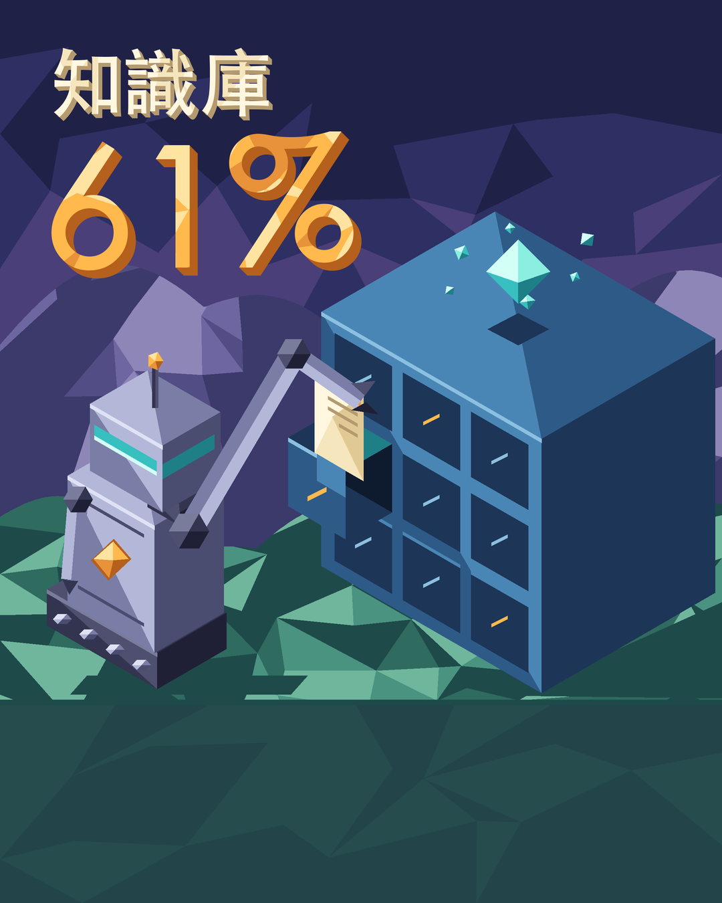

# 低多邊形

## 一句話
所有形體都由平塗的三角形與幾何面組成，每個面一個顏色、依受光角度分成幾階，不描邊、不漸層，像用紙折出來的立體模型。

## 適合與不適合的題材
- 適合：科技、雲端、資料、產品展示這類要有未來感與立體感的題材。
- 適合：地形、山、建築、機器、結晶等本來就有稜角的物件。
- 適合：需要在手機上一眼看清、輪廓乾淨的形體。
- 不適合：需要溫度與人味的題材（皮膚、表情、柔軟衣料）。
- 不適合：大量小字或精細圖表（面太碎會干擾閱讀）；需要柔和手作感的題材。

## 氣氛
冷靜、俐落、有點遊戲或數位藝術的感覺；夜晚與黃昏的紫藍加琥珀色特別合適。

## 用程式畫的難度與限制
難度：低到中。三角形填色是 PIL 最擅長的事，樣張約 0.3 秒就能出圖。
限制：沒有真正的 3D 引擎與光照，面的亮度是用法線與光向量計算後量化成色階，等角物件的面則是手排；弧面形體（圓管、球）要用多邊形近似，過少看起來粗糙、過多就失去風格；文字筆畫彎曲處的切面會顯得雜亂，要控制格子大小；動畫時頂點抖動可以做出閃爍感，但整體旋轉需要自行做投影。

## 指標畫法
1. 先定畫布與光源：1080×1350，以 2 倍尺寸繪製再縮小；光向量取 (-0.45, -0.65, 0.62)，從左上方照下。
2. 背景用抖動格點：在區域內劃 N×M 格，內部頂點隨機偏移格寬的 40–45%，邊界頂點只沿邊界滑動，每格切成兩個三角形，斜線方向交錯。
3. 面的顏色用法線決定：由三角形三個頂點（x、y、高度 z）算法線，與光向量做內積，由 0.3–0.95 映射到 4 階色階（陰影、主色、亮部、高光）；遠景加 0.05 的偏移讓整體偏亮。
4. 天空的色階依高度：6 階由天頂 #1F2147 到地平線 #E88A6E，每個三角形加 ±0.55 階的隨機值，不用漸層。
5. 遠近分層：遠山（#3B3A6B 到 #8F86B8）對比低、顏色淡紫；近丘（#1F4A4A 到 #6FB69C）對比高；兩層用山稜線函數裁切。
6. 等角方塊：地面軸角 30°，左面向左上、右面向右上；頂面最亮、左面主色、右面最暗；每個面再切成兩個三角形，色階差一階；亮邊加 6px 的高光斜角。
7. 所有形體不描邊，相鄰面只靠明度差分開；抗鋸齒靠 2 倍繪製加縮小，三角形填色時邊線也用同色，避免接縫露出底色。
8. 「放進知識庫」用遮擋：抽屜沿牆面外法線拉出 80px，先畫抽屜內部與筆記卡，最後畫抽屜前板；卡片下端被前板蓋住，就看起來插進去了。
9. 文字用切面網格：字形遮罩內放抖動格點，三角形取 2–3 階色階；先畫 6–12px 向右下的陰影階當厚度。
10. 底部 22% 用近乎平的網格，只用相鄰兩階色，不放任何物件。
11. 結晶與碎片：八面體加幾顆 4–5 邊小寶石環繞，作為「被存起來的知識」。

## 代表畫家、設計師與作品
- Boris Delaunay（鮑里斯·德勞內，亦譯 Delone），1890–1980，蘇聯／俄羅斯數學家：「空球（Sur la sphère vide）」論文（1934），奠定 Delaunay 三角剖分。學：把一組點變成不留細長三角形的網格，是低多邊形地形的數學基礎。
- Buckminster Fuller（巴克敏斯特·富勒），1895–1983，美國：網格穹頂（geodesic dome，專利 1954 年核發）、1967 年蒙特婁世博會美國館。學：用三角形撐起大型曲面，說明三角形為什麼穩固又好看。
- Yu Suzuki（鈴木裕），日本遊戲製作人：《Virtua Fighter（VR 快打）》（1993，Sega AM2，Model 1 街機基板）。學：早期多邊形角色靠幾何形體與乾淨色塊辨識，少面數也能讀出動作。
- Olly Moss（奧利·莫斯，海報畫家，Firewatch 美術指導）與 Jane Ng（珍·吳，Campo Santo 的 3D 美術）：《Firewatch》（2016，Campo Santo）。學：以大色塊與簡化的樹與地形取代細節，遠景比近景更簡化。
- Matt Nava（馬特·納瓦），美國美術總監：《Journey（風之旅人）》（2012，thatgamecompany，擔任美術總監）。學：簡化的大形體加強烈的色彩節奏，沙丘與天空的色階安排。

## 配色與色階
每個色階都是「陰影、主色、亮部、高光」四階，天空六階。主色相是冷紫藍背景、青綠地面、藍色立方體，琥珀色只給最重要的元素（61%、胸口核心、卡片標籤）。色碼與 `sample.py` 一致。

| 角色 | 陰影 | 主色 | 亮部 | 高光 | 用在 |
|---|---|---|---|---|---|
| 天空（6 階） | #1F2147 | #2E2F63 | #4A3F78 | #7A4F86 | 天頂到中段 |
| 天空（接地平線） | #B8627E | #E88A6E | — | — | 地平線暖色 |
| 遠山 | #3B3A6B | #524D85 | #6E66A0 | #8F86B8 | 遠景稜線 |
| 近丘（青綠） | #1F4A4A | #2F6B5F | #4A9380 | #6FB69C | 地面、陰影 |
| 底部留白帶 | #203F43 | #234549 | #264C4E | — | 平靜區（只用相鄰兩階） |
| 知識庫（藍） | #1D3557 | #2E5A88 | #4A86B5 | #8CC0E0 | 方塊、抽屜 |
| 機器人（鋼灰） | #4A4C70 | #7A7EA6 | #B4B8D8 | #DFE2F4 | 身體、頭、手臂 |
| 暗部零件 | #1F2036 | #33344F | #4F5070 | #7A7C9C | 履帶、關節 |
| 琥珀 | #B5601C | #E8923A | #FFB94D | #FFE3A0 | 數字、核心、標籤 |
| 青色 | #1F7F86 | #38BFC0 | #8AEEE0 | #D2FFF6 | 護目鏡、結晶 |
| 奶油（筆記卡） | #B49A6E | #E0C994 | #F6E6BD | #FFF7E0 | 卡片、標題字 |
| 抽屜深處 | #0E1A2E | — | — | — | 抽屜口 |

## 光源、陰影與體積
光從左上方來，單一光源。體積由「面的朝向」決定，不靠漸層：頂面最亮、左面主色、右面最暗。地面投影用最深一階（#1F4A4A）的多邊形，朝右下方，邊緣銳利。抽屜內部與結晶下方加接觸陰影。遠景不加陰影，靠明度差分層。

## 線條、描邊與邊緣
- 完全不描邊；面與面的邊界就是明度或色相的差。
- 唯一的線是亮邊：等角物件的上緣加一條 6px 高光斜角，表現「被光打到的稜」。
- 邊緣銳利、無模糊；以 2 倍繪製再縮小換取平滑。
- 細長形體（天線、手臂）用兩個三角形分成一亮一暗的兩半。
- 不用輪廓線強調主角，靠與背景的明度差。

## 質感與筆觸
沒有筆觸，也沒有紋理；質感來自面數與色階：面越大越像人工物，越碎越像自然地形。紫色背景的三角形大而扁，地面的較小較密。文字與數字的切面由抖動格點決定，格距約 40–46px。不使用雜訊、顆粒或透明度。

## 細節密度、格線與比例
物件在 78% 以上的畫面中，底部約 22% 只留近乎平的青綠網格。密度順序：知識庫與機器人（最多面）、文字、遠山、天空（最大面）。主角機器人約占畫面高度 45%，知識庫約占 50%，兩者分左右、各占一側；抽屜 3 欄 3 列，足夠大讓卡片看得見。

## 字體搭配與字級
- 中文標題：STHeiti Medium，約 112px，奶油色切面，向右下 6px 厚度。
- 大數字：STHeiti Medium，約 250px，琥珀色切面，厚度 12px。
- 中文字型限用 STHeiti Medium 或 Hiragino Sans GB；用程式逐字檢查是否缺字（缺字會變成與缺字符號相同的位圖）。
- 不放小字；說明文字若要加，用 42px 以上並避開切面雜亂的區域。

## 動態性格
- 乾淨、機械、俐落：以 24 或 30 fps 平順移動，進場用「面一片片拼上去」。
- 頂點小幅抖動（1–3px）做出水晶閃光，不要整體晃動。
- 數字出現時像切面一塊塊翻轉，約 0.5 秒。
- 鏡頭可緩慢平移讓遠近山層產生視差（遠山慢、近丘快）。
- 色階換階用硬切，不做淡入淡出。

## 元件清單
1. 機器人（Agent）：等角方塊機身，履帶、軀幹、頭部與整條護目鏡光條，不畫臉。
2. 筆記卡：奶油色切面卡，琥珀色標籤與三條字線。
3. 知識庫：藍色等角檔案櫃，3×3 抽屜牆。
4. 被拉出的抽屜：沿牆面外法線拉出，青色內部與前板。
5. 前板遮擋：前板蓋住卡片下端，表現插入。
6. 結晶：青色八面體加環繞碎片，放在櫃頂。
7. 手臂：兩節梯形四邊形，一亮一暗，多邊形關節。
8. 握爪：兩片三角形爪。
9. 胸口核心：琥珀色菱形，四個三角面。
10. 履帶：深色方塊加六邊形輪。
11. 天空：六階紫到橘的三角網。
12. 遠山與近丘：兩層網格，用稜線裁切。
13. 地面投影：最深階的多邊形。
14. 切面文字：標題與大數字。

## 常見失敗與避免方式
- 面太碎像破碎玻璃：控制格距，天空大、地面小。
- 顏色漸層：每個面一個顏色，不用內部漸層。
- 三角形接縫露出底色：填色時邊線用同色。
- 光向不一致：所有面都用同一光向量計算。
- 遠景與近景同樣對比：遠景要淡、低對比。
- 缺字：中文字型限定，逐字檢查。
- 機器人畫成有臉的卡通：只用護目鏡光條。
- 卡片懸在櫃外沒進去：卡片要被抽屜前板遮擋一部分。
- 範例程式無法執行：`sample.py` 必須自成一檔，輔助函式全部放在同一檔內。

## 一定要做／一定不要做
一定要做：
- 所有面用同一光源與同一色階。
- 不描邊，靠明度差分開。
- 遠近分層，遠淡近濃。
- 琥珀色只給最重要元素。
- 底部 22% 保持平靜。

一定不要做：
- 在面內部使用漸層或透明度。
- 加黑色輪廓線。
- 讓面碎到看不出形體。
- 在切面文字旁放小字。
- 照抄任何特定遊戲或作品的畫面。

## 原創界線
可以學：三角網格、依法線分色階、遠近層次與切面字的做法。
不可以：複製 Firewatch、Journey、Virtua Fighter 等作品的畫面、角色或場景構圖；樣張中的機器人、檔案櫃與地形都是原創造型；畫面不放品牌名與 Logo。
