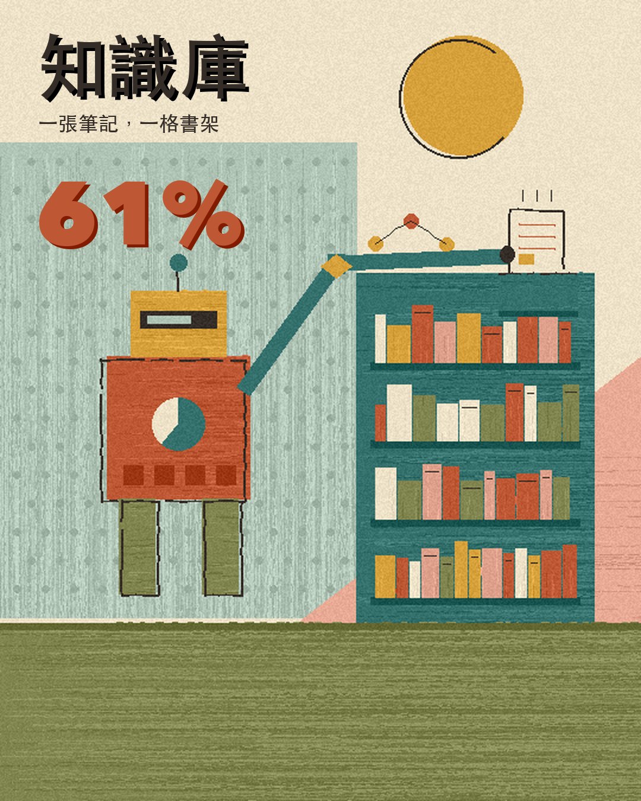

# 世紀中期插畫

## 一句話
用簡化成幾何的大色塊、暖而不飽和的芥黃、鏽紅、墨綠與灰藍，加上略微錯位的墨線與乾筆紋理，像 1950 年代雜誌、童書與唱片封套的套色印刷插畫。

## 適合與不適合的題材
- 適合：知識、生活、旅行、家庭這類需要溫暖、懷舊、親切感的科普題材。
- 適合：物件擬人化的敘事，例如用機器與家具講流程。
- 適合：數字或標題一個大字配大片色塊的社群卡。
- 不適合：需要高科技、冷冽、精準讀數的題材。
- 不適合：需要寫實質感或細小資料標註的圖表。
- 不適合：需要強烈對比與高飽和衝擊的活動宣傳。

## 氣氛
溫暖、手作、略帶懷舊，像舊書與老唱片。顏色柔和有點褪色，線條不整齊，所以顯得有人味。

## 用程式畫的難度與限制
難度：中。大色塊與簡化造型好畫；乾筆紋理與抖動墨線要靠隨機程式模擬。
限制：
- 真正的手繪筆壓與顏料暈染做不出來，只能用「斷續短線」與「抖動線」模擬。
- 人物臉部與手勢做不出來；主角用機器與傢俱。
- 逐像素的顆粒函式在大圖上很慢；本風格先在半解析度（540×675）繪製，再放大到 1080×1350，約半秒完成。
- 墨線若沒有偏移與缺口，會太乾淨像數位向量；偏移與缺口一定要做。
- 小字在乾筆底上不好讀，中文說明字要放在紙色底區。

## 指標畫法
1. 以半解析度（540×675）畫圖，色塊完成後放大到 1080×1350（LANCZOS），再疊文字。
2. 先鋪大色塊：紙色底 `EEE2C8`；左側灰藍色塊（0,120 到 300,520，半解析度）當背景牆，牆上印一組重複點紋（Girard：半徑 3、間距 24、奇數列錯位 12、色為牆色 −22）；右側粉色三角當地面延伸；一個芥黃圓當太陽。
3. 每個物件先填平塗色，再在內部撒「乾筆」：數量約 面積÷120 加 8 條，每條 10 至 0.8 倍寬度，斷成 3–14px 的短段、段間隔 1–5px，顏色取主色加減 10–18 的亮度。
4. 錯位墨線 `misreg_rect()`：墨線整體偏離色塊約 (4,−3) 或 (−4,3)（半解析度，放大後 8px），線寬 2，每段隨機抖 ±0.7，約 8% 的線段缺口不畫。
5. 圓形不畫完整輪廓，只畫一段 10–60 度到 250–330 度的弧線（偏移 (−4,3)），像漏印。
6. 機器人：矩形軀幹（鏽紅，胸下重複 4 個同大深紅方塊）、矩形頭（芥黃）、一條墨色視窗條加灰藍掃描條、天線墨線加墨綠圓、腿為兩條橄欖綠長方；胸口用紙白圓加墨綠 61% 扇形。不畫臉。
7. 書架：墨綠櫃體，四層書，書寬 10–22、高 30–48（半解析度），顏色取芥黃、鏽紅、紙色、粉、橄欖，每本偶有頂端一條墨線；隔板為櫃色加深 30。
8. 放入表現：卡片垂直向下，下半被櫃體上緣「唇板」（墨綠，高 32）遮住；卡片畫在唇板之前，唇板畫在卡片之後，看起來插進櫃子。手臂是 Saul Bass 式的稜角剪紙形（兩根 13px 墨綠直條，肘部方塊接合加芥黃菱形，不描邊）舉到櫃頂抓住卡片側邊，卡片上方 3 條短墨線表示下降。
9. 底部約 22% 為橄欖綠整塊平靜區，只留橫向乾筆與零星點，上緣一條深橄欖細帶。
10. 最後整張加顆粒（±10）；文字用「雙印」：深色字（原色加深 60）偏移 (6,5) 再印主色字。

## 模範學習
（事實查證：Mary Blair 為《Cinderella》（1950）、《Alice in Wonderland》（1951）、《Peter Pan》（1953）做色彩造型，其配色以不尋常的對比著稱，動畫師 Marc Davis 以 Matisse 比擬；Alexander Girard 1952–1973 任 Herman Miller 紡織部設計總監，設計逾 300 款織品，常用大膽配色與抽象圖案，《Environmental Enrichment Panels》1972 年發行；Saul Bass《The Man with the Golden Arm》（1955）與《Anatomy of a Murder》（1959）片頭用黑色剪紙，前者的鋸齒手臂，Bass 說是為了表現成癮者的失序感。）

### Mary Blair 瑪麗．布萊爾（1911–1978，美國）
- 為什麼學她：她用意外而和諧的配色，把場景簡化成色塊，是溫暖、童趣又不幼稚的標準。
- 可以照做的規則：
  1. 配色要「意外但和諧」：鏽紅身體搭墨綠書櫃、粉紅地面搭灰藍牆，避免一般的紅對綠或藍對橘（Marc Davis 以 Matisse 比擬，已查證）。
  2. 一個場景只用 6 色，且每個大形只用 1 色，不混色。
  3. 簡化到只剩關鍵形：機器人是兩個矩形加兩條腿，書櫃是一個矩形加四條橫板，不加細節。
  4. 輪廓少用：頭與書櫃不描墨線，墨線只留給機器身體與筆記卡，其他以色塊邊界說話。
  5. 把背景當圖案：灰藍牆是一面完整的色牆，不畫牆縫與影子。
- 不要照抄：《it's a small world》的娃娃與角色、《Alice》與《Cinderella》的具體場景。
- 檢查表：
  - 相鄰的兩個大色塊是意外但和諧的組合嗎？
  - 有物件不描輪廓嗎？
  - 每個大形只有一個底色嗎？

### Alexander Girard 亞歷山大．吉拉德（1907–1993，美國）
- 為什麼學他：他把重複的幾何圖案與大膽色彩變成秩序，一張畫面靠「重複」就能有節奏。
- 可以照做的規則：
  1. 一種圖案重複用：灰藍牆印一組點紋（半解析度：半徑 3、間距 24、奇數列錯位 12），顏色比牆深 22；機器身體下方重複 4 個同大方塊（半解析度：16×16、間距 26）。
  2. 重複要齊：圖案單元大小與間距固定，不可隨機。
  3. 圖案與主體分開：點紋只印在牆上、不印在機器上；機器上的方塊是另一個圖案。
  4. 色彩大膽但有限：主色 3 個＋紙色、墨色；圖案色一律是底色的深階，不另加新色。
- 不要照抄：他設計的特定織品圖案、Environmental Enrichment Panels 的眼睛與人形。
- 檢查表：
  - 是否有一個重複圖案，單元大小與間距一致？
  - 圖案色是底色的深階，沒有新色嗎？
  - 圖案沒有蓋到主體的輪廓與資訊嗎？

### Saul Bass 索爾．巴斯（1920–1996，美國）
- 為什麼學他：他把主題壓成一個大膽的剪紙形，示範「簡化到只剩一個符號」。
- 可以照做的規則：
  1. 手臂做成稜角分明的剪紙形：兩根 13px 寬（半解析度）的條，肘部是方塊接合，不用圓弧與圓關節（鋸齒手臂，已查證）。
  2. 不描邊：剪紙形只靠色塊與背景分開。
  3. 一個大形當符號：整張以「手臂伸向書櫃」為唯一動作，其他物件靜止。
  4. 關節用幾何符號：肘部加芥黃菱形，取代圓形螺絲。
  5. 大片留白當背景：底部 22% 橄欖綠平面與左上紙色大面積承擔「空」的力量。
- 不要照抄：金臂的白色鋸齒手臂、紙娃娃與人體部位的片頭構圖、原作的字體。
- 檢查表：
  - 手臂是直線與直角組成，沒有圓弧嗎？
  - 手臂沒有描邊嗎？
  - 畫面只有一個動作主軸嗎？

## 代表畫家、設計師與作品
- Mary Blair（瑪麗・布萊爾），1911–1978，美國：為迪士尼《Cinderella》（1950）與《Alice in Wonderland》（1951）做色彩造型，後設計 it's a small world（1964，紐約世界博覽會）。學：大膽而意外的配色與把場景簡化成色塊。
- Charley Harper（查理・哈柏），1922–2007，美國：為《Ford Times》雜誌與《The Golden Book of Biology》繪製插圖，自稱「minimal realism」。學：用最少的幾何形狀抓住對象特徵。
- Miroslav Šašek（米羅斯拉夫・薩謝克），1916–1980，捷克出生：《This Is Paris》（1959）是 This Is… 城市繪本系列的第一本。學：把建築與街景簡化成平塗色塊與細墨線，帶旅行手札的親切感。
- Jim Flora（吉姆・弗洛拉），1914–1998，美國：1940–50 年代為 Columbia 與 RCA Victor 繪製唱片封套（如《Mambo for Cats》），並著有兒童書《The Day the Cow Sneezed》（1957）。學：誇張的幾何人物與錯位的墨線，節奏感強。
- Alexander Girard（亞歷山大・吉拉德），1907–1993，美國出生：1952–1973 年為 Herman Miller 設計紡織與圖案，1960 年設計紐約 La Fonda del Sol 餐廳。學：重複圖案、民俗色彩與幾何簡化。
- Alvin Lustig（阿爾文・盧斯提格），1915–1955，美國：為 New Directions 出版社設計七十多本書衣（1945 年起）。學：用幾何抽象與少量顏色做出有辨識度的封面。
- Eyvind Earle（艾文・厄爾），1916–2000，美國：負責迪士尼《Sleeping Beauty》（1959）的背景與色彩造型。學：嚴謹的水平垂直構圖、重複的線性細節與高度風格化的色彩。

## 配色與色階
一個畫面最多 6 個色（不含紙色與墨色）：芥黃、鏽紅、墨綠、橄欖綠、粉、灰藍。整體偏暖且稍微褪色，不用純白與純黑。色碼與 `sample.py` 一致（陰影 = 主色減 30、亮面 = 加 12、高光 = 加 18）。

| 角色 | 陰影 | 主色 | 亮面 | 高光 | 用途 |
|---|---|---|---|---|---|
| 紙色 PAPER | D0C4AA | EEE2C8 | FAEED4 | FFF4DA | 畫面底、書、卡片、圓盤 |
| 墨色 INK | 160E08 | 342C26 | 403832 | 463E38 | 錯位墨線、視窗條、文字 |
| 芥黃 MUSTARD | B8821C | D6A03A | E2AC46 | E8B24C | 太陽、機器人頭、書、節點 |
| 鏽紅 RUST | A03A16 | BE5834 | CA6440 | D06A46 | 機器人身體、書、卡片線、強調字 |
| 墨綠 TEAL | 16524E | 34706C | 407C78 | 46827E | 書櫃、手臂、儀表扇形、天線燈 |
| 橄欖綠 OLIVE | 626630 | 80844E | 8C905A | 929660 | 腿、底部留白區、書 |
| 粉 PINK | C0826C | DEA08A | EAAC96 | F0B29C | 地面三角、書 |
| 灰藍 SKY | 92A698 | B0C4B6 | BCD0C2 | C2D6C8 | 背景牆、視窗掃描條 |

紅配額：鏽紅用在機器人身體與大數字；書上只有零星紅色。

## 光源、陰影與體積
- 沒有真正的光源；物件是平的，體積靠色塊疊放與「錯位」得到。
- 陰影只有兩種：櫃體隔板與唇板用「主色減 30」的深階，墨線則偏離色塊邊緣形成假影。
- 數字與標題用「雙印」做出微弱的立體：深色字往右下偏移 (6,5)。
- 不使用漸層、不使用模糊陰影。

## 線條、描邊與邊緣
- 墨線細（約 2px 半解析度，放大後 4px 不到）、色塊不嚴格對齊墨線，墨線偏離 8px 左右。
- 墨線每段隨機偏 ±0.7px，約 8% 缺口；轉角不連貫。
- 部分物件不加墨線（灰藍背景、粉色三角、底部橄欖綠、機器人頭、書櫃、手臂），墨線只留給機器身體與筆記卡（Blair、Bass 的少描邊）。
- 邊緣是直接切出的硬邊，不柔化。

## 質感與筆觸
- 乾筆：短而斷續的細線，順著形狀方向（背景牆直向、地面橫向、機器人橫向）。
- 顆粒：全圖 ±10 的亮度雜訊。
- 點：底部平靜區撒約 500 個亮階點，不加其他質感。
- 色塊本身無漸層，濃淡來自乾筆線的明暗跳動。

## 細節密度、格線與比例
以 1080×1350 為準：
- 標題區在頂部左側（約 5%–15% 高）；中間大約 15%–78% 為場景；底部約 22% 為橄欖綠留白區。
- 數字 61% 放在灰藍牆上、機器人頭上方；標題與說明在左上。
- 機器人在畫面左 1/3，書架在右 1/3，中間用手臂連起；書架約佔畫面寬 20%、高 44%。
- 主要物件不超過 4 個：機器人、書架、卡片、數字；其餘是太陽與三個節點。
- 太陽放在書架上方偏左，與卡片之間要留空，不要疊在一起。

## 字體搭配與字級
- 中文標題：STHeiti Medium，120px，墨色，加雙印偏移 (6,5)。
- 數字：Avenir Next Heavy（`Avenir Next.ttc` index 8），150px，鏽紅，加雙印。
- 說明：STHeiti Medium 34px，墨色，放在標題下方，無外框。
- 中文字型限用 STHeiti Medium 或 Hiragino Sans GB，不用 Songti（本地版缺常用字，說明文字曾掉字）；繪圖後逐字檢查沒有缺字。
- 不使用襯線體；字距正常。

## 動態性格
- 12 fps（一拍二），像逐格換圖的手作動畫。
- 色塊先出，墨線隨後「慢半拍」滑入，製造錯位感。
- 物件進場用簡單位移或縮放，緩動 ease-out，不彈。
- 乾筆紋理每 2–4 幀換隨機種子，輕微閃動；顆粒每幀換。
- 卡片沿手臂向下滑入唇板，停住時墨線抖一下。
- 鏡頭只做緩慢推近或平移，不加閃白或爆炸。

## 元件清單
1. 主角 Agent：矩形機器人，鏽紅身體、芥黃頭、墨色視窗條、墨綠天線燈，無臉。
2. 胸口儀表：紙色圓盤加墨綠 61% 扇形。
3. 腿：兩條橄欖綠長方。
4. 手臂：墨綠稜角直條加芥黃菱形肘節，不描邊，舉向櫃頂。
5. 筆記卡：紙色加錯位墨框、三條鏽紅線、一塊芥黃標籤。
6. 知識庫：墨綠書櫃，四層，書的色塊參差。
7. 唇板：櫃頂的墨綠遮板，蓋住卡片下半。
8. 書：芥黃、鏽紅、紙色、粉、橄欖，頂端偶有墨線。
9. 太陽：芥黃圓加弧形漏印墨線。
10. 節點圖：三個圓點加折線，放在櫃頂左邊。
11. 背景牆：灰藍直向乾筆長方，印重複點紋，邊緣不加墨線。
12. 地面三角：粉色三角延伸櫃後。
13. 底部留白帶：橄欖綠橫向乾筆。
14. 動態符號：卡片上方三條短墨線表示下降。

## 常見失敗與避免方式
- 失敗：墨線與色塊完美對齊，像數位向量。避免：墨線偏移 8px 並留缺口。
- 失敗：顏色太飽和、太亮。避免：全部維持褪色感，不用純白、純黑。
- 失敗：缺字（Songti 說明字掉字）。避免：限用 STHeiti Medium，逐字檢查。
- 失敗：卡片浮在書架上方，沒有放進去。避免：用唇板遮住卡片下半。
- 失敗：大數字放進底部留白區，破壞平靜。避免：數字放在場景上方牆面。
- 失敗：乾筆線太規則像條紋布。避免：長度、位置、明暗全部隨機，並斷成短段。
- 失敗：顆粒用逐像素迴圈在大圖上很慢。避免：在半解析度做，再放大。
- 失敗：機器人畫臉。避免：用視窗條與天線。
- 失敗：太陽疊在卡片上，視覺打架。避免：太陽與卡片之間留空。

## 一定要做／一定不要做
一定要做：
- 色塊與墨線錯位。
- 乾筆短段質感。
- 暖而褪色的配色，最多 6 色。
- 用遮擋表現卡片放入。
- 底部約 22% 保持平靜。

一定不要做：
- 使用漸層、柔邊陰影或高飽和色。
- 畫有眼睛嘴巴的機器人臉。
- 使用 Songti 或其他可能缺字的字型。
- 在底部留白區放大字。
- 照搬特定畫家的構圖或角色。

## 原創界線
可以學：套色錯位、簡化幾何、暖褪色配色、乾筆質感與雙印字等技法。
不可以：複製 Mary Blair 的 it's a small world 角色、Charley Harper 的特定鳥類構圖、Jim Flora 的特定封套、Saul Bass 或 Girard 的標誌圖樣；不放品牌名；機器人與書架必須是原創造型。
