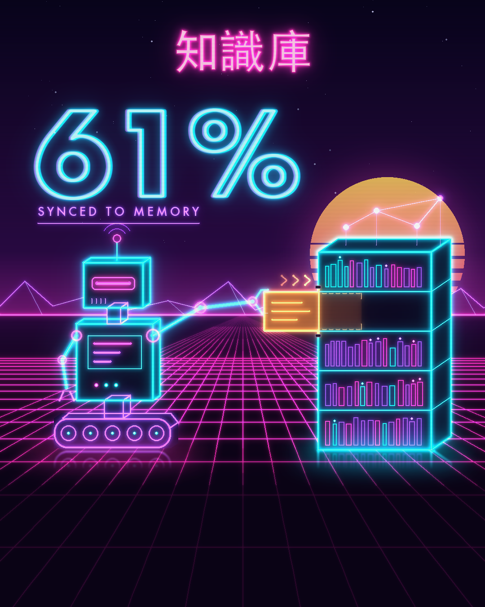

# 霓虹網格

## 一句話
近黑的紫藍夜空加一條地平線，所有東西都是會發光的霓虹管線框，地面是往同一個消失點收斂的洋紅透視網格，配上條紋夕陽與合成波配色。

## 適合與不適合的題材（3–5 條）
- 適合：AI、資料、系統、雲端、自動化這類「科技感、未來感」的知識題材，線框正好能表現「結構」。
- 適合：大數字與一句重點標題的單幕強調（數字做成霓虹字，一眼可讀）。
- 適合：流程、資料流、連線關係，因為發光線條天生就是路徑。
- 適合：夜間氛圍、倒數、上線、啟動、掃描這類「通電」時刻。
- 不適合：溫暖人文、親子、醫療照護、傳統產業、需要大量文字段落的內容；暗底加發光不利長篇閱讀。

## 氣氛
夜晚、通電、冷靜的興奮感。洋紅與青色互相對比，帶 1980 年代對未來的想像（懷舊科幻）。畫面安靜但發亮，像在老式電腦螢幕前看一座城市。

## 用程式畫的難度與限制（低／中／高；哪些部分需要圖像生成模型或手繪素材才做得好）
難度：低到中。線框、網格、發光、掃描線都是純程式強項。
- 容易：透視網格、霓虹管（管色加白芯加高斯光暈）、霓虹字、條紋太陽、掃描線。
- 較難：線框物件要先填近黑底再描線（遮擋），否則網格會穿透物件；要自己處理深度（斜投影）。
- 不適合程式硬做：真實城市天際線、鉻金屬字、人物臉部、有質感的跑車；這些要圖像生成或手繪素材。
- 限制：光暈用多層高斯模糊相加，全幅 1080×1350 約 1 秒內可完成，但動畫逐幀都做會偏慢，背景光暈可預先算好。

## 指標畫法（這個風格公認的正統做法，寫成 5–8 個可以照做的步驟，例如上色順序、線條方向、分版套色、明暗層數；具體到參數）
1. 底色：天空由上到下漸層 #08041C → #2A0A44，地平線上方約 20% 高度再過渡到 #6E1870 的霧帶；地面從地平線 #280840 漸暗到 #0A0316。
2. 定地平線：放在畫面高度約 52%（樣張 y=700/1350），消失點在水平中央。地平線本身畫一條 3px 洋紅管。
3. 地面網格：放射線從消失點出發，近端間距約 128px（約畫面寬 12%），共 25 條；橫線依透視間距，y = 地平線 + K/(0.5+0.35k)，越近地平線越密，距地平線小於 96px 的橫線省略以免糊成一片。線寬 2px，亮度由地平線往下 150px 內漸亮。
4. 太陽：漸層圓盤（上 #FFD65C 到下 #FF2E8C），半徑約畫面寬 16%，被水平縫切開，縫從中心偏上開始，起始 3px，每條縫加寬 3px、間距由 26px 每次減 4px（最小 10px），地平線以下全部裁掉。外加不透明度約 60% 的粉紅大光暈。
5. 霓虹管：每條線畫兩次。管色層線寬 w（常用 3–9px），白芯層線寬 w/3（管色往白推 60%）。管色層疊加三層高斯光暈（半徑 34、12、4，強度 0.5、0.8、1.0）再疊原圖，最後把白芯用 lighter 蓋上去。
6. 遮擋在發光之前：每個線框物件的輪廓先用 #0C061E 填滿，並在腳下放一個半徑約 10px 模糊的近黑橢圓影，再描管線。這是線框風格最容易漏掉的一步。
7. 深度用斜投影：物件前面是正矩形，頂面與右側面用固定位移（樣張為 dx=16~44、dy=-11~-30）連出去，不做真正的透視，保持乾淨。
8. 收尾：整張疊掃描線（每 3px 一條，亮度 86%），底部約 22% 把網格亮度降到 12% 留給字幕。
9. 光落地：管色光池（洋紅／青橢圓，模糊 26px、強度 55–60%）加上接地線下 44px 的淡倒影，都在遮擋與發光之後、掃描線之前疊上。

## 模範學習

### Syd Mead（賽德·米德，1933–2019，美國）
- 為什麼學他：他以 gouache（不透明水彩）加噴筆畫出《Blade Runner》《Tron》的未來載具與城市，人稱「visual futurist」，是「乾淨、光滑、可信的未來感」的標準。
- 可以照做的規則（參考 Tron 的 Light Cycle 概念圖、Blade Runner 的 Spinner、畫冊 Sentinel 系列）：
  1. 載具與機器是「暗色實體加極細發光邊線」：內部先用 #0C061E 填死，再描線，發光只在輪廓與面板接縫。本樣張機器人、書櫃都先遮擋再發光。
  2. 單一視點、低地平線：消失點在畫面水平中央，地平線落在約 52% 高度，主角壓在地平線附近，讓它顯得巨大。
  3. 光滑地面，物件在地面留下短而淡的倒影：從接地線往下鏡射約 44px，強度約 60% 往下漸弱到 0。倒影在畫面最下 22% 之前就消失。
  4. 漸層要像噴筆：天空、太陽用連續平滑的 3 段漸層，沒有雜訊、沒有顆粒；硬邊只留給形體輪廓與太陽的切縫。
  5. 面板線是設計語言：胸口面板、頭部視窗用單線矩形與 2–3 條長短不一的橫槽，不加螺絲與磨損。
  6. 畫面只有一個暖色光源（太陽）與一個暖色焦點（琥珀卡片），其餘冷色；暖冷對比靠面積小的暖色。
  7. 構圖有一條清楚的動線：機械手臂到卡片再到插槽，視線由左到右。
- 不要照抄：Spinner 的飛行車造型、Light Cycle 的車身曲線與發光軌跡、未來都會的高樓天際線、任何具名載具設計。
- 檢查表：
  - 物件內部是否先遮擋，網格與太陽不會透過主體？
  - 接地處有沒有淡淡的倒影，且在底部約 22% 前消失？
  - 天空與太陽的漸層是否平滑沒有雜訊？
  - 暖色是否只出現在太陽與琥珀卡片？

### Dan Flavin（丹·弗萊文，1933–1996，美國）
- 為什麼學他：他從 1963 年起只用市售日光燈管做作品，光不只是被看，而是把顏色打在周圍的牆與地上；這正是霓虹風格要學的「光變成環境」。
- 可以照做的規則（參考 "monument" for V. Tatlin 系列，1964 起，第一件為 7 支冷白燈管的階梯形；以及 untitled (to Donna) 系列，1971，角落的原色燈管組）：
  1. 管子是標準件：直線、等長、不彎曲。本樣張書櫃的格線、卡片的橫線都是直線管，沒有曲線霓虹字以外的彎管。
  2. 一件作品只用 1–2 種純色（冷白、粉、黃、藍、綠之類）；一個物件一個管色：書櫃青、機器人青加少量紫、標題洋紅。
  3. 光落在周圍面上：管色以加法疊到地面，形成橢圓光池（半徑約 190–200px × 20px、模糊 26px、強度約 55–60%）。書櫃下為青、機器人下為洋紅。
  4. 老實露出硬體：管的端部有深色端蓋與細輪廓。本樣張在琥珀插槽管的上下兩端放 12×6px 的深色端蓋。
  5. 對稱或階梯式重複：同一長度的管子等距並列，用數量而不是造型製造節奏（書櫃 5 層等高）。
  6. 相鄰兩色在空間中混色：洋紅與青的光池在兩物件中間相疊，不要用漸層填色代替。
  7. 作品很簡單，周圍留白讓光自己當主角：底部 22% 不放物件。
- 不要照抄：Tatlin 紀念碑的七管階梯造型、角落（corner）擺法與 "to Donna" 的原色組合、任何具名作品的管數與排列。
- 檢查表：
  - 管線是否只有直線（霓虹字除外），沒有手繪曲線？
  - 周圍地面有沒有被管色照亮，而不是只有輪廓亮？
  - 有沒有露出硬體（端蓋、固定點）的細節？
  - 全圖管色是否不超過 3 色加 1 個強調色？

## 代表畫家、設計師與作品
- Ivan Sutherland（伊凡·蘇澤蘭），1960 年代美國：Sketchpad（1963）。學：以線條表達結構、線框是一種語言的原點。
- Steven Lisberger（史蒂芬·利斯伯格）等，1980 年代美國：電影《Tron》（1982）。學：暗底、單色發光線條構成的數位世界，色彩克制。
- Syd Mead（西德·米德），美國：為《Tron》與《Blade Runner》（1982）做視覺未來設計。學：未來物件的比例、夜景光源與反光的處理。
- Atari 團隊（Ed Rotberg 為主要設計者之一），美國：街機《Battlezone》（1980）。學：向量線框加地平線的最簡構圖，遮擋與深度靠線條表達。
- David Braben 與 Ian Bell，英國：電腦遊戲《Elite》（1984）。學：用極少的線建立可信的立體物件與太空感。
- Dan Flavin（丹·弗萊文），1933–1996，美國：螢光燈管作品系列《"monument" for V. Tatlin》（1964 年起，首件為《"monument" 1 for V. Tatlin》）。學：光本身就是材料，單一色管與牆面上的色溢（光暈）。
- Bruce Nauman（布魯斯·瑙曼），美國：霓虹字作品《The True Artist Helps the World by Revealing Mystic Truths》（1967）。學：霓虹字以螺旋排列的字形、管子轉折與字內留白。

## 配色與色階（表格：角色｜色碼｜用途；每個主要顏色列出陰影／主色／亮面／高光；一個畫面最多幾色；強調色怎麼用。色碼必須和 sample.py 一致）
一個畫面最多 3 個管色（洋紅、青、紫）加 1 個強調色（琥珀），其餘為暗底。每個管色的「高光」就是白芯（主色往白推 60%）。

| 角色 | 色碼 | 用途 |
|---|---|---|
| 天空頂（陰影） | #08041C | 畫面最暗的天空 |
| 天空中段 | #2A0A44 | 天空漸層中段 |
| 地平霧帶 | #6E1870 | 地平線上方的光霧 |
| 地面暗 | #0A0316 | 地面與底部留白區 |
| 遮擋填色 | #0C061E | 線框物件內部，擋住網格 |
| 洋紅（主色） | #FF2EAA | 網格、標題字、狀態提示 |
| 洋紅高光（白芯） | 約 #FFC0E6 | 洋紅管的芯 |
| 青（主色） | #00EBFF | 主角輪廓、書架、大數字 |
| 青高光（白芯） | 約 #99F5FF | 青管的芯 |
| 紫（主色） | #9646FF | 次要結構、鏈條、標籤、書脊 |
| 紫（暗） | 約 #602CAA | 遠景山脈線 |
| 端蓋 | 約 #281A32（輪廓 #9678AA） | 琥珀插槽管上下兩端的深色端蓋 |
| 琥珀（強調） | #FFAA3C | 只用在「正被放入的筆記卡」與目標插槽，全畫面唯一暖色 |
| 太陽上緣 | #FFD65C | 太陽漸層頂 |
| 太陽下緣 | #FF2E8C | 太陽漸層底 |

強調色規則：暖色只給一個東西，讓視線自然落在「動作發生處」。

## 光源、陰影與體積
光源是物件自己：每條管線向外發光，沒有方向性主光。體積靠斜投影的三個面（正面、頂面、右側面）與光暈疊加表現；不做漸層塗色。物件腳下放模糊近黑的接觸影（半徑約 10px 模糊，不透明度約 80%）。太陽在物件之後，物件遮擋太陽。

## 線條、描邊與邊緣（粗細以畫面寬度的比例表示）
- 主輪廓管：4–5px（約 0.4–0.5% 寬），主角與書架。
- 次要結構：2–3px（約 0.2–0.3%）。
- 關節與手臂：7–9px，關節圈 3–4px。
- 遠景網格與山脈：1–2px。
- 線端一律圓頭，轉折用圓角（joint=curve）。白芯寬度為管寬的 1/3 且至少 1px。

## 質感與筆觸（具體參數：密度、大小、透明度、方向）
- 光暈：三層高斯，半徑 34／12／4，強度 0.5／0.8／1.0。背景網格用較小光暈（20／6／2，強度 0.35／0.7／0.8）以免搶主體。
- 星點：約 70 顆，亮度 70–190，其中約 15% 畫成 3px 小圓。
- 掃描線：每 3px 一條，亮度 86%，水平，全畫面。
- 霓虹字：描邊空心字（描邊 4px），另疊 4px 左右的粉／青色差位移（強度約 45%），只用於大數字。
- 不加雜訊與紙紋，保持乾淨。

## 細節密度、格線與比例（主體佔畫面多少、留白比例）
主體（機器人加書架）約占畫面高度 35%，位於地平線兩側偏下；標題在頂部約 8–10%，大數字在上段約 15–35%。底部約 22% 只剩暗網格，供字幕使用。左右各留約 6–8% 邊界。網格是背景，亮度不得超過主體。

## 字體搭配與字級（中文／數字／英文的字體性格；標題、標籤、大數字佔畫面高度的比例）
- 中文標題：黑體（STHeiti Medium），約 104px（畫面高 7.7%），洋紅霓虹實心字。
- 大數字：Futura Bold，約 250px（畫面高 18.5%），青色空心霓虹字加色差。
- 英文標籤：Futura Medium，約 26px，字距加寬約 6px，紫色，下方加一條 2px 底線。
- 中文只保留必要字詞，因為細字體加光暈在手機上容易糊；中文不用空心字。

## 動態性格（怎麼動才對味：幀率、緩動、進出場、鏡頭；不該怎麼動）
- 幀率 24–30 fps。
- 網格往鏡頭方向無限捲動（橫線 y 依相位往下移，放射線固定），這是這個風格的標誌動態。
- 進場：線條「描出來」（沿路徑逐段亮起），再補光暈；或霓虹閃爍 2–3 次後穩定（亮度 0.3→1→0.5→1）。
- 緩動：ease-out，結尾輕微過衝後回穩。
- 鏡頭：緩慢前推或輕微左右漂移，幅度小。
- 不該：彈跳、橡皮筋、旋轉亂飛、持續全畫面閃爍（手機上傷眼）；太陽與網格不可同時高速動。

## 元件清單（知識影片常用的 14 個元件在這個風格下怎麼畫，各一句：主角 Agent、筆記卡、知識庫、資料夾、大數字牌、長條圖、箭頭、勾與叉、路徑或地圖、時間軸、對話框字幕、章節標示、人群或多個物件、背景）
- 主角 Agent：線框機器人（履帶底盤、方箱身、方塊頭加一條洋紅視窗縫、天線、三段式手臂），青色主輪廓、紫色底盤、洋紅關節；不畫臉。
- 筆記卡：琥珀色矩形管，內有 3 條橫線，左緣被夾爪夾住。
- 知識庫：青色線框書架，分 5 層，每層是細長直立的小方塊（書脊）排成列，顏色在紫、青、洋紅間隨機。
- 資料夾：線框矩形加頂部小標籤，紫色，內部填遮擋色。
- 大數字牌：Futura Bold 空心霓虹字，青色，下方一行小標籤。
- 長條圖：直立管線矩形，洋紅與青交替，頂端加小亮點，底部貼在網格地面上。
- 箭頭：三個漸亮的 V 形（人字形）箭頭，琥珀或青色，指向目標。
- 勾與叉：青色勾、洋紅叉，4–6px 管線，外圈加空心圓管。
- 路徑或地圖：沿網格地面延伸的亮線，起終點用圓點；也可用網格本身當地圖。
- 時間軸：水平一條青色管線，節點用圓圈，目前節點填色並加強光暈。
- 對話框字幕：#0C061E 半透明底框加 2px 紫色管框，字用白色加輕微光暈，放在底部 22% 留白區。
- 章節標示：左上角英文小字加數字，如 01 / 紫色，帶底線。
- 人群或多個物件：重複同一個線框小方塊或小機器人，依透視縮小，沿網格排列。
- 背景：漸層夜空、星點、條紋太陽、低矮線框山脈、洋紅透視網格、掃描線。

## 常見失敗與避免方式（至少 6 條）
1. 物件沒有遮擋，網格從線框裡透出來顯得髒：先用 #0C061E 填輪廓再描線。
2. 光暈太強整片發白、字糊掉：限制光暈強度總和，白芯留細，主體字不要加過大半徑的光暈。
3. 顏色太多變成彩虹：最多 3 管色加 1 強調色。
4. 網格橫線等距，沒有透視感：用 1/z 間距，並省略太近地平線的線。
5. 近地平線橫線擠成一片實心帶：距地平線 96px 內不畫橫線，或亮度壓低。
6. 底部沒留白，字幕壓在亮網格上看不清：底部 22% 把網格亮度降到 12%。
7. 機器人只有一隻手臂或沒有身體，看不出是機器：要有身體、頭、底盤與手臂，用方塊感與面板、不畫臉。
8. 中文字體缺字（豆腐字）：只用 STHeiti Medium 或 Hiragino Sans GB，並逐字驗證。

## 一定要做／一定不要做（各 5 條）
一定要做：
1. 每條線畫管色與白芯兩層。
2. 物件先遮擋再發光。
3. 暖色強調只給一個焦點物件。
4. 大數字用空心霓虹字，易讀又有風格。
5. 疊淡淡的掃描線，統一整張質感。

一定不要做：
1. 不要在淺色背景上使用霓虹效果。
2. 不要把一大段中文做成霓虹字。
3. 不要讓網格比主體還亮。
4. 不要用真實品牌標誌或影視角色。
5. 不要做全畫面快速閃爍。

## 原創界線（這個風格可以學什麼、不可以照做什麼）
可以學：透視網格的幾何、霓虹管加光暈的畫法、線框遮擋、冷暖配色的規則、條紋太陽的構成方式。
不可以照做：特定電影或遊戲的角色、車輛、標誌性構圖與專有圖樣（例如《Tron》的光之摩托與角色造型、特定專輯封面的構圖）；任何插畫家的特定作品構圖。機器人與書架請自行設計，不得描摹既有作品。
