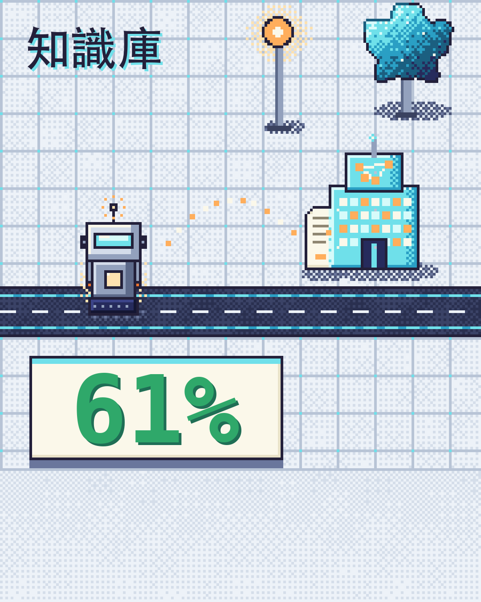

# 像素科技城市

## 一句話
俯視角（略帶斜上方）的 16-bit 抖色像素科技城：淺灰藍廣場地磚、青色發光導引線、橘色強調點，機器人當主角，所有建築都是統一深紫描邊的小方塊積木。

## 適合與不適合的題材（3–5 條）
- 適合：AI Agent、記憶、知識庫、資料流、工作流程這類「有地點、有路徑、有東西被搬來搬去」的題材，城市天然就是系統架構的隱喻。
- 適合：分階段、分層的流程（資料中心 → 終端 → 知識塔 → 信標），可以直接排成一張關卡地圖。
- 適合：產品功能示意與 SaaS 解說，明亮、乾淨、不嚴肅，手機小畫面也讀得清楚。
- 不適合：需要人物情緒、表情的故事（機器人沒有臉，只靠護目鏡與核心燈色表達狀態）。
- 不適合：沉重、嚴肅或需要真實感的題材（醫療事故、法律爭議），像素玩具感會削弱分量。

## 氣氛
明亮、清爽、有點遊戲感的未來城市。底色是淺色（不是暗色賽博龐克），冷色系的灰藍與青為底，橘色只在「重點」亮起，像城市裡的指示燈。整體安靜、有秩序、可愛但不幼稚。

## 用程式畫的難度與限制（低／中／高；哪些部分需要圖像生成模型或手繪素材才做得好）
難度：中。樣張完全用 PIL 逐像素繪製（約 0.2 秒），用 `components_base.py` 與 `components_tech.py` 的函式即可重現。
- 程式做得好：地磚、道路、方塊建築、機器人、紙卡、光點、有序抖色的陰影與光暈。
- 程式做得吃力：有機形狀（人群、樹、動物）與大面積複雜場景的構圖，需要手動調整座標；全像樹的輪廓是程式噴出來的，略顯圓潤。
- 需要手繪或圖像模型：多角度的角色（機器人轉身、走路 4 方向）、大場景的氛圍插畫、真正精緻的像素人物。
- 中文不用像素字型（沒有中文字），用 STHeiti Medium 或 Hiragino Sans GB；像素感只留給數字與英文。

## 指標畫法（這個風格公認的正統做法，寫成 5–8 個可以照做的步驟，例如上色順序、線條方向、分版套色、明暗層數；具體到參數）
1. 先定美術格：4:5 畫面用 180×225 美術像素，最後整數倍放大 6 倍（1080×1350），用最近鄰（NEAREST）放大，禁止平滑。單一元件用 56×56 的小畫布繪製。
2. 先鋪地面再放物件：廣場底色用 `#d5deea`＋`#edf2f8` 做有序抖色，每 14 像素畫一條 `#b8c4d6` 格線，交點點一格 `#6fe0ea` 發光點。
3. 每個顏色只用 3–4 階（陰影／主色／亮面／高光），光從左上來：物件的上邊與左邊取亮階，右邊與下邊取暗階；右側 3 像素寬用 50% 抖色疊暗階做體積。
4. 用 Bayer 4×4 有序抖色做所有漸層（光暈、陰影、玻璃、道路噪點）：閾值 `t > (BAYER[y%4][x%4]+0.5)/16`，不要用隨機雜訊抖色（會髒）。
5. 描邊統一：所有物件外圍 1 像素 `#23203a`，內部分色塊之間不再描邊（只靠色階分開）；描邊貼齊外輪廓，不留縫。
6. 陰影放在地面：物件下方一個橢圓，用 `#4a5478`／`#6a769c` 以 60% 閾值的抖色填，橢圓寬約物件底寬的 0.8 倍、高約 3–4 像素。
7. 強調色最後上：先完成整張冷色畫面，再用橘色（`#f0742e`／`#ffae5c`）點出視線要到的地方（視窗燈、核心、路徑光點），每個畫面橘色面積不超過整張的 3%。
8. 最後疊文字與大數字：在放大後的圖上用字型繪製，文字放在抖色背景上方的乾淨卡片裡，避免與格線打架。

## 模範學習
（事實查證：Susan Kare 於 1983–1986 在 Apple 為第一代 Macintosh 設計介面元素與字體；圖示在方格紙上草繪，一格一像素；包含垃圾桶、檔案夾、Happy Mac、炸彈等；Chicago 字體的字形限於垂直、水平與 45° 線，大寫高 9 像素。Paul Robertson、eBoy 為在世或現存工作室，只取原則，不取任何作品細節。）

### Susan Kare（1954 年生，美國，圖示設計）
- 為什麼學她：她證明小到只有幾十個像素的圖示，一樣能一眼認出是什麼。
- 可以照做的規則：
  1. 只用一個清楚剪影：筆記卡的外形是「長方形＋折角」，折角用 3 像素的斜切與一條 OUT 色折線，一看就是文件（折角是文件圖示的通用做法）。
  2. 放大主要物件：筆記卡從 13×17 放大到 16×22 像素，保證縮小到手機畫面仍看得出是紙。
  3. 斜線只用 45°：折角與箭頭的斜邊都是每格退一階，與 Chicago 字形的 45° 規則一致。
  4. 刪除零散單點：拖尾光點改為 2×2 方塊、固定間距，去掉機器人旁多餘的 1 像素閃點。
  5. 隱喻要直白：卡片進塔，用牆遮住卡片一半表達「放進去」，並在牆上留一條青色發光縫。
  6. 一個物件一個重點色：卡片只有一塊橘色小標籤，不加第二個強調色。
- 不要照抄：Happy Mac、垃圾桶、炸彈、Clarus 狗牛與任何 Macintosh 圖示的造型；也不複製 Chicago 字體。
- 檢查表：
  - 筆記卡縮小到 1/4 時仍看得出是帶折角的文件嗎？
  - 畫面中沒有零散的單像素亮點嗎？
  - 卡片被牆遮住的比例約 50%，且有明顯的入口標記嗎？
  - 斜邊都是每格一階的 45° 嗎？

### Paul Robertson 保羅．羅伯森（澳洲，像素動畫；只取原則）
- 為什麼學他：他的像素作品在極小格子裡仍能清楚表現動勢，原則可轉成靜態構圖。
- 可以照做的規則（原則，不涉及作品細節）：
  1. 動作用一條有弧度的點列暗示方向：從機器人到卡片的 2×2 光點沿拋物線排開，不畫箭頭。
  2. 把細節放在動作焦點：卡片與塔的入口有細節，其他物件只留剪影。
  3. 一幅畫只表現動作的一個瞬間，不同時畫起點與終點。
- 不要照抄：任何具體角色、場景或動畫分鏡。
- 檢查表：
  - 動作方向在不看箭頭時也能看出來嗎？
  - 細節是否集中在卡片與入口附近？

### eBoy 像素城市工作室（Kai Vermehr、Steffen Sauerteig、Svend Smital，1997 年，只取原則）
- 為什麼學它：他們用統一的像素單位與高密度的小圖磚，建構城市，一致性是風格的骨架。
- 可以照做的規則（原則，不涉及作品細節）：
  1. 全畫面只用一個像素單位（1 美術像素 = 6 螢幕像素），所有物件對齊同一格。
  2. 光源統一從左上，陰影一律落在右下地面。
  3. 描邊統一 1 像素 OUT 色；所有物件的描邊色相同。
  4. 物件前後以遮擋表達，不縮放：卡片在塔後，只靠繪製順序。
- 不要照抄：Pixoramas 的具體海報構圖、既有建築造型。
- 檢查表：
  - 所有物件的像素大小一致，沒有混用不同尺度嗎？
  - 描邊色都是 #23203a 嗎？
  - 陰影方向一致嗎？

## 代表畫家、設計師與作品
- eBoy（Kai Vermehr、Steffen Sauerteig、Svend Smital 創立，1997 年，德國柏林／美國洛杉磯）：以等角像素城市海報「Pixoramas」聞名，代表作如《Ecity》（1998）、書籍《HELLO》（2002）。學：高密度小細節與統一的色塊語言。
- 渋谷員子（Kazuko Shibuya，1965 年生，日本）：Square 像素美術師，《Final Fantasy II》（1988）、《Final Fantasy VI》（1994，平面總監與角色像素）。學：極小尺寸角色與道具的辨識度與色階取捨。
- Paul Robertson（保羅．羅伯森，澳洲）：像素動畫短片《Pirate Baby's Cabana Battle Street Fight》（2006）與《Scott Pilgrim vs. The World: The Game》（2010）動畫。學：像素動態與擠壓拉伸的節奏，而不是畫法的靜態細節。
- Pedro Medeiros（Saint11，巴西）：《Celeste》（2018）美術，並公開發表像素動畫與技巧教學。學：抖色、色階與動態的實務技巧。
- Slynyrd（Raymond Schlitter）：長期發表「Pixelblog」像素教學系列，含 City Builder（城市建造）等主題。學：色階配置、等角與氛圍場景。
- Octavi Navarro（奧克塔維·納瓦羅，西班牙巴塞隆納）：像素藝術部落格「Pixels Huh」的城市與夜景場景，並參與《Thimbleweed Park》（2017）的美術與動畫。學：用有限色階營造夜晚城市的氛圍與敘事細節。

## 配色與色階（表格：角色｜色碼｜用途；每個主要顏色列出陰影／主色／亮面／高光；一個畫面最多幾色；強調色怎麼用。色碼必須和 sample.py 一致）
一個畫面總色數不超過約 40 色（以下各色階合計）。冷色為底、橘色強調、綠色只給結果數字與「驗證通過」。

| 角色 | 陰影 | 主色 | 亮面 | 高光 | 用途 |
|---|---|---|---|---|---|
| 廣場地磚 PLZ | `#8fa0b8` | `#b8c4d6` | `#d5deea` | `#edf2f8` | 地面底色與格線 |
| 金屬 MET | `#3a4260` | `#5d6a8a` | `#93a1bd` | `#d3dcea` | 機器人本體、燈柱、框架 |
| 青玻璃／發光線 GLS | `#1b5f80` | `#2a9fc4` | `#6fe0ea` | `#d6fbfa` | 知識塔外牆、道路導引線、標題光影 |
| 道路 ROAD | `#2a3050` | `#3a4266` | `#4c5682` | — | 光軌道路路面 |
| 橘色強調 ORG | `#a8481c` | `#f0742e` | `#ffae5c` | `#ffe2b0` | 核心、窗燈、路徑光點、燈泡 |
| 結果綠 GRN | `#1f6e55` | `#2fa86a` | `#6bd68a` | `#c4f5c8` | 大數字 61%、勾 |
| 深藍面板 NAVY | `#141633` | `#262b5c` | `#3c4488` | — | 螢幕、護目鏡、車輪 |
| 紙卡 PAPER | `#b9b29a` | `#e9e2c8` | `#fbf8ea` | — | 筆記卡、數字牌 |
| 地面陰影 SH | `#4a5478` | `#6a769c` | — | — | 物件落影（抖色） |
| 描邊 OUT | `#23203a` | — | — | — | 全部物件外框、標題主色 |
| 灰石 STONE | `#6f6a66` | `#8f8672` | `#c9bfa5` | `#efe6d0` | 筆記卡上的文字線 |

強調色用法：橘色只放在一個畫面的「動作焦點」（機器人核心、被搬運的筆記、塔的入口）；洋紅 `#8a2a6e／#e0489a／#ff9ccb` 為備用第二強調色，同一畫面不與橘色一起大面積使用。

## 光源、陰影與體積
光從左上來。物件上緣與左緣取亮階（如 MET 的 `#d3dcea`），右緣與下緣取暗階（`#5d6a8a`），右側 3 像素寬用 50% 抖色過渡。陰影落在地面右下，是橢圓形抖色（`#4a5478`／`#6a769c`），不畫在物件身上。發光物（燈、核心、玻璃）周圍用 `#ffe2b0` 或 `#6fe0ea` 做半徑 5–9 像素的抖色光暈，由內向外變稀。

## 線條、描邊與邊緣（粗細以畫面寬度的比例表示）
- 描邊固定 1 美術像素（約畫面寬度的 0.55%，即放大後 6px），顏色 `#23203a`。
- 重要物件（機器人、卡片）可以用 2 像素外框（外圈深色、內圈強調色），例如筆記卡的狀態邊框。
- 邊緣不抗鋸齒；斜線只用階梯狀（1 像素一階），圓用 `disc()` 逐像素判斷。
- 標題與大數字用字型繪製，加一圈偏移 5–6px 的色影（青或深綠）代替描邊。

## 質感與筆觸（具體參數：密度、大小、透明度、方向）
- 沒有「筆觸」，質感全部來自有序抖色：Bayer 4×4，不用透明度，每個像素只有一種實色。
- 廣場地磚：閾值 `0.55 + noise*0.3`（noise 約 ±1 的低頻正弦組合）在 `#edf2f8`／`#d5deea` 之間抖；格線間距 14 像素。
- 道路：閾值 `0.5 + noise*0.3` 在 `#3a4266`／`#2a3050` 之間抖；兩側青色導引線每 8 像素 5 亮 3 暗；中線白色虛線每 12 像素 6 亮 6 暗。
- 玻璃牆：左側取亮階，並以 3 像素寬的 50% 抖色疊暗階；窗戶 3×3 方塊，每 4 像素一格，顏色在白、淺青、橘之間輪替。
- 日常裝飾粒子（光點）是 2×2 像素方塊，橘／白交替。

## 細節密度、格線與比例（主體佔畫面多少、留白比例）
- 美術格 180×225（放大 6 倍＝1080×1350）；元件 56×56。
- 主體（機器人＋筆記卡＋知識塔）占畫面高度約 25%，橫排在畫面中段偏上；大數字卡占約 17%；標題占約 8%。
- 底部約 22% 留白：只剩淡色抖色地磚，無格線、無發光點，保持安靜。
- 單一畫面物件不超過 8–10 件（樣張為：機器人、筆記卡、知識塔、燈柱、全像樹、道路、數字卡、標題）。

## 字體搭配與字級（中文／數字／英文的字體性格；標題、標籤、大數字佔畫面高度的比例）
- 中文標題：STHeiti Medium（`/System/Library/Fonts/STHeiti Medium.ttc`）或 Hiragino Sans GB，字級約 104px（畫面高度的 7.7%），色 `#23203a`，右下加 5px 偏移的 `#6fe0ea` 色影。
- 大數字：等寬粗體字（樣張用 Menlo Bold，210px，約畫面高度 15%），色 `#2fa86a`，右下加 6px 偏移的 `#1f6e55` 色影，放在紙卡 `#fbf8ea` 上。成片可改用像素字型以強化風格（英文與數字專用）。
- 標籤：每畫面最多一個短標籤，STHeiti 約 40–48px。
- 中文字不可用像素字型（缺字），必須檢查字型是否有該字。

## 動態性格（怎麼動才對味：幀率、緩動、進出場、鏡頭；不該怎麼動）
- 幀率：角色與道具一拍兩格（約 8–12 fps 的換圖），鏡頭平移與推近保持平順（30 fps）。
- 移動以整數像素（或整數的 U 倍）貼齊，不要出現小數位置造成像素閃爍。
- 進場：物件由下往上「彈出」2–3 格再定位，或以像素方塊逐列顯現；轉場用方塊式的馬賽克擦除。
- 機器人：待機時核心橘色呼吸（2 格交替），工作時護目鏡全亮、核心放光；移動時履帶 2–4 格換圖。
- 筆記卡沿拋物線飛向塔，路上留 2×2 的光點拖尾，抵達時入口亮一格閃光。
- 不該：旋轉任意角度（像素會糊）、平滑縮放、漸層淡入淡出的過多使用、動態模糊、鏡頭晃動過大。

## 元件清單（知識影片常用的 14 個元件在這個風格下怎麼畫，各一句：主角 Agent、筆記卡、知識庫、資料夾、大數字牌、長條圖、箭頭、勾與叉、路徑或地圖、時間軸、對話框字幕、章節標示、人群或多個物件、背景）
- 主角 Agent：金屬灰機器人，方頭帶護目鏡（不畫眼睛與嘴）、頭頂天線、胸前橘色核心、履帶；狀態靠護目鏡與核心燈色表達（`robot()`）。
- 筆記卡：樣張用 16×22 像素米白紙卡（Kare 的小尺寸辨識原則；元件表仍可用 13×17），3–4 條灰色文字線、左上折角、一塊橘色小標籤；寫錯加紅框與叉、驗證加綠框與勾。送進知識塔時先畫卡片、再畫塔，牆蓋住右半，牆上一條青色發光縫。
- 知識庫：青玻璃的 wiki 塔，窗戶橘白相間、頂部螢幕顯示節點連線，下方一個深色入口。
- 資料夾：金屬色抽屜櫃或深藍面板的檔案櫃，櫃面有 3 條橘色色條作為分類。
- 大數字牌：米白卡片、深色 2 像素外框，頂部一條青色亮邊，數字用綠或深色。
- 長條圖：方塊式長條，每格 20×36 像素的方塊，深色描邊內填色，結果用綠、對照用灰。
- 箭頭：道路上的青色三角箭頭，或橘色的方塊階梯箭頭，1 像素階梯斜邊。
- 勾與叉：用 2 像素粗的階梯線，勾用 `#2fa86a`、叉用紅色 `#e0486a`（需符合同畫面強調色限制）。
- 路徑或地圖：光軌道路（深色路面＋兩側青色導引線＋白色中線），路口放全像路牌。
- 時間軸：一條橫向的道路，節點放小建築或圓形標記，節點之間用 2×2 橘白交替方塊連接。
- 對話框字幕：米白卡片、深色 2 像素外框，中文字用 STHeiti，放在畫面下方留白帶。
- 章節標示：深藍面板橫條，英文／數字用像素或等寬字（金色 `#ffd65c` 亮字），中文用白字。
- 人群或多個物件：重複的小機器人或小房子，用不同的窗燈顏色與天線形狀區分，避免完全複製。
- 背景：淺灰藍地磚＋格線，道路貫穿，遠處留一點全像樹與燈柱；底部 22% 收斂為安靜的淡色地磚。

## 常見失敗與避免方式（至少 6 條）
- 失敗：畫面用深色背景又塞滿霓虹，變成一般賽博龐克。避免：維持淺色廣場底，強調色只用橘色一點。
- 失敗：主角只畫成一隻手臂或看不出是機器。避免：一定畫出方頭、護目鏡、天線與履帶。
- 失敗：給機器人畫卡通眼睛與嘴巴，變成吉祥物。避免：只用護目鏡亮色與核心燈色表達狀態。
- 失敗：用平滑縮放或旋轉造成像素糊掉。避免：最近鄰放大、只用整數倍與整數位移。
- 失敗：中文字缺字（方框）。避免：只使用 STHeiti Medium 或 Hiragino Sans GB，並檢查每個字是否為缺字符號。
- 失敗：陰影用隨機雜訊抖色，畫面髒。避免：只用 Bayer 4×4 有序抖色。
- 失敗：物件太多太雜，主角被淹沒。避免：單畫面不超過 8–10 件物件，主體以外的物件降低對比。
- 失敗：每個物件描邊顏色不同。避免：全部使用 `#23203a`。

## 一定要做／一定不要做（各 5 條）
一定要做：
1. 全部用同一組色階與同一種描邊色。
2. 光源固定從左上，陰影落在右下的地面。
3. 用最近鄰、整數倍放大。
4. 強調色（橘）只放在動作焦點。
5. 保留畫面底部約 22% 的安靜留白。

一定不要做：
1. 不要在機器人臉上畫眼睛與嘴巴。
2. 不要用平滑縮放、任意角度旋轉或動態模糊。
3. 不要使用隨機雜訊抖色。
4. 不要用像素字型畫中文。
5. 不要在畫面中放現成品牌或遊戲角色、商標。

## 原創界線（這個風格可以學什麼、不可以照做什麼）
- 可以學：eBoy、SimCity 這類作品的色塊語言、圖磚化與密度控制；有序抖色、色階與統一描邊等技法本身。
- 不可照做：任何特定作品的構圖、角色、標誌性圖案（例如特定遊戲的角色、Pixoramas 的特定海報構圖、既有遊戲的建築造型）。
- 機器人、知識塔、道路與全像樹都是原創造型，不要改畫成既有機器人或建築的複製品。
- 畫面中不放任何品牌名稱、商標或遊戲 UI 的原樣。
