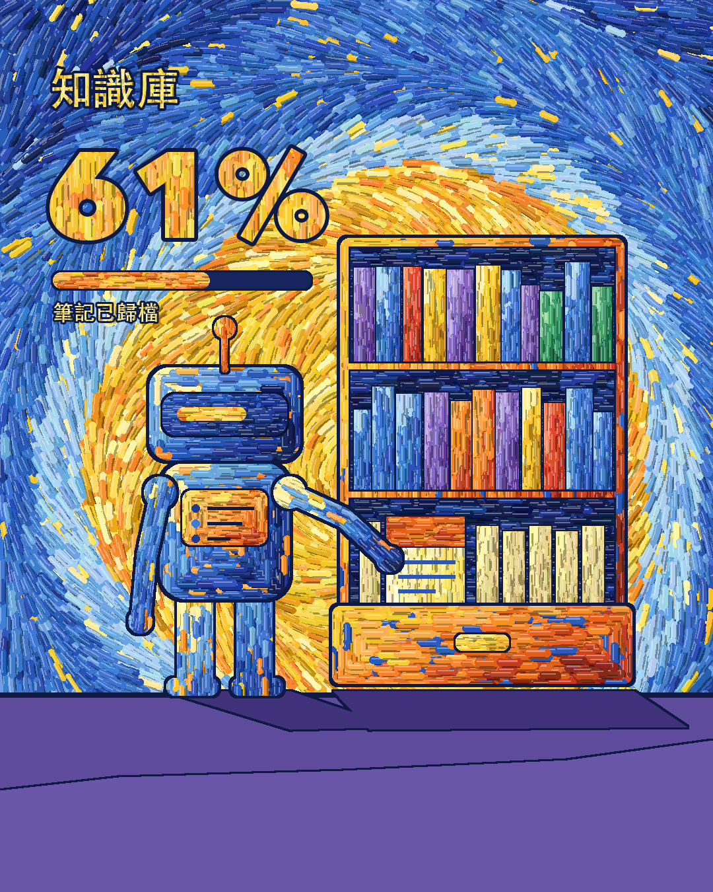

# 後印象派（梵谷）

## 一句話
厚塗的方向性筆觸沿著形體與氣流走，用互補色對（鈷藍對橘黃、黃對紫）讓畫面震動，物件外圍圈一條深色輪廓線；大面積背景可以像高更那樣收成不分明暗的平塗色塊，情緒比寫實重要。

## 適合與不適合的題材
- 適合：情緒強烈、要「有人味」的知識短片：學習的焦慮與突破、夜晚加班、孤獨的專注、靈感湧現。
- 適合：天空、旋渦、光暈、田野這類本身有流動感的背景；機器人與書櫃這類硬物也行，筆觸會沿著它們的邊走。
- 適合：封面、章節首頁、單張海報，對比強、縮小仍醒目。
- 不適合：需要冷靜、可信、企業感的資料報告與財報畫面。
- 不適合：精細資訊（表格、小字、流程圖）；厚塗筆觸太吵。
- 不適合：需要中性、柔和色調的題材（醫療、金融合規說明）。

## 氣氛
濃烈、旋轉、有點焦慮又有點狂喜。深藍的夜與橘黃的光互相拉扯，筆觸像用力擠上去的顏料，整張畫在震動；底部一塊平塗的紫色讓眼睛休息。

## 用程式畫的難度與限制
難度：中到高。重點在「筆觸要沿形體走」與「厚塗的凸起感」，要靠流場函式與三層線（陰影邊、本體、高光脊）才畫得像；單張樣張約 4 秒。
限制：
- 每種形體要自己寫流場：矩形用「平行最近邊」（`follow_rect`），手臂腿用「沿最近線段」（`follow_limb`），天空用旋渦（`swirl`）；少一個，筆觸就變成亂刷。
- 筆觸是多段折線，PIL 的 `joint='curve'` 只能近似圓滑，放大看略有稜角。
- 厚塗凸起只有「右下陰影邊＋左上亮脊」兩條細線，不是真的高度圖；光源必須固定左上。
- 筆觸數量大（天空兩層約 3 萬顆）；動畫時筆觸位置要固定（固定亂數種子），只讓流場相位或顏色緩慢變，否則畫面沸騰。
- 深色輪廓用遮罩膨脹取外圈，所以輪廓粗細一致，不像手畫有粗細變化；可以另加少量斷續的筆觸補強。
- 文字一律先畫深色外框再填筆觸，否則在旋渦背景上看不清。

## 指標畫法
1. 先定互補色對：鈷藍（背景與機器人）對橘黃（光暈、書櫃框、感測燈），第二組黃對紫（光暈對地面）。整張只用這兩組加少量紅綠點綴。
2. 天空：旋渦流場，圓心放在動作後面（樣張 580,690），顏色依半徑分帶：黃核心 → 橘黃帶 → 淡青白帶 → 鈷藍 → 群青；半徑加上 `sin(3θ)` 的擾動，讓色帶像漣漪。兩層筆觸（長 40 寬 14，長 26 寬 9）。
3. 每顆筆觸三層：右下偏 1.8px 的暗邊（本體色 ×0.66）、本體、左上偏移的亮脊（本體色提亮 35%、寬約 1/4）。
4. 物件先填中間色，再用形體流場撒筆觸，筆觸以遮罩裁切，最後用 `contour()` 在外側畫 4–5px 的深藍描邊（`0E1A44`）。
5. 機器人：鈷藍色階為主，少量橘黃飛白筆觸（`flick`）；護目鏡深群青，感測燈用橘黃，與藍形成補色；胸口面板用橘色，內容是清單式的點與線，不排成臉。
6. 書櫃：框用橘紅色階、筆觸沿邊走；內部深藍；每本書各自一種色階（紫、黃、綠、藍、紅、橘）並各自描邊，像高更的分區輪廓。
7. 地面是高更式平塗：一整塊紫（`5E4B9C`）、一塊更亮的紫形，以及更暗的平塗投影，只用薄深色線封邊，沒有筆觸、沒有明暗。這同時是底部 22% 的平靜區。
8. 文字：先畫深藍外框（標題 4px、數字 6px），字形內填黃橘筆觸；進度膠囊同樣平塗加筆觸加外框。

## 模範學習
### Vincent van Gogh（1853–1890，荷蘭，主要創作於法國）
為什麼學他：他的筆觸本身就是情緒，並且有一套可以拆成規則的做法：方向、厚度、互補色、深色輪廓。
可以照做的規則：
1. 筆觸沿著形體的方向走：圓柱沿軸、盒面平行於邊、天空沿氣流旋轉。
2. 一塊面由「一個色相的好幾階」組成，並排而不是抹勻，筆觸之間留得出縫。
3. 用互補色製造震動：藍與橘、黃與紫、紅與綠，放在相鄰位置。
4. 外圍加一條深色（普魯士藍或深褐）輪廓線，讓厚塗的顏色不會糊在一起。
5. 天空與背景比主體更「動」：旋渦、波紋、光暈；主體筆觸較短、較穩。
6. 厚度靠亮脊與暗邊暗示，亮面筆觸比暗面更厚、更飽和。
7. 色彩可以離開自然色：機器人是鈷藍、地面是紫，只要整體和諧。
不要照抄：不要複製《星夜》（The Starry Night，1889，紐約現代藝術博物館）的村莊、柏樹與月星構圖，也不要複製《夜間咖啡館》（The Night Café，1888，耶魯大學美術館）的室內透視與黃綠配色，或《麥田與柏樹》（Wheat Field with Cypresses，1889，大都會藝術博物館）的柏樹形與雲形。
檢查表：
- 每塊面的筆觸方向是否跟形體或流場有關，而不是亂刷？
- 相鄰兩大塊是否構成互補色？
- 每個物件外圍是否都有深色輪廓？
- 背景比主體更動、更亂嗎？

### Paul Gauguin（1848–1903，法國，曾居布列塔尼與大溪地）
為什麼學他：他把畫面簡化成大面積平塗色塊與深色封邊（綜合主義、分區主義），正好為厚塗畫面提供「休息區」。
可以照做的規則：
1. 用不分明暗的單一色塊構成大形，顏色可以不寫實。
2. 色塊之間用深色線封邊，像琺瑯或彩繪玻璃的隔線。
3. 刪掉透視與陰影，用色塊的上下左右位置表達空間。
4. 平塗區與筆觸區並置，讓眼睛在「吵」與「靜」之間切換。
5. 輪廓可以用曲線與裝飾性形狀，而不是照物件實際的形。
不要照抄：不要複製《佈道後的幻象》（Vision After the Sermon，1888，蘇格蘭國家美術館）的斜向樹幹與紅色地面構圖，也不要複製《黃色基督》（The Yellow Christ，1889，水牛城 Albright-Knox 美術館）的十字架與婦女人物。
檢查表：
- 至少有一塊完全沒有筆觸與明暗的平塗區嗎？
- 平塗區是否被深色細線封邊？
- 平塗區的顏色與厚塗區的主色成互補或對比嗎？

## 代表畫家、設計師與作品
- Vincent van Gogh（文森・梵谷）：1853–1890，荷蘭。《夜間咖啡館》（1888，耶魯大學美術館）、《麥田與柏樹》（1889，大都會藝術博物館）、《星夜》（1889，紐約現代藝術博物館）。學他的方向性厚塗、互補色與深色輪廓。
- Paul Gauguin（保羅・高更）：1848–1903，法國。《佈道後的幻象》（1888，蘇格蘭國家美術館）、《黃色基督》（1889，Albright-Knox 美術館）。學他的平塗色塊與分區輪廓。
- 兩人於 1888 年 10 月至 12 月在法國南部阿爾勒的「黃色小屋」共同生活約兩個月，本風格把梵谷的筆觸與高更的平塗放在同一張畫。

## 配色與色階
色碼以 `sample.py` 為準。

| 角色 | 色階（暗→亮） | 用途 |
|---|---|---|
| 鈷藍 BLUE | 16255E 1F3C94 2B58B8 3F7AD0 6AA6E0 A9D2F0 | 天空外圈、機器人身體、書、卡片文字線 |
| 黃 YEL | C98A12 E8A91C F6C72E FBDF5E FFF0A0 | 光暈核心、標題、卡片、把手 |
| 橘 ORA | 8E2A1A C4401F E4651F F58A2A FBB04A | 書櫃框、胸口面板、感測燈、天線、大數字、進度條 |
| 深輪廓 NAVY | 0E1A44（護目鏡外框 0A1236） | 所有物件與文字外框 |
| 地面平塗 | 5E4B9C 主色；6A56A8 亮塊；3F327A 投影 | 高更式平塗區，無筆觸 |
| 書（紅） | B8301F E04A2E F58A5E | 每本三階 |
| 書（綠） | 1F7A52 3E9E6A 8FD3A0 | 同上 |
| 書（紫） | 5B3A96 8466C0 B9A2E4 | 同上 |
| 書（黃藍橘） | 取自 YEL、BLUE、ORA | 同上 |
| 索引卡 | C9B067 E8D48A FFF0A0 | 抽屜內其他卡片 |
| 新卡片 | D9C47A FBDF5E FFF0A0 FFF8D0 | 被放入的筆記卡（標頭用 ORA） |
| 護目鏡 | 0E1A44 16255E 1F3C94 2B58B8 | 機器人頭部深色帶 |

互補配額：橘黃只當與藍相鄰的補色與光；紫色只給地面，與黃色光暈互補；紅綠只給書，各一兩本。

## 光源、陰影與體積
- 光源固定左上：每顆筆觸右下一條暗邊、左上一條亮脊。
- 體積靠色階左上亮、右下暗（`light_fn`），以及筆觸沿形體彎。
- 投影是平塗：一塊比地面更暗的紫形（`3F327A`），不模糊、不漸層。
- 光暈：背景黃橘旋渦就是光的來源，同時為深色輪廓的物件打聚光。
- 大數字與標題不加投影，用深色外框代替。

## 線條、描邊與邊緣
- 描邊是這個風格的核心：深藍（`0E1A44`）4–5px 外圈，書與卡片較細（2–3px），文字外框 3–6px。
- 輪廓畫在形狀外側（遮罩膨脹減去原遮罩），不吃掉內部的筆觸。
- 平塗區的封邊線較細（約 3px），顏色同輪廓。
- 不要加高光輪廓或發光；邊緣要硬。

## 質感與筆觸
- 筆觸是多段折線，長 14–40、寬 5–14，沿流場積分，頭尾圓頭。
- 三層結構：暗邊、本體、亮脊；亮脊只畫在寬度大於約 5px 的筆觸上。
- 天空筆觸最長最粗，主體較短（長約 20–24），文字內最細（長 14–26）。
- 顏色以 `pick()` 依明度挑階並加 ±9 的抖動，偶爾用飛白色（橘、黃）。
- 平塗區刻意沒有任何質感，形成對比。

## 細節密度、格線與比例
以 1080×1350（4:5）為準：
- 地平線 y=1052，下方約 22% 是平塗紫與一塊亮紫形，完全沒有筆觸。
- 標題 66px、大數字 184px（Avenir Next Heavy）、標籤 32px，左邊界約 74px。
- 旋渦圓心在動作後方（580,690）；機器人 k=1 高約 556px，書櫃 430×670。
- 主體不超過 4 個；裝飾只靠旋渦本身，不另加星星或圖案。
- 書約 25 本，每本獨立描邊。

## 字體搭配與字級
- 中文只用 STHeiti Medium，所有中文先過 `check_glyphs()`，缺字會報錯。
- 數字用 Avenir Next Heavy（index 8）。
- 標題 66px 黃色筆觸加 4px 深藍外框；大數字 184px 橘黃筆觸加 6px 外框；標籤 32px 黃色加 3px 外框。
- 外框先畫、再於字形內填筆觸，確保在旋渦背景上可讀。

## 動態性格
- 旋轉：背景旋渦極慢地轉動（流場相位緩慢增加），像整個天空在呼吸；位置固定，只動相位與少數亮點筆觸。
- 筆觸「刷出來」：由背景到主體、由大筆觸到小筆觸依序出現，每顆約 3–5 幀。
- 亮點閃爍：黃色小筆觸在深藍區輕輕明滅，像星光，不要快速。
- 物件進場帶一點彈性，但輪廓線必須跟著一起出現。
- 鏡頭：緩慢旋轉推近 3–5%；不要劇烈搖晃。
- 不該：不要讓所有筆觸同時重畫（沸騰），不要加模糊動態。

## 元件清單
以下函式都在 `sample.py`。
- 厚塗筆觸：`impasto()`，沿流場積分的折線，三層（暗邊、本體、亮脊）並以遮罩裁切。
- 流場（矩形）：`follow_rect()`，平行最近邊。
- 流場（肢體）：`follow_limb()`，沿最近線段。
- 流場（旋渦）：`swirl()`，繞圓心並隨半徑起伏。
- 輪廓線：`contour()`，在遮罩外圈畫深色帶。
- 挑色：`pick()`，依明度挑階並混入飛白色。
- 物件上色：`part()`，中間色打底、筆觸、輪廓一次完成。
- 旋渦天空：`sky_col` 依半徑分色帶。
- 平塗地面與投影：高更式平塗加細封邊。
- 機器人：鈷藍身體、深色護目鏡加橘色感測燈、橘色胸口清單面板，無五官。
- 筆記卡與抽屜：卡片畫在抽屜之後、前板之前；前板蓋住下半張表示已放入。
- 書櫃與書：橘框、深藍內部、各自描邊的書。
- 大數字與標題：`typeset()`，深色外框加筆觸填色。
- 進度膠囊：深藍軌道、橘黃筆觸填色、外框。

## 常見失敗與避免方式
- 失敗：筆觸方向亂，畫面像噪點。避免：每個形體都定義流場，筆觸沿流場積分。
- 失敗：沒有亮脊與暗邊，厚塗變成扁平色塊。避免：每顆筆觸畫三層。
- 失敗：互補色用錯位置，顏色互相抵消成髒灰。避免：互補色放相鄰但不重疊混合，不要在同一筆觸裡混。
- 失敗：沒有深色輪廓，黃與橘糊成一團。避免：每個物件與文字都有 4–6px 深藍外圈。
- 失敗：整張都是筆觸，眼睛沒有地方休息。避免：留一塊高更式平塗（地面）。
- 失敗：把《星夜》的村莊與柏樹畫進去，變成仿作。避免：只借旋渦流場的原理，主體是自己的機器人與書櫃。
- 失敗：文字直接放在旋渦上看不清。避免：先畫深色外框再填筆觸。
- 失敗：動畫每幀重撒筆觸造成沸騰。避免：固定種子，只動流場相位。

## 一定要做／一定不要做
一定要做：
- 筆觸沿形體或流場的方向。
- 至少一組互補色並排（藍對橘）。
- 每個物件與文字都有深色輪廓。
- 留一塊無筆觸的平塗區（底部約 22%）。
- 光源固定左上，亮脊與暗邊方向一致。
一定不要做：
- 不要隨機亂刷筆觸方向。
- 不要用模糊、漸層或發光。
- 不要照畫特定名作的構圖與物件組合。
- 不要在圖中放品牌名稱或商標。
- 不要讓文字沒有外框就壓在旋渦上。

## 原創界線
可以學：沿形體的方向性筆觸、互補色對比、深色輪廓、旋渦流場、平塗與筆觸並置。
不可以：照抄《星夜》《夜間咖啡館》《麥田與柏樹》《佈道後的幻象》《黃色基督》等的構圖、母題（村莊、柏樹、月星、咖啡館室內、十字架）；不得使用他人商標或品牌；機器人、書櫃、卡片造型必須自行設計。
