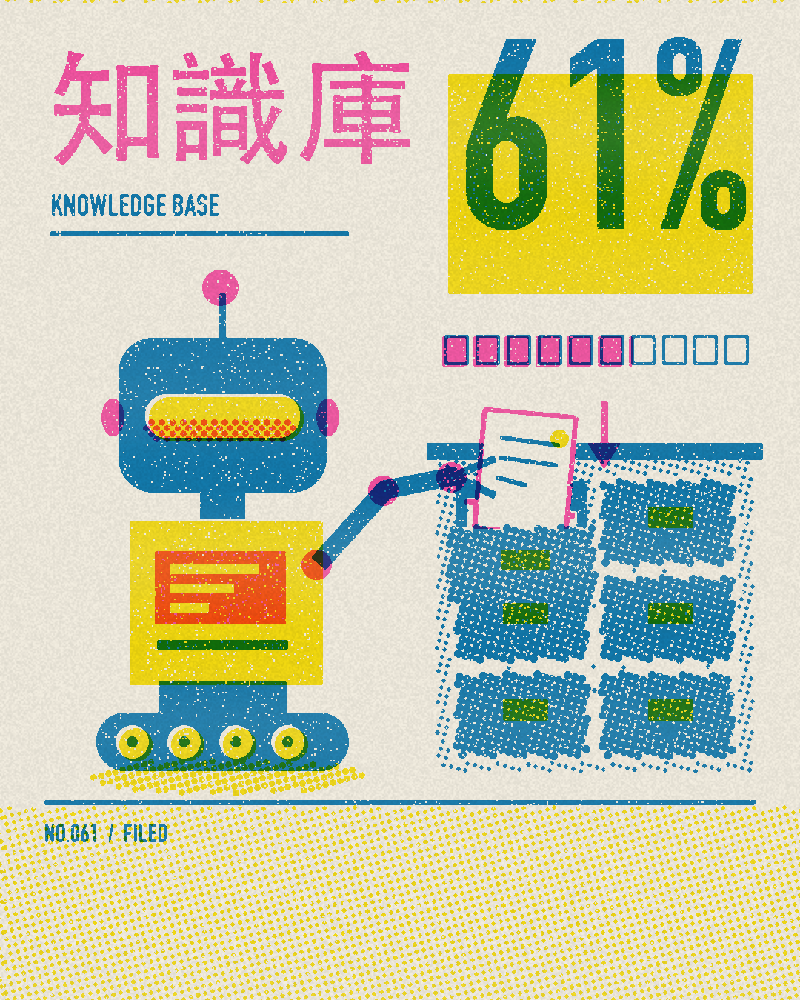

# 復古孔版印刷（Riso Print）

## 一句話
用兩三種特別色油墨，逐色分版、疊印，靠半色調網點、套色偏移和紙張顆粒，做出「剛從孔版印刷機出來」的手工印刷感。

## 適合與不適合的題材（3–5 條）
- 適合：知識卡、懶人包、清單、概念拆解，大數字加一個主視覺就能講清楚。
- 適合：文化、教育、獨立品牌、社群活動，需要「有人味、不像企業罐頭」的場合。
- 適合：吉祥物或機器人這類簡單幾何角色，靠色塊與疊色就有辨識度。
- 不適合：需要精準色彩的產品照、金融圖表、醫療資訊（油墨疊色會改變色相，易誤讀）。
- 不適合：大量小字、密集表格、寫實人像與漸層光影。

## 氣氛
懷舊、手作、輕鬆、有一點叛逆。色彩鮮豔但不刺眼，因為底下是米色紙；畫面帶一點不完美（偏位、飛白、顆粒），反而讓人覺得可信、可親。

## 用程式畫的難度與限制（低／中／高；哪些部分需要圖像生成模型或手繪素材才做得好）
難度：中。分版、疊印、網點、套色偏移都能用 PIL 程式化做到，而且幾何形主體（機器人、櫃子、卡片）很適合。限制：自然物（人臉、植物、手繪肌理線條）需要手繪素材或手工描點才有「版畫手感」；真正的 riso 不規則墨斑與紙纖維，程式只能用雜訊近似。

## 指標畫法（這個風格公認的正統做法，寫成 5–8 個可以照做的步驟，例如上色順序、線條方向、分版套色、明暗層數；具體到參數）
1. 先決定 3 支滾筒（特別色）：黃 FFE800、粉 FF48B0、藍 0078BF；整張圖只准用這三色與它們的疊色。
2. 每支滾筒是一張獨立灰階遮罩：實心區（solid）直接填 255，中間調區（tone）用 0–255 表示墨量。
3. 中間調一律轉成調幅網點（AM halftone）：網距約 10px（1080 寬約 108 線），點半徑 = 網距 × 0.60 × √墨量；三色網角錯開 30 度（黃 75、粉 45、藍 15），避免摩爾紋。
4. 印刷順序由淺到深：黃 → 粉 → 藍；用「正片疊底（multiply）」疊在紙色上，疊色自然產生橙紅（黃＋粉）、綠（黃＋藍）、紫藍（粉＋藍）。
5. 需要「露出紙白」的地方（如筆記卡）要在所有滾筒遮罩上挖空（knock-out），不能靠加白色。
6. 套色偏移：每支滾筒各自位移，樣張用黃 (+5,+4)、粉 (−3,+2)、藍 (0,0)；藍是主版，不動。偏移量約畫面寬 0.3–0.5%。
7. 瑕疵疊加：邊緣高斯模糊 1.1px 再二值化（模擬版孔）；墨量乘 0.94（油墨半透明）；實心區加約 3.5% 飛白點；橫向滾筒墨量起伏 86–100%；最後乘一層 236–255 的紙面雜訊。
8. 構圖用大色塊與留白，不畫漸層；明暗只靠「網點大小」與「疊色」兩層，不超過 3 階。

## 模範學習

### Bruno Munari（布魯諾·穆納里，1907–1998，義大利）
- 為什麼學他：他把「用最少的形狀與疊色講清一件事」做到極致，書籍設計與兒童讀物（Libri illeggibili 1949 起、Nella notte buia 1956、Negativo-Positivo 1950 年代）都靠平塗色、裁切與重疊，和孔版印刷的邏輯同源。
- 可以照做的規則：
  1. 把形狀化約成基本幾何：方、圓、橫條。本樣張機器人是圓角方塊加圓球，櫃子是矩形格，手臂是圓點接線段。
  2. 疊印當作主要的視覺手法：兩色疊出第三色（黃×藍=綠、黃×粉=橘紅），讓一個色塊同時講兩件事（61% 壓在黃塊上）。
  3. 一張圖只講一個想法：這裡是「卡片被放進去」；其餘元素（61%、進度條）都只是同一件事的量化。
  4. 以重複單元做變奏：十格進度條，六格填粉、四格留空，正負相對，等於 Negativo-Positivo 的圖地翻轉。
  5. 大面積留白做不對稱平衡：上方標題與 61% 色塊左右錯開，底部約 22% 只留一條地線與一層淡黃網點。
  6. 讓媒材的痕跡留著：版偏移、飛白、紙紋都不修掉，這是質感的來源，不要再另外加裝飾。
  7. 文字小而準：英文標籤用窄體大寫一行，中文標題只有一個粉色名詞。
- 不要照抄：Libri illeggibili 的裁孔與裝訂造型、Nella notte buia 的黑頁挖孔構圖、Munari 的 Xerografie 與猴子 Zizi 等具名作品。
- 檢查表：
  - 主要形狀是否只有方、圓、條三類？
  - 是否至少有一處兩色疊印出第三色，且是刻意的？
  - 是否有一組正負相對的重複單元（滿格與空格）？
  - 底部約 22% 是否只留地線與淡網點？

### Blexbolex（布萊克斯波萊克斯，1966 年生，法國；在世藝術家，只學原則）
- 為什麼學他：他在昂古萊姆美術學院學絲網印刷，繪本（L'Imagier des gens 2008、Saisons 2009）用極少的平塗色與疊色，以形狀而非輪廓講故事。
- 可以照做的規則：
  1. 不描輪廓：物件的邊界就是色塊的邊界。本樣張的軀幹是單一黃色方塊，櫃子與抽屜都沒有外框，抽屜之間用紙白間隙分開（寬 9px）。
  2. 色票固定而克制：只有黃、粉、藍加紙色，整組繪本都用同一組顏色，不因單張而增色。
  3. 用色塊的重疊做細節：胸前面板是粉疊在黃上的橘紅，輪子是黃疊在藍上的綠邊，不另外畫細線。
  4. 簡化到只剩可辨識的輪廓：機器人側面一眼可認，頭、軀幹、底座三塊；不加螺絲、紋路、陰影。
  5. 圖與圖互相對話：大數字、進度條、櫃子在同一頁形成「量」與「物」的對照，意思來自並置而不是文字說明。
  6. 色調偏舊紙感、偏柔和，不用霓虹螢光色；紙色保持米色。
- 不要照抄：L'Imagier des gens 的人物與職業角色造型、Saisons 的四季構圖、他標誌性的臉部與帽子畫法。
- 檢查表：
  - 畫面中有沒有「外框線」？除標題下的地線以外應該沒有。
  - 軀幹、頭、櫃子是否都是單色色塊，不是描線加填色？
  - 細節是不是靠疊色而不是額外的線？
  - 顏色是否只有三色加紙色？

## 代表畫家、設計師與作品
- Saul Bass（索爾·巴斯），1920–1996，美國：《迷魂記（Vertigo）》（1958）與《砍死羅傑（Anatomy of a Murder）》（1959）的海報與片頭設計。學他用極少色、剪紙般的平塗幾何表達概念。
- Charley Harper（查理·哈珀），1922–2007，美國辛辛那提：自稱「極簡寫實（minimal realism）」，以極簡幾何描繪鳥類與自然的插畫。學他「用最少形狀講清楚主體」的歸納功夫。
- Josef Albers（約瑟夫·亞伯斯），1888–1976，德裔美國：《Interaction of Color》（耶魯大學出版社，1963）。學他對疊色與色彩相互影響的系統性觀察，疊印色相要先試再用。
- Miroslav Šašek（米羅斯拉夫·薩謝克），1916–1980，捷克（後流亡西歐）：《This is Paris》（1959）。以平塗色塊與簡練線條畫城市。學他的構圖留白與手繪線條的鬆。
- Olle Eksell（奧勒·埃克塞爾），1918–2007，瑞典：1950 年代為 Mazetti 設計的「眼睛」標誌，並出版《Design = Economy》。學他用有限色與簡單造型做出幽默與辨識度。
- Blexbolex（布萊克斯波萊），1966 年生，法國：圖畫書《Saisons》（2009，英文版《Seasons》2010）。他學過網版印刷，書中以疊色與簡化造型做圖像敘事，學他的疊色與造型歸納。

## 配色與色階（表格：角色｜色碼｜用途；每個主要顏色列出陰影／主色／亮面／高光；一個畫面最多幾色；強調色怎麼用。色碼必須和 sample.py 一致）
一個畫面最多 3 種油墨 + 紙色。「陰影／亮面」不另外調色，而是靠網點密度（墨量）與疊色得到。

| 角色 | 色碼 | 用途 |
|---|---|---|
| 紙（底） | F3EEE1 | 米色紙；高光＝不印墨的紙白 |
| 黃（亮面／強調底） | FFE800 | 色塊底、機器人軀幹（平塗無框）、標籤、輪子；墨量 25–70% 網點當淺色面 |
| 粉（主色／強調） | FF48B0 | 標題「知識庫」、卡片框線、進度條；強調色，每圖面積不超過 15% |
| 藍（主版／陰影） | 0078BF | 輪廓、機器人頭、櫃子（無外框）、大數字；墨量 18%（櫃身）、67%（抽屜與抽屜前板）網點當中間調，不再畫外框 |
| 黃×粉 疊印 | 約 FF4A3A 橘紅 | 機器人胸前面板 |
| 黃×藍 疊印 | 約 007A55 深綠 | 「61%」壓在黃塊上的字色 |
| 粉×藍 疊印 | 約 5A2A8A 紫藍 | 關節、側螺絲，作為最深的陰影 |

強調色用法：粉色只給「最想讓人看的 1–2 個東西」（標題、卡片）；藍色負責結構；黃色負責底與亮。

## 光源、陰影與體積
- 沒有真實光源；體積靠平面分色。主體用「藍輪廓＋黃網點填色」表達，陰影用同色網點加疊另一色。
- 地面陰影用黃色網點橢圓（墨量約 43%），不用黑、不用漸層。
- 層次最多 3 階：紙白、單色網點（中間調）、實心或疊印（最深）。

## 線條、描邊與邊緣（粗細以畫面寬度的比例表示）
- 主輪廓 8–10px，約畫面寬的 0.8%；內部細節 4–6px，約 0.4–0.5%。
- 線端略圓、轉角可略方；不要用細到 3px 以下的線，會在網點與飛白中消失。
- 邊緣是硬邊但帶輕微不規則：模糊後門檻 118/255，模擬版孔而非向量銳利。

## 質感與筆觸（具體參數：密度、大小、透明度、方向）
- 網點：網距 10px，點半徑最大約 6px；黃 75°、粉 45°、藍 15°。
- 油墨透明度 94%；疊印用 multiply。
- 飛白：約 3.5% 的半解析度雜點，模糊 0.7px 後二值化。
- 滾筒條紋：水平方向，墨量 86–100%，週期約 37px 與 211px 疊加。
- 紙張顆粒：全圖乘 236–255 的雜訊，半解析度放大。

## 細節密度、格線與比例（主體佔畫面多少、留白比例）
- 主體（機器人＋櫃子）約佔畫面高度 45%，標題與大數字各約 20%。
- 底部約 22% 保持安靜：只放一條地面線、淡黃網點與一行小字。
- 大色塊為主，細節只放在主體上；不要鋪滿花紋。

## 字體搭配與字級（中文／數字／英文的字體性格；標題、標籤、大數字佔畫面高度的比例）
- 中文標題：STHeiti Medium（華文黑體），168px，約畫面高 12.5%，粉色。
- 大數字：DIN Condensed Bold，360px，約畫面高 27%，藍色壓在黃塊上產生綠色疊印。
- 英文標籤：DIN Condensed Bold，34–40px，約畫面高 3%，藍色。
- 中文字只用 STHeiti Medium 或 Hiragino Sans GB，並逐字檢查是否缺字。

## 動態性格（怎麼動才對味：幀率、緩動、進出場、鏡頭；不該怎麼動）
- 8–12 fps 的「一拍二、一拍三」動法，像刷印的節奏，不要 60 fps 絲滑。
- 進場：一色一色「印」上來（黃 → 粉 → 藍），每色相隔 3–4 幀，並帶 3–6px 的套色偏移，之後收斂到定位。
- 緩動：用階梯式或 ease-out，位移不超過 20px；不要彈性、不要旋轉飛入。
- 鏡頭：固定，最多慢慢推近 3%；不要快速運鏡。
- 不該：漸層變色、模糊轉場、光暈發光。

## 元件清單（知識影片常用的 14 個元件在這個風格下怎麼畫，各一句：主角 Agent、筆記卡、知識庫、資料夾、大數字牌、長條圖、箭頭、勾與叉、路徑或地圖、時間軸、對話框字幕、章節標示、人群或多個物件、背景）
- 主角 Agent：履帶底盤、方形胸腔、圓角方頭加面罩條與天線的機器人，藍輪廓、黃身體網點、粉色面板。
- 筆記卡：紙白（四色挖空）加粉色框線與藍色文字橫線，微傾 5 度。
- 知識庫：藍色卡片目錄櫃，抽屜帶黃色標籤座，藍色網點填色。
- 資料夾：黃色色塊加藍色輪廓，粉色標籤耳。
- 大數字牌：黃色矩形底，藍色超粗窄體數字壓在上面成綠色。
- 長條圖：粗框實心條，主要一條粉色，其餘藍色網點。
- 箭頭：粉色粗桿（10px）加實心三角頭。
- 勾與叉：粗 12px 的粉色或藍色筆畫，圓端。
- 路徑或地圖：藍色虛線，節點用黃色圓加藍框。
- 時間軸：一條藍色粗線，節點用黃色方塊，目前節點改粉色。
- 對話框字幕：紙白底、藍色邊框 6px，文字藍色，邊角略方。
- 章節標示：英文窄體加編號，如「NO.061」，藍色，放在角落。
- 人群或多個物件：同一個形狀重複，只換色與網點密度，保持 3 色。
- 背景：紙色加紙面雜訊；底部以淡黃網點區塊收尾。

## 常見失敗與避免方式（至少 6 條）
- 用了超過 3 種油墨：回到三色，其他色只能靠疊印得到。
- 網點角度相同導致摩爾紋：三色至少錯開 30 度。
- 套色偏移太大變成重影：控制在畫面寬 0.5% 以內。
- 疊印後字看不清：藍字壓黃底會變深綠，仍要有明度差；不要把粉字壓在藍底。
- 用漸層或陰影：換成網點密度變化。
- 做得太乾淨：少了飛白、條紋與紙張雜訊就變成普通扁平插畫。
- 中文缺字或豆腐方塊：只用指定字型並逐字比對 notdef。
- 底部也塞滿內容：保留約 22% 留白。

## 一定要做／一定不要做（各 5 條）
一定要做：
1. 分版繪製，每色獨立遮罩。
2. 用 multiply 疊印並做白色挖空。
3. 三色網角錯開 30 度。
4. 加入套色偏移、飛白與紙張雜訊。
5. 留出底部安靜區與足夠留白。

一定不要做：
1. 不要用漸層、陰影、發光。
2. 不要超過 3 種油墨。
3. 不要用黑色油墨（深色靠藍與疊印）。
4. 不要用細於 3px 的線。
5. 不要在畫面放品牌標誌或抄既有海報。

## 原創界線（這個風格可以學什麼、不可以照做什麼）
可以學：分版思維、少色疊印、網點、套色偏移、留白構圖與幾何簡化。不可以照做：任何藝術家的具體構圖、角色與招牌圖樣（例如特定海報的剪影造型、特定繪本的角色），也不可使用品牌名稱或標誌；機器人、櫃子與卡片的造型要自己設計。
