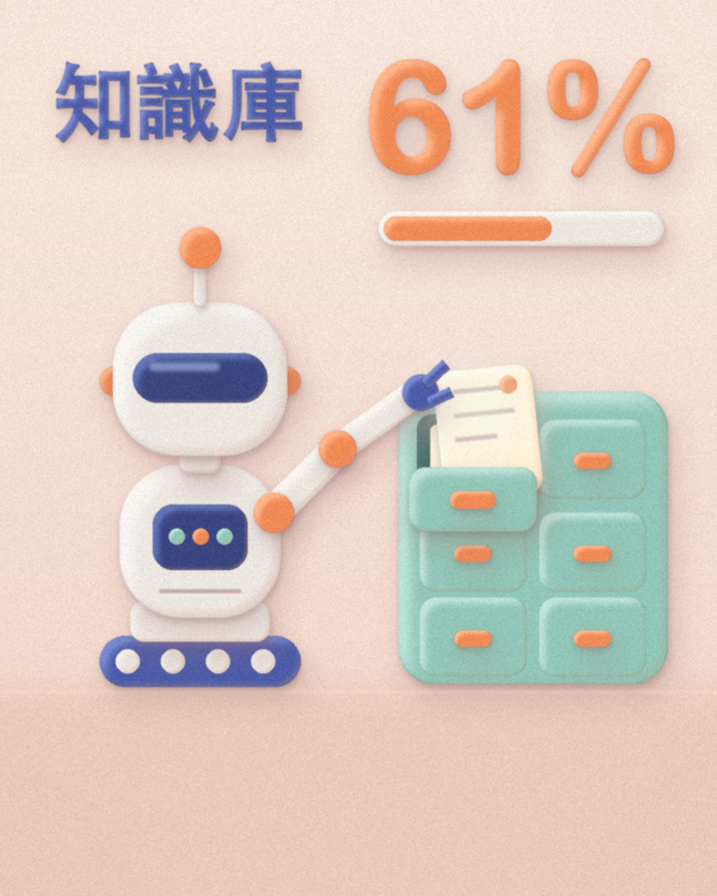

# 柔軟黏土感

## 一句話
所有東西都是圓潤、微微下陷又微微鼓起的黏土塊，暖色底、左上主光加右下暖反光、帶色的接觸陰影與極細的指紋顆粒，看起來像有人把整個畫面用手捏出來再拍成照片。

## 適合與不適合的題材
- 適合：想讓 AI、數據、流程這類冷題材變得親切、可愛、有人味的科普與產品介紹。
- 適合：兒童教育、新手引導、客服與員工關懷等需要「放鬆、不嚇人」的場合。
- 適合：圖示感強的主角（機器人、櫃子、卡片、進度條），輪廓簡單、縮小後仍然辨識得出來。
- 不適合：需要精確讀數的密集圖表與小字（圓潤體積會吃掉細節）。
- 不適合：嚴肅、鋒利、科技冷感的題材，例如資安警示、金融風控。

## 氣氛
溫柔、俏皮、手作感，像一格定格動畫的劇照。底色是淡桃粉，主角是白色與薄荷綠，用靛藍和橘色收重點，安靜但有溫度。

## 用程式畫的難度與限制
難度：中。每個物件都要走一套多層遮罩（暗底、核心、亮瓣、反光、高光、顆粒），逐層用 PIL 的模糊與位移相減合成；樣張一秒左右出圖，但物件多時，逐幀重畫要先把靜態物件預先合成成底圖。
限制：
- 真正的黏土有指紋、不規則的捏痕與微小氣泡，程式只能做到極細顆粒與均勻的圓潤，近看偏「乾淨的 3D 圖示」而非手工。
- 形狀以圓角矩形、橢圓與粗線為主，有機形體（手、動物）要大幅簡化。
- 物件的重疊與擠壓（兩塊黏土互相壓出凹痕）做不出來，只能靠接觸陰影暗示。
- 文字要先「增厚」成圓粗體才像黏土，細字體與小字不適合，字級要大。
- 手感的上限很低；真要像黏土，建議用圖像生成或實拍黏土當材質，再用程式統一配色與排版。

## 指標畫法
1. 先畫背景：由上到下的線性漸層（`F7E7DC` 到 `F0D5C8`），y 約 1035 起鋪地面色 `EBC9BA`，邊緣模糊 24px；再疊一層橢圓暈影（顏色 `D7A79E`、不透明度 0.28、模糊 150px），最後整張加極細顆粒（高斯標準差 4，在一半解析度生成再放大）。
2. 每個物件用同一個 `clay()` 函式處理，輸入遮罩、四階色票與圓潤半徑 `soft`（細小物件 4–8、數字 12、大塊 20–24）。先投陰影：遠影（偏移 10,22、模糊 22、不透明度 0.30）加近影（偏移 2,6、模糊 5、不透明度 0.27），顏色是帶紅的 `9A6C6C`，不用黑。
3. 暗底與核心：整塊先填暗階，再把遮罩模糊 `soft×0.6`、以 `(v−70)×3` 壓成核心，貼上主階，邊緣自然留一圈暗色，像黏土邊緣的環境遮蔽。
4. 亮瓣：核心減去向右下位移 `0.8·soft` 的自己，得到左上月牙，模糊後貼亮階（不透明度上限 235）。
5. 暖反光與高光：遮罩減去向左上位移 `soft/3` 的自己，得到右下細邊，貼暗階與 `FFC9A8` 的混色（0.45、不透明度 0.7）；再在左上緣取一小塊二值化貼高光色並模糊 `soft×0.25`（細小物件與凹槽關閉）；最後疊顆粒，用 1px 模糊的遮罩貼回畫面。
6. 凹槽與刻痕用 `groove()`：深色線（`9A6C6C`、模糊 1.5px、不透明度 0.55）加往下 3px 的淺色亮邊，粗 6–8px，像用工具壓出來。
7. 「放進去」靠遮擋：先畫抽屜內部的深色凹槽與直立卡片，再畫筆記卡（下降到凹槽中，下緣低於抽屜前板上緣約 40px），最後才畫抽屜前板，讓前板蓋住卡片下緣；前板上方加一圈薄荷色柔光暈表示「收下了」。
8. 手臂是圓頭粗線段加關節球：肩、肘、腕三顆球，兩段手臂粗 44–50px，末端是兩根圓頭手指，夾在筆記卡左上緣。

## 代表畫家、設計師與作品
- Nick Park（尼克・帕克），1958 年生，英國：Wallace & Gromit 系列（《A Grand Day Out》於 1989 年完成，《The Wrong Trousers》1993 年上映）、與 Peter Lord 共同執導《Chicken Run》（2000）。學：圓潤的造型、清楚的輪廓，以及用角色姿態而非複雜表情傳達情緒。
- Will Vinton（威爾・文頓），1947–2018，美國：《The Adventures of Mark Twain》（1985，導演）、California Raisins 廣告（1986 年起），並註冊了「Claymation」一詞。學：把黏土做成有明確輪廓的角色，加上暖色打光與商業化的清楚辨識度。
- Art Clokey（阿特・克洛基），1921–2010，美國：短片《Gumbasia》（1955）、《Gumby》（1956 年起）、《Davey and Goliath》（1961 年起）。學：最早的黏土動畫語言，簡單的幾何形與被壓扁、拉長的質感。
- Peter Lord（彼得・洛德），1953 年生，英國：Aardman Animations 共同創辦人，Morph 在 BBC《Take Hart》的首度亮相（1977）。學：用極簡的圓頭小人與單色黏土做出一眼認得的角色。
- Otmar Gutmann（奧特馬爾・古特曼），1937–1993，德國出生、在瑞士工作：企鵝《Pingu》（1986 年設計角色，1990 年起在瑞士電視播出）。學：極少的形狀、不靠台詞的動作，以及黏土動畫的簡潔配色。

## 配色與色階
一個畫面的色相最多 5 個：暖底、白殼、薄荷、橘、靛藍，外加一個奶油色給紙卡。每個色相四階，色碼以 `sample.py` 為準。陰影一律帶紅褐，不用純黑或灰。

| 角色 | 陰影 | 主色 | 亮面 | 高光 | 用途 |
|---|---|---|---|---|---|
| 白殼 SHELL | B8AEB0 | ECE6E0 | F8F5F0 | FFFFFF | 機器人身體、頭、手臂、進度條軌道 |
| 薄荷 MINT | 5E9688 | 92C6B8 | BDE3D7 | EEFAF5 | 知識庫櫃體、抽屜 |
| 橘 ORANGE | C25E36 | F08A55 | FFB487 | FFE4D2 | 大數字、進度條填充、關節球、把手、標籤點（強調色） |
| 靛藍 INDIGO | 2F3B7A | 4C5CA8 | 7586CF | C5CEF5 | 中文標題、履帶底座、手腕與手指 |
| 護目鏡藍 VISOR | 252C52 | 3B4680 | 5D6FB4 | B4C2F2 | 護目鏡、胸口螢幕 |
| 奶油 CREAM | CDB98F | FFF2D6 | FFF9EA | FFFFFF | 筆記卡、歸檔卡片 |
| 背景 BG | — | F7E7DC | F0D5C8 | — | 上到下漸層（主色欄為上，亮面欄為下，非光影階） |
| 地面 FLOOR | — | EBC9BA | — | — | 下方約 22% 地面；桌緣高光線 FBEDE5 |
| 陰影色 SHADOW | — | 9A6C6C | — | — | 所有接觸與遠投影、刻痕 |
| 反彈光 BOUNCE | — | FFC9A8 | — | — | 右下緣暖反光 |
| 凹槽 CAVITY | — | 3E4E56 | — | — | 抽屜開口內部的深色凹槽 |
| 暈影 | — | D7A79E | — | — | 畫面四周極淡的暈影 |

橘色配額：大面積橘只給大數字與進度條；其他地方只用小面積（關節球、把手、天線頂、標籤點）。

## 光源、陰影與體積
- 主光在左上，補光是右下的暖色地面反彈；因此每個物件有「左上亮瓣、中間主色、右下暗邊加暖反光」三層。
- 陰影一律帶紅褐，分兩層：遠影柔、近影緊，物件像是被輕輕放在桌上。
- 體積靠遮罩的模糊與位移相減做出來，不靠硬色塊；邊緣永遠留一圈暗階，像黏土的環境遮蔽。
- 凹陷（抽屜口、螢幕、刻痕）反過來：暗色在上，亮緣在下。
- 地面只有一道微亮的桌緣線，不畫地平線與反射。

## 線條、描邊與邊緣
- 不描邊。輪廓由暗階的邊緣與投影形成，邊緣是軟的。
- 圓角是這個風格的簽名：大塊圓角半徑約為短邊的 30–40%，小塊取一半高度（膠囊形）。
- 手臂、手指、天線用「圓頭粗線段」，末端一律圓頭，沒有尖角。
- 刻痕與文字線用 `groove()`，粗 6–8px，是壓進去的凹線，不是描上去的線。
- 沒有銳利的白邊或黑邊；所有邊的柔化程度跟物件大小成正比。

## 質感與筆觸
- 整張畫面有極細的顆粒（標準差 4），模擬黏土表面與指紋，顆粒只做在物件與背景上，不做在文字之外的獨立圖層。
- 表面不要有明顯紋路；質感來自「微鼓的亮瓣」加「帶紅色的暗邊」。
- 文字用圓粗字型再外擴 2–3px（puff），讓字像一條條捏出來的黏土蛇。
- 反光很收斂：每個物件最多一個小高光，細小物件不加。
- 不做金屬、玻璃或透明質感，保持整體「不反光的軟質」。

## 細節密度、格線與比例
- 畫面分三段：上段約 27% 放標題與大數字；中段約 50% 放機器人與櫃子；下段約 22% 是安靜的地面，只有一條桌緣高光。
- 每個畫面只有一個主角（機器人）與一個目標（拉出的抽屜），其餘是配角。
- 物件之間留大量呼吸空間，不超過 6 個主要形體。
- 比例要「Q」：頭約占機器人高度的三分之一，櫃子大約與機器人等高，圓角比真實的大。
- 細節密度低，每個物件最多兩層細節（本體加一個把手或標籤）。

## 字體搭配與字級
- 中文標題：STHeiti Medium，128px，靛藍 `4C5CA8`，外擴 2px，用 `clay()` 做成黏土字（soft 7）。
- 大數字：Arial Rounded Bold，230px，橘色主階 `F08A55`，外擴 3px（soft 12）；下方配一條黏土進度條，軌道用白殼色、填充用橘色。
- 中文字型限用 STHeiti Medium 或 Hiragino Sans GB，每次出圖前以 `glyphs_ok()` 逐字檢查缺字。
- 小字不使用；需要說明就放進旁白或下一個畫面，因為細字會被圓潤體積吃掉。

## 動態性格
- 以 12 fps 為主（一拍二），保留定格動畫的頓挫感，不追求絲滑。
- 彈性出場：物件從 0.8 倍彈到 1.08 倍再回 1.0，約 8 幀，影子同時變化。
- 擠壓與延展：落地時垂直壓扁 8%、橫向撐寬 4%，再回彈。
- 筆記卡下降時略微左右擺動，被前板蓋住後前板輕輕下壓一下。
- 顆粒每幀換一次種子（輕微閃動）會有定格動畫的「沸騰」感；整體做得很輕，不要抖動。
- 鏡頭用緩慢推近，或硬切到特寫；不用快速掃動。

## 元件清單
- 背景與地面：暖色漸層、暈影、顆粒，下方地面與桌緣高光線。
- 主角 Agent（機器人）：圓角方頭、整條靛藍護目鏡（非眼睛，上有一條光帶）、兩側橘色耳栓、細天線加橘球、白色圓軀幹、胸口螢幕與三顆燈、履帶底座與四個輪子；不畫臉。
- 手臂：肩、肘、腕三顆關節球加兩段白色粗圓臂，末端兩指夾具。
- 筆記卡：奶油圓角卡片，三條壓痕文字線與一顆橘色標籤點，微旋轉 6 度。
- 知識庫：薄荷色圓角櫃體，2×3 抽屜，各有橘色把手。
- 拉出的抽屜：深色凹槽加直立歸檔卡片，前板往前拉並下壓。
- 薄荷柔光：抽屜口上方的模糊光暈，表示「已收納」。
- 大數字牌：橘色圓粗黏土字。
- 進度條：白殼軌道加橘色填充，填充長度對應百分比。
- 標題：靛藍黏土中文字。
- 護目鏡反光：護目鏡上一條淺藍的模糊光帶。
- 接觸陰影：每個物件的遠影加近影。
- 刻痕：`groove()` 的壓痕線，用於機器人腰線與卡片文字線。
- 顆粒層：全畫面極細噪點。

## 常見失敗與避免方式
- 看起來像塑膠或果凍：高光太大、太亮。每個物件最多一個小高光，並降低不透明度。
- 看起來像貼圖陰影：陰影用黑或灰。改用帶紅褐的 `9A6C6C`，分遠近兩層。
- 邊緣太硬太乾淨：遮罩沒有柔化。每個物件都要走 `clay()` 的核心加暗邊流程。
- 顆粒太重變成髒污：標準差維持 4 左右，不要疊多層雜訊。
- 圓角不夠：形狀偏方正就失去黏土感，大塊圓角半徑取短邊的 30–40%。
- 卡片只是浮在抽屜上：要讓卡片下緣被前板遮住，才看得出放進去。
- 主角畫成有臉的卡通：不畫眼睛嘴巴，用護目鏡光帶、天線、胸口螢幕與履帶。
- 小字與細線糊掉：字級放大，細節用刻痕代替，文字限用圓粗字型。
- 全畫面都是柔光與暈影：只在主角與目標處用，其他地方維持平靜。

## 一定要做／一定不要做
一定要做：
- 每個物件都走同一套流程：陰影、暗邊、核心、亮瓣、暖反光、小高光、顆粒。
- 陰影一律帶紅褐色，遠近兩層。
- 圓角要大，輪廓要簡單。
- 用遮擋表現「放進去」。
- 底部約 22% 保持平靜。

一定不要做：
- 使用黑色或灰色陰影。
- 畫尖角、硬邊或描邊。
- 一格塞滿細小物件與小字。
- 把高光畫成大片白塊。
- 照搬任何特定動畫的角色、場景或招牌造型。

## 原創界線
可以學：黏土的圓潤造型、暖色打光與接觸陰影、顆粒質感、定格動畫的節奏與彈性。
不可以：複製 Wallace & Gromit、Gumby、Pingu、Morph 或 California Raisins 的角色、造型與招牌場景；畫面中不放品牌名；機器人、櫃子與卡片必須是原創造型。
