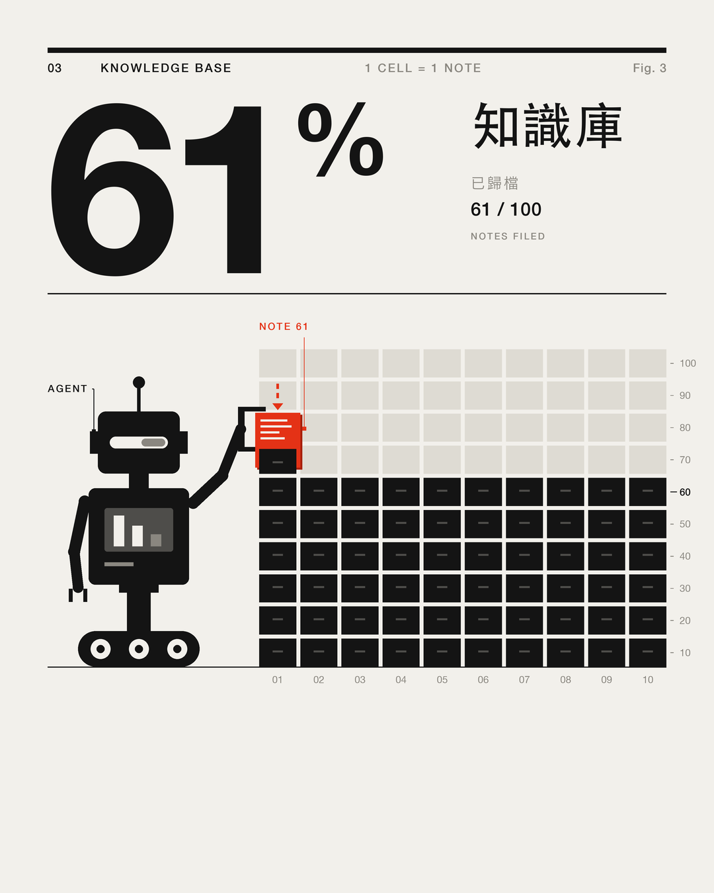

# 瑞士極簡資料風

## 一句話
用 12 欄格線、一種無襯線字體、紙色加墨色加一個訊號紅，把資料本身畫成畫面主角：大數字負責結論，單位圖負責證據，每個元素都對齊在同一張格線上。

## 適合與不適合的題材
- 適合：一個數字就是結論的題目（61%、3 倍、第 1 名），數字大到佔畫面三分之一也不嫌多。
- 適合：進度、佔比、庫存、筆記與文件累積量這類可以「一格代表一個」的單位圖。
- 適合：企業、金融、人資、SaaS 的專業形象內容，需要可信、克制、有秩序的氣質。
- 不適合：需要溫度、角色情感或熱鬧氣氛的故事；這個風格天生冷靜。
- 不適合：需要質感或光影的題材（食物、自然、人物肖像）。

## 氣氛
冷靜、準確、有秩序。像一本設計精良的年報或展覽海報：話很少，但每個字都站在該站的位置上，留白就是它的聲量。

## 用程式畫的難度與限制
難度：低。矩形、細線、文字與格線運算全是程式最擅長的事，是最適合程式生成的風格之一，且完全不吃抗鋸齒以外的特效。
限制：
- 風格的好壞全在對齊與比例，差 2px 就看得出來；所有座標必須由格線函式（`col()`、`bl()`）算出，不可手填。
- 沒有陰影、漸層、質感可以遮醜，主角（機器人）只能用矩形、圓與粗線段構成，輪廓簡化到近乎圖示。
- 「放進去」的動作沒有透視與光影可用，只能靠遮擋與唯一的強調色說清楚。
- 字距與字重要靠字型本身；Helvetica Neue 缺字時退回 Helvetica，但字重層次會少一階。
- 動畫上容易顯得呆板，需要靠節奏與切換精準度補足。

## 指標畫法
1. 定格線：1080 寬，邊界 72px、欄距 24px、12 欄（欄寬 56px）、基線單位 12px。所有 x 座標來自 `col(i)`，所有 y 座標來自 `bl(n)`。
2. 頂部放一條 8px 粗墨色橫線，下方一行 18px 小字（序號、章節、單位、圖號），小字用 2.2px 開字距、全大寫、分別靠欄左邊對齊。
3. 大數字：Helvetica Neue Bold 360px，字距 −4.5%（約 −16px），墨邊對齊第 0 欄；「%」縮成 42% 字級，緊貼數字右側 14px 內，頂部與數字頂部齊平。
4. 標題塊放在第 8 欄，頂部與大數字的大寫頂齊平：中文標題 76px、字距 2px；副標 22px 灰；數值 28px；英文註解 14px 灰、字距 2.2px。
5. 用 2px 橫線把「結論（數字）」和「證據（圖表）」隔開，線貼在一個基線格上。
6. 單位圖是主角：10 × 10 格，一格代表一筆資料（一份筆記 = 1%）。格寬約 56px、格高約 42.6px、間距 6px。已完成的格填墨色，並在格中央畫 3px 灰色把手（抽屜）；未完成的格填 TINT；從底列由左到右、一列一列填滿。
7. 唯一強調色只給「正在變化的那一格」：目標格連同進入它的筆記卡用訊號紅，其餘一律墨、灰、紙。
8. 主角機器人由矩形、圓與 16–18px 粗線段組成：履帶底座、方形軀幹加一塊顯示面板、方頭加一條橫向感應槽（不是眼睛）、一根天線；一隻手臂垂下，另一隻伸向目標。
9. 「放進去」靠遮擋：筆記卡是比一格高的紅色長卡（約 68 × 83px），先畫卡片，再把目標格的墨色前板蓋在卡片下 40% 上，只留一條紅色上緣；卡片的下半確實消失在格子裡。卡上方加兩段紅色短線與一個向下三角表示動作方向（不用彎箭頭）。
10. 標註：英文小字加 1.2px 直角引線與 6px 方點，只標最重要的兩個東西（AGENT、NOTE 61）；不使用額外中文標註。
11. 座標軸：累計數值掛在圖右邊緣，每列一個刻度，重點刻度（60）改用墨色、粗刻度；欄序號在圖下方，用灰色 15px。
12. 全部以 3 倍尺寸繪製後用 LANCZOS 縮小，細線與字緣才銳利。底部約 22% 保持空白紙色。

## 代表畫家、設計師與作品
- Josef Müller-Brockmann（約瑟夫・穆勒－布洛克曼），1914–1996，瑞士蘇黎世：《Grid Systems in Graphic Design》（1981，Arthur Niggli 出版）、蘇黎世音樂廳（Tonhalle）貝多芬音樂會海報（1955）、《Der Film》海報（1960，蘇黎世工藝美術館）。學：用格線決定一切位置、用客觀的版面取代裝飾。
- Armin Hofmann（阿明・霍夫曼），1920–2020，瑞士巴塞爾：《Giselle》芭蕾海報（1959，巴塞爾戶外劇場）、《Graphic Design Manual》（1965）。學：極少的元素、黑白對比與字形本身的張力。
- Emil Ruder（艾米爾・魯德），1914–1970，瑞士蘇黎世出生、任教巴塞爾：《Typographie: Ein Gestaltungslehrbuch》（1967，英文版 Typography: A Manual of Design）。學：版面是一套可教、可練習的字級、字重與留白規則。
- Max Miedinger（馬克斯・米丁格），1910–1980，瑞士：Neue Haas Grotesk（1957，後改名 Helvetica，與哈斯鑄字廠 Eduard Hoffmann 合作）。學：中性、均勻的無襯線字讓內容自己說話。
- Otto Neurath（奧托・紐拉特），1882–1945，奧地利：維也納圖像統計法（Vienna Method of Pictorial Statistics，1920 年代中期起，後稱 Isotype）、《International Picture Language》（1936）。學：一個圖示代表固定數量，用「重複單位」而非放大圖形來比較。
- Gerd Arntz（格爾德・阿恩茨），1900–1988，德國出生、後定居荷蘭：為 Isotype 設計約 4,000 個圖示。學：把人與物簡化到最少幾何形，仍然一眼認得。
- Karl Gerstner（卡爾・格斯特納），1930–2017，瑞士：《Programme entwerfen》（1964，英文 Designing Programmes）。學：用規則與系統（而不是單一解答）生出版面。
- Edward Tufte（愛德華・塔夫特），1942–，美國：《The Visual Display of Quantitative Information》（1983）。學：提高「資料墨水比」，圖表中每一滴墨水都該傳達資料。

## 配色與色階
紙色、墨色、兩個灰、一個強調紅，全畫面最多這幾個色。強調紅只用於「正在變化的那一個東西」。色碼與 `sample.py` 一致。

| 角色 | 陰影 | 主色 | 亮面 | 高光 | 用途 |
|---|---|---|---|---|---|
| 墨色 | 不用 | #141414 | #4E4D4A | #8A8780 | 文字、已完成的格、機器人本體；亮面灰用於抽屜把手與面板，高光灰用於次要標籤與刻度 |
| 紙色 | #DEDBD3 | #F2F0EB | 不用 | 不用 | 畫面底；陰影階只作為「尚未完成」的空格填色 |
| 訊號紅 | #A8200C | #E43216 | 不用 | #F2F0EB | 目標格上的筆記卡、動作短線、NOTE 61 標註；陰影階是卡片下方 3px 的偏移邊；高光是卡上的紙色文字線 |
| 灰 | #8A8780 | #8A8780 | #DEDBD3 | 不用 | 細線、次要標籤、座標刻度 |

灰色不再另設色碼，需要更淺時用紙色陰影階 #DEDBD3。

## 光源、陰影與體積
沒有光源。整個畫面是平面，體積完全不表現：物件不加陰影、不加漸層、不加高光。唯一的深度提示是目標卡片下方一道 3px 的深紅偏移邊（#A8200C），讓卡片比格子「高」一點，並靠遮擋表示前後。要讓某物顯得重要，用位置、尺寸與紅色，而不是光。

## 線條、描邊與邊緣
- 不描邊。形狀是實心色塊，邊緣是銳利直角；只有機器人軀幹（10px）、頭（12px）、履帶（半圓）有圓角。
- 線寬層級（1080 寬）：頂部粗線 8px、區隔線 2px、地面線 1.5px、引線與刻度 1.2px、座標軸短線 1.2px。
- 手臂是 16–18px 粗線段、圓頭接點；手爪是兩段 7px 直條。
- 所有線條只有水平與垂直（引線是直角折線），不畫斜線與曲線，只有動作三角是例外。

## 質感與筆觸
沒有質感。純色平塗，無紙紋、無雜訊、無網點、無手繪抖動。所謂質感來自精準：欄線對齊、字距收緊、數字用等寬對齊。超取樣縮圖後的細線銳利度就是這個風格唯一的「材質」。

## 細節密度、格線與比例
- 版面分三段：頂部資訊與大數字約佔高 33%，單位圖與機器人約佔 42%，底部約 22% 留白（字幕區）。
- 大數字高度約為畫面寬的 1/3，是畫面最大元素；單位圖是第二大；機器人與卡片最小但最亮（紅色）。
- 單位圖 10 × 10，格距 6px；機器人佔第 0–3 欄，圖表佔第 4–11 欄。
- 一個畫面只有一個強調點（紅），一個主角（圖表），一組標註（最多 2 條引線）。
- 細節要少：格子的把手、面板上的三根長條、刻度，到這裡為止。

## 字體搭配與字級
- 大數字：Helvetica Neue Bold 360px，字距 −4.5%；「%」42% 字級。
- 中文標題：STHeiti Medium 76px，字距 2px；副標 Hiragino Sans GB 22px，灰色。中文字型限用 STHeiti Medium 或 Hiragino Sans GB，並用 `check_glyphs()` 逐字確認沒有缺字。
- 英文小字：Helvetica Neue Medium 14–18px，全大寫，字距 2.2px，靠左對齊、右側不齊（flush left, ragged right）。
- 數值：Helvetica Neue Medium 28px；座標刻度 15px。
- 墨邊對齊：文字的第一個字形墨邊要貼在欄線上，而不是字框邊。

## 動態性格
準確、克制、機械式的精準。
- 以 24 fps 為主，用緩入緩出（ease-in-out），不使用彈跳與過衝。
- 格子逐列、逐格依序「點亮」，每格間隔 2–3 幀；大數字用計數器滾動到目標值，數字用等寬字避免跳動。
- 筆記卡沿垂直線直線下降、平移，停止時沒有回彈；被遮擋進格後紅色上緣閃一格（3 幀）。
- 鏡頭只做直線平移與推近，不旋轉、不晃動。
- 切換用硬切或水平擦除；不要淡入淡出與模糊轉場。

## 元件清單
1. 格線函式：`col()`、`col_r()`、`bl()`，所有位置的來源。
2. 頂部粗線與資訊列：8px 墨線加序號、章節名、單位說明、圖號。
3. 大數字牌：Helvetica Neue Bold 加上標「%」。
4. 標題塊：中文標題、灰色副標、數值、英文註解。
5. 區隔線：2px 墨色橫線。
6. 單位圖：10 × 10 的格，已完成、未完成、目標三種狀態。
7. 抽屜格：墨色格加 3px 灰色把手。
8. 座標軸：右側累計刻度與下方欄序號。
9. 機器人 Agent：履帶、桅桿、軀幹加面板、方頭加感應槽、天線。
10. 手臂與手爪：粗線段加兩段夾條。
11. 筆記卡：紅色長卡，紙色文字線，3px 深紅偏移邊。
12. 動作標記：兩段紅色短線加向下三角。
13. 引線標註：英文小字加直角引線與方點。
14. 地面線：1.5px 墨線，機器人與圖表共用。

## 常見失敗與避免方式
- 筆記卡只是疊在格子上、看不出進入：先畫卡、後畫格子前板，讓卡的下半被蓋住。
- 大數字與標題不在同一條基線：大寫頂用 `bl()` 對齊，標題頂與數字頂齊平。
- 文字邊緣沒對齊欄線：用字形墨邊而非字框定位（`text()` 已內建）。
- 強調紅出現太多處：只給目標格與卡片、動作短線與 NOTE 61 標註。
- 機器人畫出眼睛與嘴巴：只用一條橫向感應槽，掃描光偏向動作方向。
- 加了陰影或漸層讓畫面「好看一點」：一律刪除，用位置與尺寸取代。
- 缺字：中文字型限定，並逐字檢查；英文與數字用 Helvetica Neue。
- 單位圖格子大小不一或間距不均：格寬、格高、間距都由同一組公式算出。
- 畫面塞太滿：底部 22% 留白，標註最多兩條。
- 數字與單位圖對不上（例如 61% 卻填了 60 格）：填滿格數、目標格與數字必須一致。

## 一定要做／一定不要做
一定要做：
- 所有位置由格線算出，不手填座標。
- 只用一個強調色，且只給正在變化的元素。
- 用遮擋表現「放進去」。
- 大數字當主角，且對齊欄線。
- 底部 22% 保持空白。

一定不要做：
- 使用陰影、漸層、霓虹、紋理或裝飾線。
- 讓文字置中、置右來「湊平衡」（數值刻度除外）。
- 使用超過一個彩色。
- 為機器人畫臉。
- 為了好看而改變資料的真實比例。

## 原創界線
可以學：格線、單位圖、無襯線大字、留白、強調色用法等方法。
不可以：複製穆勒－布洛克曼或霍夫曼等人的特定海報構圖、使用 Helvetica 標誌性的商標排版或任何品牌識別；不使用 Isotype 原有圖示（如 Arntz 設計的人形與工廠符號）；畫面中不放品牌名；機器人與卡片必須是原創造型。
