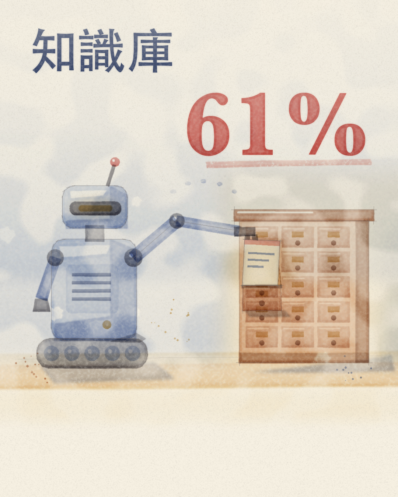

# 水彩

## 一句話
半透明的顏料一層一層疊在冷壓紙上，亮處留紙白、邊緣積色、暈開處柔軟，畫面有呼吸感，像一頁攤開的素描本。

## 適合與不適合的題材
- 適合：溫度、人味、學習與成長這類柔和的知識題材，例如筆記整理、知識庫、閱讀與研究。
- 適合：需要親切、手作感的品牌短片，或想讓科技題材不那麼冰冷的場合。
- 適合：場景中有大片天空、水、地面、木頭等自然材質可以暈染。
- 不適合：需要精準數據、細小標籤與密集圖表的畫面（暈染會吃掉細節）。
- 不適合：要求強烈對比、硬朗銳利或高速衝擊感的題材（例如倒數計時、促銷轟炸）。

## 氣氛
安靜、溫暖、略帶懷舊，節奏慢，留白多；像下午的光落在書桌上。

## 用程式畫的難度與限制
難度：高。水彩的魅力來自顏料與水的偶然，程式只能用多層遮罩模擬。
限制：真正的水跡擴散、顏料沉澱與紙纖維吸水無法精確重現；PIL 以高斯模糊、邊緣累積、紙紋乘法近似，每塊色約需 4 層遮罩，整張樣張約 1–2 秒，但色塊數量一多就容易變成髒糊；人物臉部與細膩筆觸做不出來，所以主角用機器人與物件；文字只能用「像顏料寫成」的方式處理，不做手寫字；動畫時每幀重算整張很慢，建議把底圖畫一次，只讓少數元素動。

## 指標畫法
本風格用「釉色模型」：每一塊顏色都是一層半透明薄色，用乘法疊在紙上，疊越多越深，不會變亮。亮處不是塗白，而是不上色（留紙）。
1. 先鋪紙：紙色 #F6F0E2，乘上一層細雜訊（紙紋），凹處略深；整張只用 4 種顏料加一個中性深灰，最重點才用玫瑰紅。
2. 第一層：用濕中濕畫天空與背景，色塊抖動 12–16px、模糊半徑 16–22px、邊緣累積 0.12–0.15，由上往下漸深（重力係數 0.85–0.9），每塊加一到兩個回暈（pale 中心、深邊緣）。
3. 每一塊色用 `wash()`：多邊形外緣抖動 1–3px，疊 4 層遮罩取平均，再依序做遮蔽（留白）、模糊、邊緣積色（rim，濕乾邊用 0.55–0.7）、重力漸層（上淺下深 0.35–0.5）、低頻濃淡不均（vary 0.35）、紙紋顆粒（gran 0.3–0.6）。
4. 濕乾分明：大面積背景用濕中濕（模糊大、邊軟）；物件用濕乾（模糊 1–2px、邊硬）。主角與背景要用不同的邊，才分得出前後。
5. 留白：高光區域丟進 `holes` 或 `RESERVE`，後面的色塊先扣掉，不用白色去蓋。筆記卡整張留白，只在邊緣上 0.95 的邊色。
6. 疊色順序：先淡後深。機器人身體先上一層淡藍 (#8FA6D1)，只在背光側再疊一層 (#4A64A6)，最後才畫深色關節與縫線。
7. 最暗的點最後畫：關節、握爪、抽屜縫用 #3A3640（群青加赭紅調出的深灰），透明度 0.6–0.85，邊硬。
8. 鉛筆底稿：用 #7A7068、alpha 50–120、線寬 1px，兩遍輕線，端點多出頭 6–10px，留在畫面上不擦掉。
9. 飛濺：在機器人腳邊、抽屜旁撒 10–14 顆 1.2–4.5px 的小點，顏色取該區的主色，越遠越小。
10. 文字當顏料寫：字形遮罩加 2.5px 模糊、MinFilter 9 取邊緣累積、上輕下重，字色用 #2E3F6E 與 #C8463F，透明度 0.95。
11. 「放進知識庫」用遮擋表現：筆記卡為縱向長條，畫成一張整卡，再在抽屜前緣的線處截斷（`clip_below()`），卡片下端被抽屜前板擋住，等於插進去；抽屜前緣補一條 0.35 的接觸陰影。

## 代表畫家、設計師與作品
- Albrecht Dürer（阿爾布雷希特·杜勒），1471–1528，德國紐倫堡：《大草皮（Das große Rasenstück）》（1503，水彩與水粉，維也納 Albertina 收藏）。學：不加修飾地觀察，一叢草也可以畫得有重量。
- J. M. W. Turner（約瑟夫·特納），1775–1851，英國：《藍色的 Rigi：日出（The Blue Rigi, Sunrise）》（1842，水彩，Tate 收藏）。學：濕中濕鋪出光與霧，以刮出紙白做最亮點。
- Winslow Homer（溫斯洛·霍默），1836–1910，美國：《藍色小船（The Blue Boat）》（1892，水彩，波士頓美術館收藏）。學：留白當作水面反光，色塊簡練而準確。
- John Singer Sargent（約翰·辛格·薩金特），1856–1925，美國（出生於義大利佛羅倫斯）：《泥中的鱷魚（Muddy Alligators）》（1917，水彩，Worcester Art Museum 收藏，使用遮蓋與刮除）。學：用留白與刮除決定亮部，快而準的邊緣。
- Paul Cézanne（保羅·塞尚），1839–1906，法國：晚期以聖維克多山（Mont Sainte-Victoire）為題的水彩系列。學：薄透的色層疊出結構，大片紙白不算沒畫完，而是留給光。
- Emil Nolde（埃米爾·諾爾德），1867–1956，德國：「未繪之畫（Ungemalte Bilder）」小幅水彩系列（約 1938–1945）。學：把紙打濕再下色，讓顏色自己流動、動作要快。

## 配色與色階
一個畫面只用 4 種顏料加一個中性深灰：群青、赭紅、土黃為主，玫瑰紅只給最重點（數字 61% 與天線小圓點）。色階依序是：陰影＝最深的一層、主色＝一般釉色、亮部＝淡釉、高光＝最淡的薄染（真正的最亮處是留紙，不上色）。色碼與 `sample.py` 一致。

| 顏料 | 陰影 | 主色 | 亮部 | 高光（薄染） | 用在 |
|---|---|---|---|---|---|
| 群青 | #2E3F6E | #4A64A6 | #8FA6D1 | #C9D5EA | 機器人身體、天空、標題字 |
| 赭紅（燒赭） | #6E3B22 | #A65A32 | #CF8A5C | #EBC3A0 | 卡片櫃、地面陰影 |
| 土黃 | #9A6A22 | #C9963E | #E3C07A | #F3E1B5 | 地面、把手標籤、護目鏡光 |
| 玫瑰紅 | #8E2A2E | #C8463F | #E27E6E | #F4C2B6 | 61%、卡片標題帶、天線燈 |

| 其他 | 色碼 | 用途 |
|---|---|---|
| 紙色 | #F6F0E2 | 底、留白、筆記卡 |
| 中性深灰 | #3A3640 | 關節、護目鏡、抽屜縫、履帶（群青加赭紅調出） |
| 鉛筆灰 | #7A7068 | 底稿線 |

## 光源、陰影與體積
光從左上來。陰影分兩種：形體陰影只在背光側（右、下）再疊一層深一階的釉色；投影用群青 (#4A64A6) 加中性灰，偏冷，落在右下方，邊緣濕軟。體積靠「亮面淡釉＋背光面第二層釉」表現，不用漸層填滿。高光以留紙處理，位置在左上邊緣與圓角處。

## 線條、描邊與邊緣
- 沒有黑色輪廓線；形體由色塊的邊界決定，這是水彩的核心。
- 邊緣有兩種：濕乾邊（顏料在邊緣積成略深的一圈）與濕中濕的軟邊（暈開）。
- 鉛筆底稿是唯一的線，細、淺、超出轉角，視為質感而非輪廓。
- 小細節（縫線、字條）用深一階的釉色小塊畫，不用描邊。
- 絕對不用均勻的粗黑線包住物件。

## 質感與筆觸
- 紙紋：細雜訊與粗雜訊以 0.4 混合，凹處吸色多，形成顆粒（granulation）。
- 回暈（backrun）：每個大色塊有 1–2 個淡中心、深皺邊的水痕。
- 乾筆：地面與動作軌跡用 `dry` 破碎，讓顏料只落在紙紋凸處。
- 濃淡不均：用低頻雜訊讓顏料不平。
- 小點與飛濺：作為收尾，少量即可。

## 細節密度、格線與比例
畫面約 78% 以上是主內容、底部約 22% 保持平靜（只有一層淡土黃釉，不畫任何東西）。主角機器人約占高度 40%，卡片櫃約占 30%；每一個畫面只有一個視覺重心。抽屜與卡片櫃用 3 欄 5 列的規則格，但每格都抖動，不能對得太整齊。

## 字體搭配與字級
- 中文標題：STHeiti Medium，約 132px，群青 #2E3F6E，以顏料書寫效果處理，位置在左上。
- 大數字：Baskerville Bold（index 1），約 250px，玫瑰紅 #C8463F；下方加一道乾筆底線 (#E27E6E)。
- 中文字型限用 STHeiti Medium 或 Hiragino Sans GB，每個字都要確認有渲染出來（缺字會變成方塊）。
- 說明文字若要加，用 STHeiti Medium 40px 以上，群青深色；不要用細體字，會被紙紋吃掉。

## 動態性格
- 慢、柔、有呼吸：12 fps 或更低也成立，用「顏色一層層長出來」當進場，而不是彈跳。
- 色塊由淡入濃，邊緣先暈開再收；每次只讓一兩個元素動。
- 鏡頭用緩慢推近或漂移，不要硬切；轉場用濕中濕的色暈覆蓋。
- 數字出現時像一滴顏料落下再暈開，約 0.6 秒。
- 底圖只畫一次，動態元素（機器人手臂、筆記卡、飛濺點）以疊加方式繪製。

## 元件清單
1. 機器人（Agent）：履帶服務型機器人，方頭、整條護目鏡光條、天線紅點，不畫臉；用群青三層疊色。
2. 筆記卡：縱向索引卡，只有邊緣上色，玫瑰紅標題帶加三條群青字線。
3. 知識庫：木質卡片櫃，赭紅色，3 欄 5 列抽屜。
4. 抽屜：土黃把手標籤加深赭圓扣，被拉出的一格有淺色內部。
5. 抽屜前板與接觸陰影：卡片下端被前板遮擋，表現「插入」。
6. 握爪：兩指深灰握在卡片上緣。
7. 手臂：兩節肩肘腕，深灰圓關節。
8. 履帶：深灰圓角長條加五個群青輪。
9. 大數字牌：玫瑰紅 61% 加乾筆底線。
10. 標題字：群青「知識庫」。
11. 天空暈染：群青淡釉、濕中濕、帶回暈。
12. 地面：土黃加赭紅淡釉，濕乾邊，底部積色。
13. 鉛筆底稿：淺灰細線，端點出頭。
14. 動作軌跡點與飛濺：乾筆小橢圓弧線，加少量顏料點。

## 常見失敗與避免方式
- 看起來像模糊的 Photoshop 濾鏡：必須有積色邊與留白，不能只靠模糊。
- 髒灰糊成一團：同一區域最多疊 3 層，且顏色限定在 4 種顏料內。
- 把高光塗白：高光一律留紙。
- 全部邊都軟：物件要有濕乾硬邊，才分得出前後。
- 太鮮艷：顏料透明度 0.35–0.85，紙色透出來，色彩才柔。
- 缺字：中文字型限定，渲染後逐字檢查。
- 筆記卡浮在櫃上沒進去：卡片下端要被前板遮擋，不能只貼在前面。
- 底部也被畫滿：底部 22% 只留淡釉。
- 機器人畫出臉：用單一護目鏡光條，不畫眼睛嘴巴。

## 一定要做／一定不要做
一定要做：
- 先淡後深，亮處留紙。
- 區分濕中濕（背景）與濕乾（物件）。
- 每個色塊都要有邊緣積色與紙紋顆粒。
- 最暗的點最後下。
- 底部 22% 保持平靜。

一定不要做：
- 用黑色均勻描邊。
- 使用不透明的白色當高光。
- 使用超過 4 種顏料加一個中性灰。
- 讓細小文字落在濕暈或紙紋重的地方。
- 照抄任何特定畫家的作品構圖。

## 原創界線
可以學：留白、濕中濕、邊緣積色、疊色順序、乾筆等技法與觀看方式。
不可以：複製杜勒、特納、霍默、薩金特、塞尚、諾爾德等人的任何具體作品構圖或畫面；樣張中的機器人、卡片櫃與場景皆為原創；畫面不放品牌名或 Logo。
